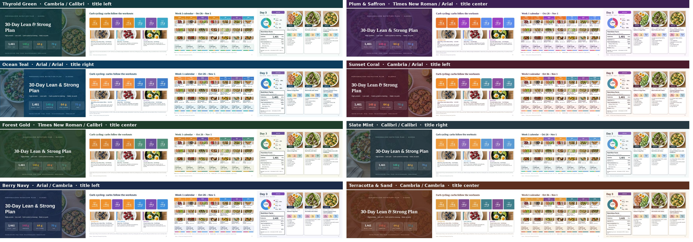

# meal-plan-studio

Where client meal plans are made. One folder per client under `clients/`, one look per client from `themes/`, one command to build and check a deck.

| Client | Theme | Plan | Deck |
|---|---|---|---|
| `aleena` | Plum & Saffron | Halal, high protein, carbs cycled to training (Mon/Tue/Thu under 100 g), 2 keto days (Wed, Sat, net 20 g or less, 16:8 window), 2 low-carb days (Fri, Sun) | 58 slides, built by `studio.py` |
| `swapna` | Thyroid Green | Soy-free keto for hypothyroidism, 16:8 / 19:5 fasting, no crucifers | delivered before themes existed (legacy build, kept as is) |

## Quick start
```
python studio.py list                    # clients, themes
python studio.py build aleena            # engine -> photos -> themed intro -> deck -> PDF -> QA
python studio.py build aleena --lite     # phone-sized PDF (smaller images)
python studio.py build aleena --theme ocean-teal    # same plan, different look (try before you commit)
python studio.py qa aleena               # carb caps, protein floors, forbidden foods, photos, page count
python studio.py gallery aleena          # re-render the deck in all 8 themes -> themes/gallery.jpg
python studio.py new maria --from aleena --theme sunset-coral    # scaffold the next client
```
Outputs land in `clients/<name>/dist/` (full PDF, no-animation PPTX, and the lite PDF). Needs python3 + Pillow, node (`pptxgenjs jszip sharp react react-dom react-icons playwright`), LibreOffice, poppler, and the pptx skill's `apply_theme.js`. Set `STUDIO_NODE_PATH` if the node modules are somewhere unusual.

## Themes (every client gets a different one)


`themes/themes.json`: Thyroid Green, Plum & Saffron, Ocean Teal, Sunset Coral, Forest Gold, Slate Mint, Berry Navy, Terracotta & Sand. Each sets the palette (including the carb-tier colours), the font pair, the title-slide layout (left, right or centre) and how round the cards are. The intro poster is recoloured to match. Fonts are limited to ones that exist in PowerPoint and in the PDF render. Add a theme by adding an object to that file.

## A new client in 6 steps
1. `python studio.py new <slug> --from aleena --theme <unused theme>`
2. Edit `client.json`: name, start Monday, targets, week pattern, `qa` (forbidden foods, caps).
3. Edit `engine.py`: recipes, caps, tier targets. Hard nos go in the ingredient table, not only in text.
4. Photos: one 4:3 overhead per recipe key (`photos/B1.jpg` ...) plus a 16:9 `HERO.jpg`. See `skill/references/photo-prompts.md`.
5. Edit `intro/intro_data.html` text and `deck/build.js` copy (client facts, rules, options slides).
6. `python studio.py build <slug>`. Fix whatever QA flags. Send the PDF.

## Layout
```
studio.py            CLI (build, qa, gallery, new, list)
themes/              themes.json, theme.js (deck), intro_theme.py (poster), gallery.jpg
tools/               post.js, repack.py (deck post-processing), render_intro.js
clients/<name>/      client.json, engine.py, out/ (plan.json), photos/, deck/build.js + prep.py, intro/, dist/
skill/               dietitian-meal-plan-builder v6 (engines, profiles, food lists, PDF/app/swap-guide builders)
scan.sh              quick text scan for forbidden foods in any PDF/PPTX/HTML
```

## Rules
- Take every diet statement literally. "Open to keto and fasting" means real keto days and real fasting windows in the plan.
- Carb caps are hard caps (engine filter + `qa` in `client.json`).
- Never one PDF page per day: 3 days per page, 2 shopping weeks per page.
- Different theme per client. Check `studio.py list`.

## Backlog (not built for Aleena yet)
17-page plan PDF, swap guide PDF, offline web app, animated intro video and the animated/phone PPTX. The skill in `skill/` already builds these for Swapna's profile; Aleena needs a profile JSON adapted from `skill/assets/profiles/`.
