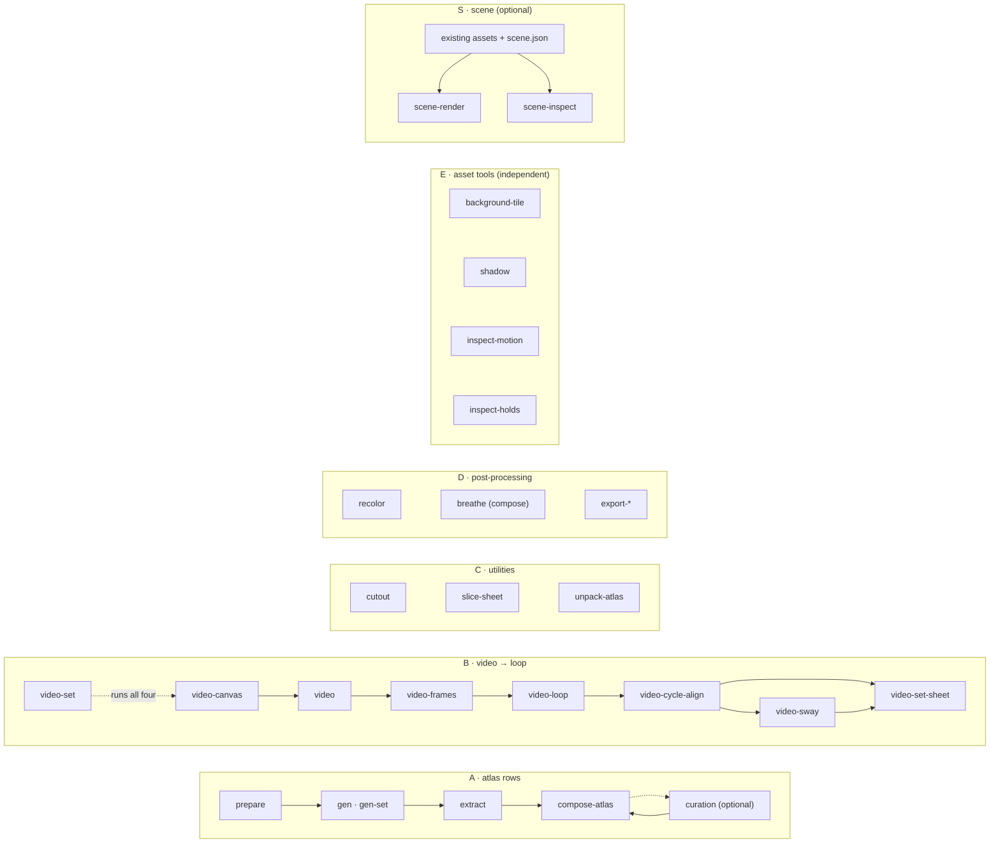
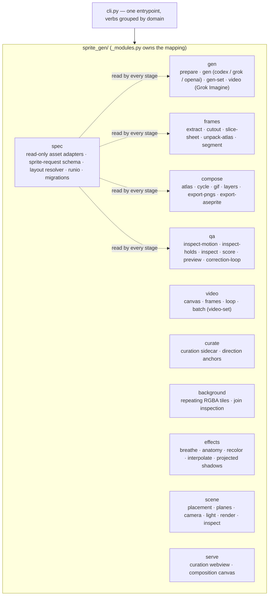
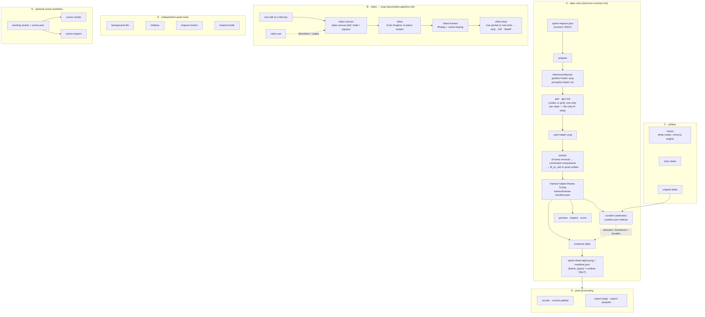
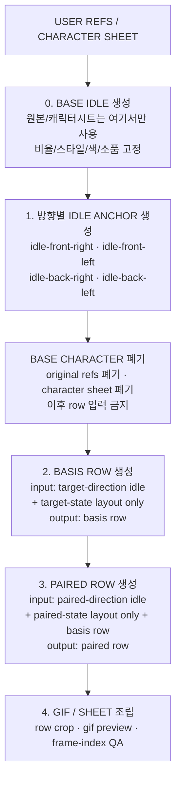

# SA Sprite-Gen Pipeline
Python CLI + skill that turns one base image into engine-ready sprites (real alpha, on-grid, same face every frame).

## Setup
`pip install -e .` in the clone (or per README), ffmpeg; optional RIFE for in-betweens. Image generation runs on codex/GPT or Grok image (uses his subscriptions; any per-image API billing → ask).

## Pipelines
- A · atlas rows: `prepare` → `gen` / `gen-set` → `extract` → (curation) → `compose-atlas`.
- B · video → loop: `video-canvas` → clip → `video-frames` → `video-loop`. **Clip step: generate the clip with Seedance 2.5/2.0 (Dreamina), Kling 4.0 or MiniMax H3 — not Grok video — then feed the file to `video-frames`.**
- C · utilities: `cutout`, `slice-sheet`, `unpack-atlas`, recolor, engine export.
- `sprite-gen --help` prints the map. Save provider/motion defaults once; set motion method to GPT image rows or bring-your-own clip, never `grok-video`.
- Upstream `docs/video.md` (`sprite-gen video`, Grok Imagine clip generation) is deliberately left out.

## Space Age rules (override anything in the appendices)
- Lean: do the job, no filler. Read the matching appendix section before acting; don't load everything.
- Ask Chuma before any paid API, credit spend, plan upgrade or new subscription. Use his existing subscriptions first. Never pay or deposit anything.
- Ask before publishing, posting, emailing or submitting a form anywhere.
- Borrow structure from third-party work, never its text, images, branding or code (clean-room via replica-skill-sa).
- Only games Chuma owns. Single-player/offline use only. No anti-cheat, DRM or ownership-check bypass, no online/multiplayer cheating, no touching clients of online games with anti-cheat. (Stricter than upstream, which also allows self-hosted servers.)
- Video generation: never a Grok video model (grok-imagine-video, "Grok Video"). Use Seedance 2.5/2.0 in Dreamina, Kling 4.0 or MiniMax H3. If the upstream text names Grok video, swap in one of those.

## Appendix A — Sub-skill index

| Sub-skill | When | Source |
|---|---|---|
| sprite-gen | Generates images and game sprites through GPT or Grok with guided provider choices, separate saved defaults, automatic cleanup and optional curation. Handles sprite requests, ordinary image generation/editing, typogra... | `SKILL.md` |

## Appendix B — Core skill

### `SKILL.md`
_Generates images and game sprites through GPT or Grok with guided provider choices, separate saved defaults, automatic cleanup and optional curation. Handles sprite requests, ordinary image generation/editing, typography logos (로고, 타이포그래피, 타이틀 글자, 타이틀 로고, wordmark, logo, title lettering: a title screen drawn with the title in it, its lettering lifted out transparent), standalone image-to-video clips (i2v, animate this still, 그록 영상, 이매진 비디오, 스틸 움직여줘, first/last frame, reference-to-video, 영상 이어붙이기, 영상 편집, extend/edit a clip), clips from a video MCP on the agent (ZCRE, 지크 MCP), chroma removal, animation atlases, video loops, 큐레이션뷰, image candidates, 팔레트 스왑, palette swap, recolor, engine exports, repeating backgrounds, projected shadows, talking face layers over body motions (말하는 얼굴, 입 맞추기, 얼굴 층, lip sync, face pack), motion/contact inspection and optional scene composition from existing assets._

#### Sprite Gen

Generation entry points: **make sprites**, **make an image**, or **animate a still into a video**. Existing generation, extraction and export tools do the work; the user chooses the result and provider. For **repeat a background**, **project a shadow**, **inspect motion** or **compose a scene**, use the independent routes below directly with existing assets.

##### Start every generation request here

For a standalone video clip, read [video](docs/video.md) and use `sprite-gen video`.
This route works from any agent engine and delivers a verified MP4 plus report.
For sprites or ordinary images, use the guides below.

Read [user-workflow](docs/user-workflow.md), then run the appropriate read-only guide:

```bash
$SPRITE_GEN_ROOT/.venv/bin/sprite-gen workflow --kind sprite
$SPRITE_GEN_ROOT/.venv/bin/sprite-gen workflow --kind image
```

##### When codex cannot run — exit 75

A call that names no provider (`gen`, `logo`, `gen-set`, `video-set`'s mid-step redraw) runs on codex. When codex cannot run here — not signed in, or the codex usage of the account used up — and the user's choice for that is to ask (the default), the command generates nothing, prints one stderr line starting `sprite-gen ask codex-unavailable:` followed by JSON, and ends with **exit 75**. That is a question for the user, not a failure: never answer it yourself, never retry without the answer, never switch provider on your own.

Ask it in these words, with the reason from the line's `cause` (`login`: "로그인이 없어요", `usage-limit`: "사용량을 다 썼어요"):

> 지피티(codex)를 지금 쓸 수 없어요 — {이유}. 어떻게 할까요?
> 1. OpenAI API 로 만들기 (호출당 과금)
> 2. 그록으로 만들기
> 3. 멈추기

##### Side-view facing

Keep the side still, canvas placement and motion prompt facing the same direction.
`video-set` observes each side input once before canvas placement and uses the requested
`--facing` for both the canvas and clip prompt. Observation is record-only by default;
it never changes the requested direction. Image correction requires explicit opt-in.

Direction is requested through the generation and motion prompts, which cannot guarantee model compliance.
The detector can be wrong even at high confidence: review the still before choosing `mirror` or `regen`.
Generation reports record direction, model, requested direction, model-reported confidence and correction
under `extra.facing`; video reports and batch items use `facing`. `final_direction` is an observation
or a value derived from it, not independent verification; `final_direction_source` identifies which.
An uncertain or failed inspection records `unknown` and its reason and continues without correction;
front-facing observations also remain unchanged. Mirroring does not preserve left/right accessory handedness.

##### Execution routes

| Task | Entry | Contract |
|---|---|---|
| GPT image sprites | `prepare`, `gen-set --provider codex`, `extract`, compose and QA | [atlas-workflow](docs/atlas-workflow.md) |
| Standalone video / animate a still, pin a last frame, reference images | `video` (`--image`, `--last-frame`, `--reference`) | [video](docs/video.md) |
| Continue or edit an existing clip | `video-extend`, `video-edit` | [video](docs/video.md) |
| A clip run left unfinished (its line or report names a `request_id`): ask for it again, never submit it again | `video-resume --request-id <id>` | [video](docs/video.md#sprite-gen-video-resume--ask-again-for-an-unfinished-generation) |
| Grok video sprites | `video-set` | [video-pipeline](docs/video-pipeline.md) |
| A soft part of a walk loop or cycle frames sways with the body (the Sway layer): an ellipse after `video-cycle-align`, `--read-on <sha256>` for a cut, `--stretch-floor D` for least area, `--frames` for full frames, `--breathe` for the breath drive, a flat share to move a region whole, `--gain-across` for across gain, and `--reference` for a way in or out of a loop | `video-sway` (old name `video-follow`) | [video-pipeline](docs/video-pipeline.md#6-the-sway-layer--video-sway) |
| Where an ellipse is carried in every other cell, and what the move changes there (an arm crossing a chest moves with it; the stretch, the bend and the seam): a record and boards of every cell, nothing moved; a seam under a third moving region is not counted | `video-sway-inspect` (old name `video-follow-inspect`) | [video-pipeline](docs/video-pipeline.md#inspecting-a-sway--video-sway-inspect) |
| A set's directions on one sheet, standing on one ground line (a 3×3 board, an engine import) | `video-set-sheet` | [video-pipeline](docs/video-pipeline.md#7-one-sheet-for-a-set--video-set-sheet) |
| A walk or run that stops, from the clip's own start played backwards | `video-stop` | [video-pipeline](docs/video-pipeline.md#8-a-walk-or-run-that-stops--video-stop) |
| Pieces of keyed clips on one canvas played as one move, at the time the caller gives | `video-chain` | [video-pipeline](docs/video-pipeline.md#9-pieces-of-clips-played-as-one-move-video-chain) |
| Build a talking lower-face pack anchored to every frame of body motions from a reference and keyed clips. | `video-face` | [face-parts](docs/face-parts.md) |
| Bake a voice and the pack's face layer onto body frames, optionally after a clip's own mouth and sound. | `face-bake` | [face-parts](docs/face-parts.md#face-bake) |
| Compare the currently displayed loop with a final candidate, including after follow-through | `video-loop-compare` | [loop-comparison](docs/loop-comparison.md) |
| Restore post-processing damage in the current cut from its exact source times, preserving normal cells and playback | `video-source-manifest` → `video-loop-repair` → `video-loop-compare` | [source restoration](docs/loop-comparison.md#restoring-the-active-cut-from-source) |
| Video sprites from a clip your agent makes with a connected video MCP (ZCRE, 지크) | `video-canvas`, `video-prompt --no-last-frame`, the agent's own MCP tools (quote, user approval, generate, save the mp4), then `video-frames` and `video-loop`, and for a walk or run cut in two or more directions `video-cycle-align --view …` over their loop directories. sprite-gen never calls the MCP. | [video-pipeline](docs/video-pipeline.md#a-clip-from-a-video-mcp-on-your-agent--zcre) |
| Typography logo, wordmark or title lettering (로고, 타이포그래피, 타이틀 글자): the title lettered into a title screen or poster first, then only its lettering redrawn on a key and cut out with its glow; the text is read back and a misspelt logo refused | `logo --text … --style …` (`--mood` to start from a picture you have, `--lettering` to cut again for nothing) | [logo](docs/logo.md) |
| Ordinary image or edit | `gen --provider codex` or `gen --provider grok` (the subscription login first; without one grok uses `XAI_API_KEY`, and a codex signed in with an API key bills it — both per call, said on stderr) | [gen](docs/gen.md) |
| Pixel art the model draws directly as a grid, 8–48 px, on your Claude subscription (`claude` signed in), or without one on `ANTHROPIC_API_KEY`, **billed per call** | `pixel-draw` | [pixel-draw](docs/pixel-draw.md) |
| Image generation with no login available (server, container, SaaS) | `gen --provider openai` — server/SaaS route on `OPENAI_API_KEY`, **billed per call**, never a default; it runs only when named, or when the user chose it for a codex that cannot run | [gen](docs/gen.md#subscription-first--openai-runs-only-when-you-chose-it) |
| Base and direction anchors | `anchor` | [directional-anchor-workflow](docs/directional-anchor-workflow.md) |
| Curation view or existing image candidates | `curation`, `unpack-atlas --pngs-dir` | [curation](docs/curation.md) |
| Uniform background removal or imported sheets | `cutout`, `slice-sheet` | [sheet-slicing](docs/sheet-slicing.md) |
| Palette swap | `sprite-gen recolor-palette`, `sprite-gen recolor` | [recolor](docs/recolor.md) |
| Idle breathing as a post-processing layer (the Breathe layer): pixel (default, pixel art) or smooth (large illustrations, video frames: head fixed, chest breathes, shoulders follow; facing values for a turned body); smooth can choose a beat that misses the hands with `--avoid-region`, and a way in or out of a loop carries on its breath with `--loop-cells`, `--start-cell` and `--reference`; pixel can breathe round from the chest with the arms moving sideways (`--chest-round`, `--arms-x`), cells held still (`--hold-mask`), what the arms hold moving whole with them (`--props-mask`), what the arms hold behind the body (a shield hung at the back) moves the same way with the body staying in front (`--props-behind-mask`), and pieces painted one colour move together (`--props-groups colour`, so a sword's reflection follows the sword) | curation sidecar, baked by compose; or `sprite-gen breathe <frames> <out>` on a folder of loop frames | [breathing](docs/breathing.md) |
| Engine exports | `export-aseprite`, `export-pngs` | [engine-export](docs/engine-export.md) |
| Background recipe or repeating tile | existing `gen` / `cutout`, then optional `background-tile` | [asset-tools](docs/asset-tools.md#background-recipe) |
| Props or icons on a transparent sheet | `slice-sheet --chroma-key none --alpha-floor 64`, props with `--scale sheet --fit contain`, icons with `--fit contain` | [sheet-slicing](docs/sheet-slicing.md#props-and-icons-sheet-scale-and-contain-fit) |
| Standalone projected shadow | `shadow` | [asset-tools](docs/asset-tools.md#projected-shadows) |
| Duplicate poses, foot contact and stride measurement | `inspect-motion` | [asset-tools](docs/asset-tools.md#motion-and-contact-evidence) |
| Read a delivery for frames that show a figure's picture again and name them against hold lists | `inspect-holds` | [asset-tools](docs/asset-tools.md#frames-shown-again) |
| Optional scene placement, lighting, camera and render | `scene-render`, `scene-inspect` | [scene](docs/scene.md) |
| What the engine can do, for an agent or a tool to read once: every verb and argument, the providers each may call and be billed by (one JSON line, a quarter of every `--help`); a sandbox that reaches the providers through a relay: `SPRITE_GEN_<PROVIDER>_BASE_URL` (`OPENAI`, `XAI`, `ANTHROPIC`) moves a provider's calls and the files it hands back, `SPRITE_GEN_LOGINS=off` runs every call on its API key | `capabilities` | [capabilities](docs/capabilities.md), [provider addresses](docs/gen.md#provider-addresses) |
| Defaults | `defaults show`, `defaults save` (`--codex-unavailable ask\|grok\|openai`: what to do when codex cannot run), `defaults clear` | [user-workflow](docs/user-workflow.md#one-settings-owner) |

Say a thing once: what an option says, leave out of the prompt. `--direction`, `--facing`, `--handed`, the key background and `video --direction side` each add their own sentence after your text, in one place. Your prompt carries the subject, its design and its pose. Text that says the opposite of an option ("facing left" with `--facing right`, the item on the other wrist) is sent as written with a warning (`extra.prompt_notes`, `video-prompt`'s `warnings`): fix the prompt, do not send it — [prompt-assembly](docs/prompt-assembly.md).

Use existing automatic pipeline stages for background removal, extraction, alignment and export. Do not ask users to select each script. For a direct utility request, run that utility; no unrelated generation questions are needed. Preserve the row pipeline and component extraction for image sprites. One-shot grid generation and fixed cell cutting are not an alternative sprite-generation route.

For attack repeat coverage, observed one-shot returns and structured loop failure reports, follow [video-pipeline](docs/video-pipeline.md#one-shot-actions----cycle-autoperiodicone-shot).

Every cut is read for held cells (neighbour cells showing the same picture), and by default they are filled with RIFE's frames between and the cut read again once its repairs have run (`video-loop --fill-held auto`; `off` cuts as filmed, with no read again). A loop is read as a ring: a run that ends on its last cell, or a last cell that shows its first cell's picture, is filled too, the first cell kept. A hold the motion means (a run longer than three cells, a cut drawn on twos or threes, the opening and closing pose of a cut played once) stays as filmed and is listed in the strip's `holds`. Tell the user each motion's poses over cells in one line from `held_fill` (`poses/cells`, before and after, e.g. `24/27` to `27/27`); for a set it aligns, that is the loop as delivered, filled at the end of the alignment. A run whose frames between were all refused stays as filmed and is named in a `warning:` line: say so with its poses over cells. An effect's lifetime, a Grok clip and `face-bake` are read and warned, not filled: pass the warning on. A cut wanted above its clip's rate is given with `--out-fps`, frames between, never repeats. Details in [loop repair](docs/loop-repair.md#7-held-cells-a-picture-shown-again-and-a-cut-at-a-higher-rate).

Two rules. When an asset will be shown at a fixed display rate above its clip's (a 60 fps game or scene), give it at that rate with `--out-fps` (`video-cycle-align --out-fps` for an aligned set) instead of letting a cell show over several frames. Before delivering clips joined one after another, or a render made from them, run `sprite-gen inspect-holds` on it (with `--log` and `--log-figure` where the renderer draws figures at a new scale or sub-pixel place each frame, and the strips' `holds` as `--holds`) and tell the user any unlisted hold; `--gate` exits 1 where any hold is on no list.

A move played once (a jump, a vault: `once`, `once-return`, `one-shot`) carries its root motion in the strip sidecar by default, the cells unchanged: `root_motion` gives each cell's root (the body's mass centre, cell px), what it stands on, and each air's take-off, landing, seconds and apex; a game reads `root` to place each cell and moves the body on its own physics. A move cut out of a longer motion is named with `video-loop --cycle once --start S --length L`, a hand on something the clip does not draw with `--contact hand=A:B`, metres with `--meters-per-px`; a jump whose body crosses the canvas is named the same way, because it never comes back to a pose it left: the one-shot cut refuses it and its line names the closest return (`the closest return, frames A-B, is R of its departure away`), whose frames are where to start the range. To give the air its own length, gravity and speed, `--air-retime gravity=G,air=T,speed=V` redraws it on that parabola with RIFE's frames between; contacts and the take-off and landing stay as filmed. Tell the user each air in one line, its seconds and its apex (the summary's `air`, e.g. `air 0.42 s, apex 0.21 m`). Details in [video-pipeline](docs/video-pipeline.md#root-motion--a-cut-played-once-where-the-body-is-what-it-stands-on-its-air).

For a move over an obstacle that clears a low wall (such as a vault or a jump), paint a flat magenta plate on the green key with `video-canvas --prop-plate` (which requires `--report`), then pass that canvas report to `video-frames --prop-plate <canvas report json>` to erase the plate from keyed frames. The plate box and colour (`prop_plate.rgb`) live in the canvas report, with no second copy; `video-frames` starts from the box and finds the plate again in every frame along with any shaded side or top a model drew on it, so a plate the camera carried off, turned, or thickened into a box is erased too, and the edge pass learns the subject's colours without it. Read the three warning lines a run can print: frames where no plate was found keep whatever of it they show, and in frames where the plate or its shaded side or top meets the subject, look at the subject's edge there; tell the user what any of the three names. Details in [video-pipeline](docs/video-pipeline.md#prop-plate---prop-plate).

A pinned idle or attack whose last frame the video model drew again has its wrap blended by default (`video-loop --wrap-blend auto`, a redraw only; `off` cuts as filmed), with details in [loop repair](docs/loop-repair.md#6-the-redrawn-wrap-a-pinned-clip-whose-last-frame-the-model-drew-again).

Scene creation consumes finished assets and remains optional. Asset metadata owns frames, native durations and anchors; scene specs own placement, scale, playback rate, planes, camera and light. Measure stride only with declared same-foot contact and an isolated foot ROI; unknown contact stays unverified. Apply only a verified report for the exact selected asset with an explicit scene direction. Never infer walking direction from the bottommost silhouette, reverse frames or change source assets to make a scene work.

##### 실행 인터프리터

`SPRITE_GEN_ROOT` is the absolute installed repository path. Use `$SPRITE_GEN_ROOT/.venv/bin/sprite-gen` or `$SPRITE_GEN_ROOT/.venv/bin/python`; do not assume an activated shell. **폴백 금지**: create a missing venv or report the failure, never use an arbitrary global Python. **NumPy 가 없는 인터프리터** fails at package import. Setup and diagnosis: [interpreter](docs/interpreter.md).

##### RIFE for walk and run loops

RIFE is rife-v4.25 with no augmentation by default. `SPRITE_GEN_RIFE_MODEL_NAME=rife-v4.6` runs the model of 3.14.0 and before, with `-x -z`, to make a cut again as it was made then; a `--between-cache` never hands one model's frames to the other.

Without RIFE, tell the user which loops went unrepaired, which motions' held cells were not filled (`held_fill.unmade`, or `--out-fps` not met) and which airs were not retimed (`air_retime.why`), and offer the install; after it, cut those loops again and run `video-cycle-align`. [loop-repair](docs/loop-repair.md).

##### Contracts and advanced tools

[run-contract](docs/run-contract.md) owns numeric requests, run layout, atomic publication and curated exports. [architecture](docs/architecture.md) explains domain ownership. [docs index](docs/README.md) lists every specialized feature and QA procedure. `sprite-gen --help` derives the command map from the package catalog. Never replace an engine stage — extraction, the loop cut, set alignment, loop repair — with a script of your own while presenting the result as a pipeline output. Where a stage's result is wrong, use the engine's own options first, keep the engine's result as the comparison, report the defect against the engine, and name in the delivery each stage done by hand and why. A new clip is for what no stage can reach: the drawing, the motion itself, a clip that holds no whole cycle ([loop-review](docs/loop-review.md)) — and a clip the engine names for one: when the alignment report's `retake` lists a loop (reason `held-drawings`: the cycle cut from its clip shows each drawing for two or three frames, the set's length leaves it at under 13 drawings a second, and frames between its drawings could not be made, so the loop halts there; or `filmed-ghost`: a filmed ghost frame has filmed ghosts on both sides, so no clean frame stands there and the loop shows it — `reasons` lists both where both apply), run the engine verbs first as above, then film that direction again and align the set anew rather than hand-painting the gap; tell the user what the reason was and that a new take usually fixes it ([loop-repair](docs/loop-repair.md) section 4).

## Appendix C — Docs (priority)

### `docs/user-workflow.md`
#### Image and sprite requests

This document owns the conversation flow. `sprite_gen/workflow/catalog.py` owns the two journeys and their choices; `workflow` derives questions and engine steps from it.

##### Start with the user's request

| Request | Choices |
|---|---|
| Make sprites | Base image provider (GPT or Grok), then motion method (Grok video or GPT image rows) |
| Make an image | Image provider (GPT or Grok) |

Inspect the request before asking anything. Pass choices already named by the user as explicit arguments. An existing sprite base image skips base-image generation and its provider question. An image request may still attach references to `gen --ref` for editing.

The command is read-only: it checks available credentials, reads defaults and returns JSON. `status` is `ready`, `needs-input` or `blocked`; exit 0 means ready and exit 2 means read the questions or blockers.

1. Check the returned access state and explain only what needs the user's attention.
2. Ask the missing generation choices in `questions`, using their labels rather than CLI identifiers. For sprites, explain that the first provider creates the base drawing, while the motion method animates it. Until it is answered, `questions` also holds `codex_unavailable` ("지피티(codex)를 쓸 수 없을 때 — 로그인이 없거나 사용량을 다 썼을 때 — 어떻게 할까요?": stop and ask, Grok, or the OpenAI API billed per call). It is asked once: save the answer at once with `defaults save --codex-unavailable <answer> --expected-revision <settings_revision>` (the question's `save: general`, no `--kind`), and it is not asked again.
3. Run `workflow` again with the answers. Request choices override saved values without modifying them. When choices came from saved defaults, briefly announce them and do not ask again.
4. Gather only missing creative inputs: subject, style, requested motions and output needs. Lock the base before motion generation.
5. Only when the start stage returns `status: ready`, run the returned pipeline through the existing tools. A populated `pipeline` is a proposal, not permission to ignore unresolved questions or blockers. Always pass its explicit provider to `gen`/`gen-set`; do not rely on the low-level CLI's omitted-provider resolution. No availability-driven provider switch is allowed in this workflow.
6. Complete the pipeline's QA and deliver the output files. Raw images are evidence, not replacements for extracted sprite frames. Follow [atlas-workflow](atlas-workflow.md), [video-pipeline](video-pipeline.md) or [gen](gen.md), as returned by the guide.

```bash
$SPRITE_GEN_ROOT/.venv/bin/sprite-gen workflow --kind sprite \
  --base-image /absolute/base.png --motion-method gpt-rows --confirmed-access codex
```

##### Authentication and subscriptions

Login, subscription and quota are separate facts. Codex uses `codex login status`; Grok uses the shared image/video credential reader, without rewriting its auth file. Neither probe proves the current media entitlement or remaining quota: those fields remain `unknown`. When access has not independently been established for the current account and request, ask the user once and pass `--confirmed-access codex` or `--confirmed-access grok`. An explicit account/access statement already in the conversation can answer this question; never manufacture confirmation from a saved provider preference. Known failed/missing credentials remain blocked even with confirmation. A successful generation is not a permanent entitlement cache.

The guide names the separate API-credit billing and requires `--confirm-api-billing` from an explicit user choice before that route becomes ready.

Native token parsing and shared credential priority stay owned by [video](video.md).

##### Finish after delivering files

Call the finish stage with the actual generation choices, including the existing base when one was used, and an existing result path. Finish does not repeat authentication probes or generation.

```bash
$SPRITE_GEN_ROOT/.venv/bin/sprite-gen workflow --kind image --stage finish \
  --image-provider codex --result /absolute/output.png
```

Ask whether to open the curation view only when `curation` is not already selected or saved. Apply `open` or `skip`, then call finish again with `--curation open|skip`. Use [curation](curation.md) to open the correct result: sprite run, video-derived frames, or a standalone image candidate set. Deliver files before opening the view; skipping it is a valid completed request. If the user edits their picks, export from the updated curation state.

When the profile has no saved defaults, finish then offers: "이번 선택을 다음 작업에도 기본으로 사용할까요?" Save only after an affirmative answer. Once a profile exists, ordinary one-off overrides do not prompt to replace it; changing defaults requires the user's explicit request. Creative content, prompts, paths and one-off actions are never part of defaults.

##### One settings owner

`preferences.json` in `~/.config/sprite-gen/` owns the `sprite` and `image` profiles separately, and beside them the `general` settings every profile shares: so far `codex_unavailable` (`ask`, `grok` or `openai`; what a call that names no provider does when codex cannot run — the rule is [gen](gen.md#when-codex-cannot-run--ask-or-what-you-chose)'s). `SPRITE_GEN_CONFIG_DIR` explicitly relocates that directory. A profile may be partial, for example saving only motion and curation when an existing base skipped image-provider selection. Missing fields prompt when needed. This storage is independent of a project or run; a run's numeric recipe and curation edits keep their existing owners.

```bash
$SPRITE_GEN_ROOT/.venv/bin/sprite-gen defaults show
$SPRITE_GEN_ROOT/.venv/bin/sprite-gen defaults save --kind sprite \
  --image-provider codex --motion-method grok-video --curation open \
  --expected-revision REVISION_FROM_SHOW
$SPRITE_GEN_ROOT/.venv/bin/sprite-gen defaults clear --kind image \
  --expected-revision REVISION_FROM_SHOW
$SPRITE_GEN_ROOT/.venv/bin/sprite-gen defaults save --codex-unavailable ask \
  --expected-revision REVISION_FROM_SHOW
```

Use the exact `settings_revision` from the guide, or `revision` from show (`missing` for no file).

Two writers with the same revision cannot overwrite each other: the first committed write wins; the second fails and must reread/reconfirm.

### `docs/atlas-workflow.md`
#### Execute the existing row sprite pipeline

This page owns the agent's row execution procedure. Start and finish conversation choices belong to [user-workflow](user-workflow.md). Stage data, numeric settings and output ownership belong to [run-contract](run-contract.md).

##### Lock the base before preparing a run

Use one accepted, uncropped, full-body idle image with the intended proportions, style, orientation and identity. A pixel-art run needs a measurable pixel grid in the base; changing prompt wording later cannot correct its style. If no suitable base exists, generate it with the chosen image provider and establish it as the reference before motion generation. Directional anchors replace the base in later row inputs; [directional-anchor-workflow](directional-anchor-workflow.md) owns that sequence and the `anchor` resolver.

##### Execute

1. **Prepare.** Put numeric choices in `sprite-request.json`: cell dimensions and margins, chroma key, states, frame counts, fps and fit. Choose the key against the subject's actual colors using [chroma-alpha](chroma-alpha.md). Prepare generates prompts and empty layout guides from that request; do not hand-copy frame counts elsewhere. [states-and-frames](states-and-frames.md) owns frame recommendations. Layout guides carry geometry only.
2. **Generate rows.** Use `gen-set --provider codex` for the GPT image-sprite route. The provider that made the base is an independent choice. Attach the resolved identity reference and that state's generated layout guide. Extra motion references must be recorded in `qa-notes.md`. Independent rows use the existing batch concurrency; [gen](gen.md) owns its execution and reports.
3. **Extract.** Run the canonical extractor for every raw row. It removes chroma, separates characters, applies the requested pixel processing and places transparent frames. Never replace this with equal-width cuts or a one-line resize for a preview. A character crossing an imaginary slot can still be extracted intact when the poses are separable. Actual missing/occluded pixels are not restored by cropping. Choose sufficient output dimensions to preserve the desired scale; [pixel-unfake](pixel-unfake.md) owns fit options.
4. **Compose and verify.** Produce the atlas, runtime manifest and animation preview with existing compose tools. Inspect the frame manifest and output reports; reject empty frames, unwanted edge/chroma remnants and identity defects. Review motion as motion using [qa-motion](qa-motion.md). Do not hide failed motion by timing changes or silently replacing poses. A user's explicit slow preview request changes display speed, not the QA verdict.
5. **Deliver.** Send the checked files, then follow the finish stage in the user workflow.

```bash
$SPRITE_GEN_ROOT/.venv/bin/sprite-gen prepare --out-dir /absolute/run \
  --character-id example --base-image /absolute/base.png --request /absolute/request.json
$SPRITE_GEN_ROOT/.venv/bin/sprite-gen gen-set --run-dir /absolute/run --provider codex
$SPRITE_GEN_ROOT/.venv/bin/sprite-gen extract --run-dir /absolute/run
$SPRITE_GEN_ROOT/.venv/bin/sprite-gen compose-atlas --run-dir /absolute/run
$SPRITE_GEN_ROOT/.venv/bin/sprite-gen compose-gif --run-dir /absolute/run --out-dir /absolute/run/previews
$SPRITE_GEN_ROOT/.venv/bin/sprite-gen inspect --run-dir /absolute/run
```

The runtime consumes `manifest.json.frame_layout`; it does not infer a grid from alpha. AI operates only at generation. Frame cleanup and atlas assembly remain deterministic. [architecture](architecture.md) explains these boundaries. [subject-profiles](subject-profiles.md) covers effects and sparse subjects. [breathing](breathing.md) and [recolor](recolor.md) own optional post-processing; neither is an extra default question for every sprite request.

### `docs/chroma-alpha.md`
#### Chroma Key & Alpha Cleanup — sprite-gen reference

> Owns: Choosing the chroma key and diagnosing alpha cleanup after extraction · Index: [docs/README.md](README.md)

##### Why the extractor unmixes instead of peeling (from the README, 2026-09-09)

The extractor keeps chroma cleanup deterministic: soft-alpha unmix preserves antialiased hair strands and thin outlines instead of peeling them away before coverage can be solved.

<p align="center">
  <br />
  <em>Illustration, magenta key: source, v1.12.0 peel, v1.13.0 soft-alpha unmix.</em>
</p>

<p align="center">
  <br />
  <em>Illustration, green key: source, v1.12.0 peel, v1.13.0 soft-alpha unmix.</em>
</p>

<p align="center">
  <br />
  <em>Pixel art, magenta key: source, v1.12.0 peel, v1.13.0 binarized output.</em>
</p>

<p align="center">
  <br />
  <em>Pixel art, green key: source, v1.12.0 peel, v1.13.0 binarized output.</em>
</p>

The close-up crops below show the edge detail behind the full-body comparisons.


> `SKILL.md` 허브에서 분리한 시나리오 상세. 크로마 키를 고르거나(특히 소재색이 키와 인접할 때), 추출 후 소재색 손실을 진단할 때 이 문서를 따른다. 분기표 SSoT 는 image-gen SKILL.md 최상단 게이트이고, 이 문서는 그 규칙의 sprite-gen 쪽 상세다.

##### Key selection

`prepare_sprite_run.py` chooses a chroma key by sampling the base image unless the request forces one. The generated character must not use the chroma color or chroma-adjacent colors.

**Choose the chroma away from the subject's dominant hue — do not blindly default to magenta.** The hard key erase is a color-distance ball (`--key-threshold`, default 96) around the key **and** around the background colour the generator actually painted (detected from the flat borders, `detect_background_key_rgb`; since 2026-09-11 — generators paint `#00FF00` as (8, 162, 24) or darker and the pure-key ball alone missed it): a subject color inside either radius is deleted no matter where it sits, so the darker the generator painted the key, the deeper into the key's dark variants (olive under green, plum under magenta) the erase reaches. Antialias fringe is no longer erased by a separate peel; key/subject boundary blends are **unmixed into despilled RGB + partial alpha** when they are close enough to the keyed region. In-band blends are limited to key-distance `<= 2`, out-of-band blends use `--fringe-unmix-reach` (default 4), and deeper key-tinted *interior* subject colors (hot pink / purple under a magenta key) survive byte-identical. Small strongly key-tinted clusters buried inside the subject (generator spill) are despilled in place — see below. Key choice still decides quality:

- Pink / purple / magenta-family subjects (꽃, 씨앗봉투) → use **green** `#00FF00`; their edge blend under a magenta key wastes real silhouette pixels.
- Deep-red / crimson / wine hair or clothing is **magenta-adjacent** (both high R). Use **green** for red/crimson/warm subjects.
- Green/teal/olive subjects → use **magenta**.
- Blue subjects → avoid cyan/blue keys; magenta or green.
- Both pink *and* green in one subject → pick the key farther from the larger/more important material, verify both survive after extraction, and prefer `--chroma-key auto` (distance-scored).

**The border and the interior answer different questions** (2026-09-12). `detect_background_key_rgb` classifies the border samples with `is_border_key_candidate` (keyed channels lit, the darkest unkeyed channel dark (< 64) and under 35 % of the brightest keyed channel, the brightest unkeyed channel under half of the brightest keyed channel, with the half bound explained in the 2026-10-21 paragraph that follows, no balance between the keyed channels) because a flat border is already background evidence: Grok paints `#FF00FF` as (216, 46, 147), blue/red 0.68, which the interior rule `is_key_family` (balance ≥ 0.8) rejected, so the detector fell back to the declared key and the whole background survived. The interior rule keeps the balance so hot pink (250, 77, 150) and purple (213, 112, 246) inside the subject stay byte-identical; they fail the border rule too, on the lit green channel. The painted key's erase ball only reaches pixels that carry the signature or are 8-connected to them through the ball (the antialiased rim) — an isolated look-alike patch inside the subject is not erased. `cutout --key auto`, `video-canvas --key` and the `video-frames` residual split use the same border function.

**The border rule accepts green leaning toward cyan or yellow** (2026-10-21). Before this change the border rule was: everything the interior rule `is_key_family` admits, or a colour with every keyed channel lit (>= 64), every unkeyed channel dark (< 64) and every unkeyed channel at most 35 % of the brightest keyed channel. The dark bar of 64 was set between magentas: the magenta key has one unkeyed channel (green), and that channel is what tells a painted magenta key from hot pink (250, 77, 150) and purple (213, 112, 246), whose green is lit (77, 112). The green key has two unkeyed channels (red and blue). A green screen leans on one of them. The studio chroma-key green `#00B140` is (0, 177, 64): its blue sits on the bar, not under it. (0, 200, 90) leans further toward cyan. Neither is interior family either (blue is over 35 % of green). Both sit more than 96 from pure green (100.9 and 105.5), so with the detector falling back to the declared key, the whole background survived the hard cut. Under `video-frames --spill auto` choosing `full`, the surviving background was then treated as spill on the subject and despilled to a blue-grey instead of being erased. The rule now: for the unkeyed channels, the darkest keeps the old bars (< 64, and at most 35 % of the brightest keyed channel), and the brightest only has to stay under half of the brightest keyed channel (`_BORDER_KEY_MAX_LEAN_RATIO`, 0.5). Under half means the hue sits nearer the key than the neighbouring secondary colour: green is at 120 degrees, yellow at 60 and cyan at 180, so the midpoints are 90 and 150. The lean is accepted in both directions: toward cyan (blue lit, e.g. (0, 200, 90)) and toward yellow (red lit, e.g. (90, 210, 0)). A key with one unkeyed channel (magenta) is unchanged: its darkest and brightest unkeyed channel are the same channel, so it still has to be under 64, and hot pink and purple are still refused on their lit green. Over the whole RGB cube, the magenta candidates are exactly what they were; for green nothing is dropped, and every added colour has a hue strictly between 90 and 150 degrees. Still refused for green: ivory (248, 247, 242), cyan (0, 255, 255), teal (0, 128, 128), sea green (46, 139, 87), a grey-green with both unkeyed channels lit (70, 200, 90), and a green exactly at the cyan midpoint (0, 200, 100), where blue is half of green. The painted key's erase ball is unchanged in shape: inside the ball it erases the pixels that carry the signature and whatever is 8-connected to them through the ball (the antialiased rim). A rim made of brown blended into a leaning green is cut with the background; the same blend buried inside the subject stays. The lean is evidence about the background that leans. So inside the frame, the lean widens only the erase ball of a painted colour that leans itself (`extract._painted_key_leans`: the painted colour is a border candidate only through the lean). For a painted colour that does not lean, the ball's seeds and the edge-contact split use the signature with every unkeyed channel dark, which is the border rule as it was before (`_border_key_candidate_field(..., lean=False)` is that rule, colour for colour, over the whole RGB cube). The detector reads the lean second. It first counts, on their own, the candidates the rule admitted before the lean. When those make up at least 12% of the samples, it returns the mean of their most populated bin, which is exactly the colour it returned before the lean. Below 12%, the samples only the lean admits join them, but their most populated bin gives the colour only where the declared key's own cut would leave that background on the border. Two conditions, both needed: the samples only the lean admits that lie farther from the declared key than the cut (the radius the caller keys with: `threshold`, which the engine sets from `--key-threshold`, 96 by default), in that most populated bin or in a bin beside it on every channel, make up at least 2% of the samples; and the candidates outside that bin and the bins beside it make up less than 12% of the samples (the border holds one key-coloured background). Otherwise the declared key is kept, as before the lean. A leaning border the declared key clears by itself gains nothing from the leaning colour; its ball would only reach further into a subject near that colour. The 2% keeps the soft rim where a subject meets an edge of the frame (its blend with the background crossing the cut there) from being read as background the cut left; and a background whose tail past the cut is under 2% of the border keys as before the lean, the few pixels past the cut included. A second key-coloured colour on the border may be the subject's own (a leaf running along an edge, or another green); read as part of the background, it would let the ball take a subject colour near the dominant one. The detector takes the cut as a `threshold` argument; the engine (`remove_chroma_background`), `cutout`, the reference window `video-frames --spill auto` keys, and the YCbCr path's decontamination pass hand it the radius they key with. Read together, leaning samples would move the colour found on a border the old rule already recognised. A sample admitted only through the lean can share the 8-wide bin of such a background and move its mean: (0, 200, 71) in the bin of (0, 200, 64) would move it to (0, 200, 65). A teal subject (0, 154, 149) sits 96.65 from (0, 200, 64), just outside the painted ball (radius 96), and 95.77 from (0, 200, 65), inside it, so the ball would erase all of it. Leaning samples in a bin of their own, such as (0, 200, 90), that outnumber the background would take the mode. A colour found the first way never leans itself: magenta has no lean (one unkeyed channel), and for green the floor of the mean of one 8-wide bin of those candidates is always one of them (checked over every bin). So the painted ball in the hard cut, the subject window the spill judgment keys and the `video-frames` edge-contact split read it exactly as they did before the lean. Consequence: under the same key, every image is keyed either exactly as before the lean or exactly as with the leaning colour read. As before the lean: wherever the rule before the lean recognised the border (its candidates at least 12% of the corner and border samples), it keys byte for byte as before, whatever leaning green is mixed into that border, in the background's own bin or in another, and in whatever share; wherever the declared key's cut clears a leaning border by itself; and wherever the border holds a second key-coloured colour. With the leaning colour: where the key's cut leaves the border's one leaning background. A leaning-green part of the subject on the corners and the border can be taken as the painted colour only where the candidates of the rule before the lean make up less than 12% of the samples, the key's cut leaves it, and no other key-coloured colour holds 12% of the border: that is, only where the subject crowds the border. A leaning-green patch such as (0, 160, 75) or (10, 120, 50) buried in the subject on (8, 162, 24) is kept. On a background that leans, a patch inside the subject that leans with it and sits within 96 of it is keyed, as any signature colour inside the painted ball is. On a leaning background, subject colours within 96 of the painted colour and joined to the background are keyed with it (for example sea green (46, 139, 87) or teal (0, 128, 128) on (0, 200, 90)), the same ball the engine uses for every painted key; on the already supported (8, 162, 24), leaf (60, 140, 60) and sea green joined to the background are keyed the same way. Colours off the key, such as brown, skin, highlight, hot pink, purple, ivory, cyan and turquoise, are not keyed on any of these backgrounds. `cutout --key auto` and `video-canvas --key` classify the flat corner colour with the border rule, lean included, because there the question is what the painted colour can be. A corner colour the old rule took routes as before; a leaning corner colour now routes to green. The detector applies the lean only second, as above, and only where the declared key's own cut leaves the border's one leaning background. One function still classifies the border everywhere: `detect_background_key_rgb`, `cutout --key auto`, `video-canvas --key` and the `video-frames` edge-contact split, as well as the painted ball in the hard cut and the subject window the spill judgment keys, but the ball, the subject window and the `video-frames` edge-contact split take the lean only from a painted colour that leans (the edge-contact split reads the frame's painted colour).

##### `--chroma-key auto`

When unsure, let `--chroma-key auto` sample the base. It excludes the detected flat opaque chroma background from subject scoring, then scores candidates by distance from the remaining subject pixels. `auto` refuses a key whose nearest subject pixel falls inside the erase radius when a safer candidate exists, records candidate `score`, `min_subject_distance`, `clears_erase_radius`, and `background` metadata in the request, and warns (stderr) when no candidate clears the subject — so a small but critical feature (eyes, a gem, an ear lamp) under 1% of the pixels is not silently deleted. Only force a key when you know the subject hue is safely far from it. Verify after extraction that the dominant subject color survived — a black-where-it-should-be-colored frame means the key was adjacent to the subject.

##### Extraction-side alpha cleanup

`extract_sprite_row_frames.py` owns alpha cleanup for sprite rows. Three passes, in order:

1. **Hard key cut** — pixels within `--key-threshold` of the key *or* of the painted background colour detected on the borders (`detect_background_key_rgb`; `background_key=` pins it explicitly) — and already-transparent input — are erased; alpha=0 pixels get their RGB cleared to `(0,0,0)` (no halo).
2. **Soft-alpha unmix** — key-tinted blends near the keyed region are separated into despilled RGB + **partial alpha**: the blend model `observed = (1-k)·subject + k·key` is solved from the key-tint score, so antialiased silhouettes keep their coverage ramp instead of collapsing into a binary staircase. In-band blends (inside `--fringe-key-threshold`) are eligible only at key-distance `<= 2`; out-of-band blends use `--fringe-unmix-reach` (default 4). This preserves deeper key-tinted material while fixing trapped blend pockets between hair strands.
3. **Trapped-spill despill** — a small connected cluster of key-tinted pixels (≤ `--spill-max-fraction` of the subject, default 0.005) containing at least one strongly tinted pixel is generator spill, wherever it sits: its color is corrected in place with alpha kept (no pinholes). Large key-tinted regions are intentional material and are never touched; marginally warm subject colors (skin) never qualify.

A fourth pass, edge decontamination (`decontam`, below; on by default in `video-frames` and `video-set`, off elsewhere), then re-explains the edge with the subject's own colours.

The unmix/spill tunables live in the run's `sprite-request.json` under `chroma` (`unmix_reach`, `spill_max_fraction`) — the extractor reads them from there, CLI flags override, and the effective values are written back to the request so every run records what produced it. Then it extracts connected components and writes fresh transparent cells. The pixel-unfake path is unaffected: it binarizes alpha downstream (α ≥ 128 → opaque), so soft-alpha input degrades gracefully. This is intentionally closer to hatch-pet than to simple `magick -transparent`.

If component extraction cannot find the declared frame count, the row is blocked. `--allow-slot-fallback` exists for explicit debugging only; it must be reported as `slots-explicit` and is not the default path.

##### `chroma.mode: "ycbcr"` — chrominance-plane matting (opt-in)

Port of perfectpixel-studio's `chroma.go` (MIT, see NOTICE). The default RGB path above classifies pixels by RGB distance to the key, so a *shaded or gradient* key background (dark green under a green key) or JPEG 4:2:0 chroma noise can drift past the erase radius and survive. The ycbcr path ignores luma entirely and separates on the CbCr plane, where shading does not move the key cluster:

1. **Key detection** — CbCr histogram *mode* of corner patches + thin borders (never a mean — a mean drifts on gradients); when enough border samples sit in the declared key's chroma family, that cluster wins outright.
2. **Soft matte** — Hermite smoothstep alpha ramp over CbCr distance (24 → 72).
3. **Despill** — subtracts only the key-direction chroma component inside the despill band; colors orthogonal to the key keep their saturation.
4. **Border flood fill** — 4-connected from the image borders through lenient key-chroma pixels; interior key-family pixels (gems, highlights) never connect and survive.
5. **Self-diagnostic rematte** — an opaque-fraction spike (subject erased) or declared-key residue spike (background survived) triggers a rematte with the declared pure key; the better result wins and the fallback is reported via extraction warnings (never silent).
6. **Dots and pinholes** — on the matte that won, a lone pixel (opaque, with no opaque pixel among its eight neighbours: `isolated_dots`) is erased and a clear pixel with seven or more opaque neighbours is filled; soft edges are left as they are. A pixel that touches another only at a corner is joined to it, as in every component the engine reads. `isolated_dots` is the one judgment of a lone pixel: [`pixel-draw`](pixel-draw.md#gates)'s G5 counts a drawn grid's stray pixels by it.

Select with request `chroma.mode: "ycbcr"` or `--chroma-mode ycbcr`. **The default stays `"rgb"`**: on clean flat-key raws the RGB path's exact-solve unmix already removes key tint completely, while ycbcr's fixed-scale despill leaves a small tinted soft-edge halo — ycbcr is for degraded sources (shaded/gradient backgrounds, JPEG chroma noise), not a general upgrade.

##### `decontam` — give the edge the subject's own colour back

The unmix above separates a blend by its key-tint score, and that assumes the subject's own colour carries no tint (grey, white). A saturated subject breaks the assumption. A crimson hair strand blended a third of the way into green scores as barely tinted, so it stays opaque and olive; where the full spill pass does reach it, the `1/(1-k)` gain of `despill_color` turns it orange. Video adds a second loss: H.264 4:2:0 has already averaged the key into the chroma of every strand one or two pixels wide. Its luma survives at full resolution.

`decontam: "palette"` re-explains the edge after the matte (either matte). It learns a 32-colour palette from the subject's confident interior (opaque, deeper than 6 px) and fits every subject pixel within 6 px of the keyed background (the still fit also fits every keyed pixel within 3 px of the subject; the video fit fits the subject pixels only), as

    observed = alpha · P + (1 − alpha) · B

B is the key background measured locally (mean of keyed pixels within 12 px). P is the palette colour whose line through B passes closest to the observation, and alpha is the projection onto that line. The colour written is P's chroma at the observation's luma: the hue comes from the subject, the light and shade from the pixel. When the subject owns no key-hued material (≤ 0.5 % of its interior carries the key hue, the same test `video-frames --spill auto` runs on its reference still), the palette is key-free, so the output cannot carry the key's hue and no channel is amplified.

| The pixel | Outcome |
|---|---|
| no palette colour explains it (a colour the interior never shows), or, in the still fit, the explanation misses its luma (outline ink darker than any blend) | engine bytes |
| closer to a palette colour than the blend explains it (margin 10, or 3 noise sigmas of the background): as observed, or, in the still fit, at its own luma within the subject's own spread (below), which then also raises the margin | engine bytes, except where the still fit finds that the matte changed it although it carries no key hue: then its own colour and coverage come back. With a key-free palette, a leftover key hue (every keyed channel above every other by more than 8) loses the excess beyond 8 on its keyed channels, which never raises a channel and leaves colours without the key hue alone (a red or a skin tone under magenta is not magenta) |
| still fit: deeper than a still's antialiased edge (2 px, the engine's in-band unmix depth) without the key's hue, or on that edge without it and with the colour (at its own luma) of the material right behind it | the subject's own colour, never a blend or a tint; its own colour and coverage come back where the matte changed it |
| video fit: with a key-free palette, a band pixel within 6 px of a key-coloured part (opaque, deeper than 6 px, key hue above 8) | keeps the matte's bytes, and the key-hue cap leaves it alone |
| video fit: a band pixel whose colour, as observed or at its own luma, is within the opaque margin of the mean colour of the subject right behind it (subject pixels deeper than 2 px, within a 3 px box radius) | that material continued to the edge, not a blend or a tint: keeps the matte's bytes (the key-hue cap still applies) |
| pushed toward the key clearly more than the fit misses by, but not proven partial coverage (in the still fit, not when a shade of a palette colour explains it within the spread) | colour only |
| a blend within the unmix reach (`chroma.unmix_reach`, default 4) | alpha and colour |
| a blend deeper in the 6 px band | colour only, so a key reflection on a solid surface is recoloured rather than made see-through |
| still fit: a keyed pixel within 3 px of the subject that fits a blend above the background's noise floor and chains to the subject | coverage recovered: the faint sides of a strand the hard cut erased |
| video fit: a keyed pixel within 3 px of the subject | stays transparent: the video fit recovers no flank coverage |
| video fit in a clip: each test at that pixel, unless this frame's evidence passes the test's bar the other way by 16 (an RGB distance, `VIDEO_HOLD`); and the palette colour picked in the previous frame, unless another palette colour's line passes closer by 16 | hold: keeps the outcome and palette colour it had in the previous frame |
| video fit in a clip: every pixel the pass examines, as its call or palette colour changes; a still pixel whose source moved by at most 8 in any channel anywhere in its 3x3 box (`VIDEO_STILL`) | blend: mixes this frame's matte and fit renderings, moving toward this frame's call by at most 0.2 a frame (`VIDEO_BLEND`) and by less when needed to limit the premultiplied output change to 4 (`VIDEO_STEP`) plus 0.25 (`VIDEO_STEP_MOTION`) per unit of source movement; a still pixel whose mix moved, is still changing, or entered or left the band moves at most 4 a frame from its previous output, and a pixel keyed in this frame stays transparent |
| video fit in a clip: a pixel written in this frame and the previous one in the same palette colour, whose mix is at its call in both frames and whose source moved by at most 8 in any channel anywhere in its 3x3 box (`VIDEO_STILL`) | settle: moves a tenth of the way (`VIDEO_SETTLE` 0.1) from its previous value toward this frame's fit, stays within 12 per channel (`VIDEO_SETTLE_REACH`) of that fit, and moves at most 4 a frame when it has to catch up to get within 12 |
| `video-frames`: within its edge band (4 px of the top, left and right edges), a pixel the matte left transparent | stays transparent: the pass adds no edge contact to a clip (below) |

Interior pixels are never touched, `off` returns the engine's output byte for byte, and everything is integer-exact or a fixed sequence of float64 operations (no random seed, no iteration-order dependence). The palette is a histogram k-means with a greedy weighted farthest-point seed and a fixed iteration count. There is no new dependency.

Licensing: the pass is plain numpy inside this Apache-2.0 repository and installs nothing. Learned matting was considered as an optional install: BiRefNet and ViTMatte (MIT) and MODNet (Apache-2.0) are compatible, while RMBG-2.0 (non-commercial) and Robust Video Matting (GPL-3.0) cannot be dependencies. None was adopted: on the ground-truth set below, the two that were measured (BiRefNet-lite and ViTMatte-S alphas with foreground estimation or this repaint) left more key contamination than this pass, and each needs a model download.

**The frame edge.** A decoded frame's blur runs the subject on into the key as a smooth tail, and the pass reads that tail as a faint blend at every distance, on the keyed ring just past the flank as well as on the flank, so no floor tells a strand's side from it. The video fit now gives keyed pixels no coverage at all, so its frame-edge band holds by construction there. Along the frame's top, left and right edges it decides a clip: `video-frames` refuses one where any visible pixel in its edge band has key colour in the source, as the key surviving the matte, so a head a few pixels under the frame edge would pass with the pass off and fail with it on. `video-frames` therefore hands the pass its edge band (`decontam_edge_band`, the gate's `EDGE_ROWS`), and there a pixel the matte left transparent stays transparent. The still fit's flank keeps what it recovers.

Two fits. `still` chooses P per pixel. `video` chooses P on a 3x3 mean of the observation, whose chroma is blurred anyway, and averages the projection alpha with a luma-only alpha where P and B differ in luma. `video-frames` uses the video fit and learns one palette per clip on the first frame, so the colours an edge may take cannot change from frame to frame; with `--prop-plate` it learns it without the plate's place on that frame ([prop plate](video-pipeline.md#prop-plate---prop-plate)). In a clip, `video-frames` keeps a history across frames, so a frame's bytes depend on the frames before it in the order they were given. This stops the edge of a still subject sparkling from frame to frame when codec noise shifts pixels across the pass's tests and palette choices. With hold, each test keeps the outcome it had at that pixel in the previous frame until this frame's evidence passes the test's bar the other way by 16 (an RGB distance, `VIDEO_HOLD`), and the palette colour picked in the previous frame stays unless another palette colour's line passes closer by 16. With blend, every examined pixel mixes this frame's matte rendering, with its key hue capped, and this frame's fit rendering, moving toward this frame's call by at most 0.2 a frame (`VIDEO_BLEND`) and by less when the premultiplied output change would exceed 4 (`VIDEO_STEP`) plus 0.25 (`VIDEO_STEP_MOTION`) per unit its source moved in its 3x3 box. A still pixel whose mix moved, is still on its way to its call, or came into or left the band moves at most 4 a frame from its previous output; a pixel keyed in this frame stays transparent. With settle, a pixel written in both frames in the same palette colour, whose mix is at its call in both frames and whose source moved by at most 8 in any channel anywhere in its 3x3 box (`VIDEO_STILL`), moves a tenth of the way (`VIDEO_SETTLE` 0.1) from its previous value toward this frame's fit and stays within 12 per channel (`VIDEO_SETTLE_REACH`) of that fit, catching up at most 4 a frame where needed.

**Gold and yellow.** Gold sits between red and green, so a gold a little darker or yellower than the palette's own also fits as a warmer palette gold with some green mixed in. Up to v2.10.1 the still fit took that reading, and gold edges and small gold drops came out orange and partly see-through. Since v2.10.2 the still fit weighs the blend against the subject's own colour at the pixel's own light (the freedom the written colour already has), and a blend has to win by more than the subject's own spread: the 99th percentile of how far its confident interior sits from the palette, large for a textured gold and small for flat colour. A still's antialiased edge is at most two pixels deep, so deeper in the band a key share has to show as the key's hue: a pixel without it is the subject's own colour, and so is an edge pixel without it that has the colour of the material right behind it. Where the matte changed such a pixel, the source colour and coverage come back. The RGB matte (`cutout`'s default) needs that: it scores key tint on the channel average, which calls yellow green, so it unmixes gold as if it were a blend; the YCbCr matte (`gen`) does not. The video fit keeps its decisions, because a decoded frame's chroma is blurred and an edge pixel's colour is no evidence of what the subject is made of there.

Three modes: `palette` runs the pass and fails loud where it cannot (no key hue, or no subject pixel deeper than 6 px to learn from); `auto` runs it wherever it applies and records why not elsewhere; `off` leaves the matte as it is.

| Entry point | Default | Flag |
|---|---|---|
| `sprite-gen cutout IMAGE` | `off` | `--decontam off\|auto\|palette` (chroma routes; on the white matte `auto` records that it has no key colour and `palette` is refused) |
| `sprite-gen gen … --transparent` | `off` | `--decontam off\|auto\|palette` (chroma strategy; `auto` leaves native alpha alone, `palette` is refused before the provider is called when it cannot apply) |
| `sprite-gen video-frames`, `video-set` | `auto` | `--decontam off\|auto\|palette` (where `auto` cannot run it leaves frames as keyed and records the reason; with brightness alpha `auto` means off and `palette` is refused) |
| row extractor (`extract`, `inspect`) | `off` | request `chroma.decontam`, or `--decontam` to override; written back to the request once in play |

Reports record what the pass did under `decontam`: mode, whether it applied (and why not), fit, the palette and its material spread, and changed / refit / tint / recovered / unexplained / restored pixel counts.

Measured on a procedural ground-truth set (red strands 0.5–3 px wide, outline and interior ink, highlights, translucent wisps, white cloth and a gold accent on a painted green key; a still, and an H.264 4:2:0 round trip at CRF 16). Key contamination counts edge pixels covered in both output and truth whose hue turned 12° or more toward the key (green residue and the despill's warm drift both turn that way), or, on near-grey truth, whose a*/b* moved toward the key by 8. Halo is the mean CIEDE2000 against the true composite on #0A0A0D and on white:

| Source | Path | Key contamination | Halo dark / white | Strand recall |
|---|---|---|---|---|
| still | RGB engine (default) | 22.5 % | 6.65 / 7.16 | 84.3 % |
| still | RGB engine + `decontam` (still fit) | 0.03 % | 1.08 / 1.09 | 99.0 % |
| still | YCbCr matte (`gen`) | 19.1 % | 9.77 / 9.36 | 77.3 % |
| still | YCbCr matte + `decontam` | 0.12 % | 1.09 / 1.08 | 99.0 % |
| H.264 frames | RGB engine + `--spill full` | 33.2 % | 12.79 / 12.43 | 82.1 % |
| H.264 frames | + `decontam` (video fit) | 10.8 % | 9.38 / 8.73 | 91.4 % |

The two still-fit rows are v2.10.2's; v2.10.0 measured 0.07 % · 1.14 / 1.14 and 0.16 % · 1.15 / 1.14 on the same set, with the same recall. The video-fit row was measured in September 2026 with the video fit as it was then, which recovered the keyed flank, and has not been re-measured since flank recovery was dropped because that benchmark's inputs and tools are not at hand. The still-fit rows of that table are unchanged, and the scene table under Defaults has the current video fit's numbers.

**Defaults.** `sprite-gen video-frames` and `video-set` default to `--decontam auto`. Stills (`cutout`, `gen`) are `off`, because the still measurements use a green key. The row extractor (`extract`, `inspect`) is `off` because its frames are a derived cache that `heal` re-derives from raw, so a changed default would silently rewrite every existing run, and pixel-art rows binarize alpha downstream anyway. Two caveats on the video default: the pass was benchmarked on a green key only, and the video fit is less decisive than the still fit (10.8 % residual key contamination against 0.03 % on the benchmark above). No blocking defect is known. Video defaults to `auto` because on a chroma key, H.264 4:2:0 chroma mixes the key into every strand one to three pixels wide, leaving an olive rim on red hair over green with the pass off, and the pass gives such edges the subject's own colour back. The video fit does no flank recovery: it examines only subject pixels within 6 px of the keyed background. It holds calls, blends changes of call, and settles still pixels across frames so still edges do not sparkle: on a still scene under decoder noise (red strands on painted green), the mean change of each keyed edge pixel from one frame to the next on a dark background was 2.34 with `off` (99th percentile 8.3), 2.27 with hold and settle only (8.3), and 2.25 with hold, blend and settle (8.0); key contamination was 6.5 %, 2.3 % and 2.4 %, respectively. Where `auto` cannot run, it leaves frames exactly as the matte keyed them and records the reason in the report (`decontam.reason`, and per frame in `rows[].decontam`): a white key ("the white matte has no key colour to remove") or a subject with no pixel deeper than 6 px inside the keyed silhouette ("no interior to learn the subject's colours from"). With `--alpha-mode brightness` (emitted light on black, no chroma key), `auto` simply means off and records `decontam: {"mode": "auto", "applied_frames": 0, "reason": "brightness alpha has no key colour to remove"}`, while an explicit `--decontam palette` is refused. `--decontam off` keeps the matte as it is: the frames are exactly the bytes the matte keyed. On stderr after its JSON summary, `video-frames` prints a one-line warning starting `video-frames: warning: decontam auto ...` when `auto` did not run on any frame (naming the reason and stating that frames match `--decontam off`), when `auto` skipped some frames, when the subject owns key-coloured material so the palette is not key-free (edges may be repainted in the key colour too), or when the key-coloured part guard kept edge pixels beside a small key-coloured part (stating how many, and that a thin detail of that colour farther out may be repainted); codec noise deep inside the subject guards no edge and raises no warning, brightness alpha prints no warning, and the line ends by naming `--decontam off` as the way to keep the matte as it is. `video-set` lists the same line prefixed by the item name under `warnings` in its set report. On an Intel i5-7500 (1080x1920 synthetic clip, CRF 18, `--spill small`, six frames, one process per run), keying took 1.14 s a frame with `off`, 3.25 s with hold and settle only, and 3.36 s with hold, blend and settle; peak memory was about 400 MB, 945 MB and 1155 MB, respectively, which is about 365 MB more than `off` per megapixel of frame; `video-set` keys three items at once by default, so at that size it can use about 2.3 GB more than `off` at a moment. Changed pixels are about 2.4 % of each frame (4.7 % in the translucent scene), all within 6 px inside the silhouette; nothing outside it changes, and the interior is byte-identical.

| scene | key contamination | halo dark / white | strand recall |
|---|---|---|---|
| red strands 1 to 3 px on painted green | 24.2 % to 10.2 % | 11.6/12.1 to 9.6/10.1 | 91.4 % to 91.4 % |
| the same on pure #00FF00 | 27.4 % to 10.9 % | 12.0/11.9 to 10.0/9.9 | 92.4 % to 92.4 % |
| red hair on magenta | 3.4 % to 0.5 % | 15.0/19.6 to 12.7/16.4 | 87.0 % to 86.9 % |
| red hair on Grok's darker magenta | 5.4 % to 1.8 % | 20.7/31.5 to 19.3/30.0 | 73.3 % to 73.2 % |
| a translucent glow and a cyan wisp | 20.6 % to 8.8 % | 12.6/9.4 to 11.7/8.5 | 85.7 % to 85.4 % |
| a small green charm (0.04 % of the interior) | 23.8 % to 11.4 % | 11.8/12.9 to 10.0/11.1 | 90.7 % to 90.7 % |

On these moving scenes, key contamination is about one point higher than with hold and settle only: a changed call takes a few frames to reach the fit's colour, where the previous version switched at once.

Strand recall no longer rises with the pass because that gain came from the flank the video fit no longer recovers; halo gains are smaller for the same reason (on Grok's darker magenta, 19.3/30.0 now against 17.1/24.7 with the flank, off 20.7/31.5). On the small green charm, the share of key-coloured edge losing half its key hue or coverage was 0.77 with `off`, 1.00 without the guard in the diagnosis, 0.82 with hold and settle only, and 0.82 now (colour error 41.7 with `off`, 64.9 without the guard, 46.2 with hold and settle only, and 45.6 now). On the two magenta keys, red hair counts as key-coloured material so the palette is not key-free, the warning line appears, and outline ink CIELAB error goes from 19.3 with `off` to 20.2 now on magenta (20.8 with hold and settle only) and from 21.7 to 22.6 on Grok's darker magenta (24.1 with hold and settle only); a white key and a subject with no interior produce identical bytes to `off`, with the reason recorded. Reports add `decontam.reason` (first skip reason), `decontam.skipped_frames` when frames are skipped, and per-frame stats and clip totals add three counters, `held_px` (pixels where a held outcome or colour differed from what that frame alone would have given), `blending_px` (pixels showing a mix of two calls, not yet at this frame's call), and `settled_px` (pixels the settle or a still step moved from the previous frame's output), alongside `key_part_kept_px` and `behind_kept_px`, while `recovered_px` is now 0 in video.

Limitations:

- An edge takes one of the subject's interior colours at its observed brightness. A thin feature whose colour appears nowhere inside the subject keeps the engine's pixels. On the RGB matte that includes the matte's reading of a thin yellow line or dot, with no pixel deeper than two pixels, as a green blend.
- In video a thin strand's chroma is gone before keying, so its colour is chosen from blurred chroma; strands come back in the hair's hue, sometimes a shade darker or paler than drawn.
- The hold works on pixels that stay put. A strand that moves is decided afresh in every frame, and its change of call is spread over a few frames while both renderings follow it, so a moving edge still changes from frame to frame as its colour does; a red rim moving over a dark background changes more than the olive rim `off` leaves, and pixels whose call changes show a mix of the two for a few frames.
- The settle follows a slow change within 12 levels per channel and catches up past that at most 4 a frame.
- A change of call on a still edge arrives at most 4 a frame. The largest change, from the matte's full coverage to a faint fit or back, can take up to about 64 frames, about 2.7 s at 24 fps; in between, the edge shows a mix of the matte's colour and the fit's.
- The video fit gives back no coverage the hard cut keyed: the outer pixels of a soft edge that the cut erased stay erased (the halo figures above).
- A subject that owns key-coloured material keeps it in its palette, and its edges are repainted with whatever explains them best, key colour included. Keep the default on stills, but pass `--decontam off` on video when that material matters.
- The pixel-unfake path binarizes alpha downstream, so on pixel-art rows only edge colours change.
- The measurements are on a green key. On magenta the pass is covered by synthetic tests (teal, skin-toned and hard-edged warm subjects, the painted key and Grok's darker one), not by a benchmark.
- A thin feature whose colour the interior never shows can be read as a palette colour plus key and take that colour: a thin yellow line beside red hair with a pink highlight came out pink (colour error 26.2 off to 48.0 auto). `--decontam off` keeps it.
- A thin key-coloured detail farther than 6 px from any key-coloured interior (the far end of a green ribbon) is repainted in a palette colour.
- Even with the pass, the thinnest strands keep some olive: the decoder shares chroma across each aligned 2x2 block, so a one-pixel strand has the strand's luma but half the key's chroma, which no single blend line explains; the pass reads it as opaque and keeps it. This is most of what remains. A block-aware fit is planned separately.
- Only on stills, outside a dark outline the flank can give a few faint pixels in the subject's colour.
- Time and memory go up: keying on an Intel i5-7500 took 1.14 s a frame with `off` and 3.36 s with `auto` at 1080x1920, and peak memory rose from about 400 MB to 1155 MB (about 365 MB more per megapixel of frame, or about 2.3 GB more for `video-set` running three concurrent jobs).

##### The measured background: any flat colour, one matte

Owns the rule; the code is `sprite_gen/frames/measured_matte.py`, routed from `cutout.py`.

A model asked for a key background rarely paints the key. It paints a muted yellow-green, a deep green that darkens toward pure green in shadow, an off-cyan, a grey; with noise, a gradient, a darker shade of the background round the subject, and sometimes thin dark strips along the edges. The chroma engine recognises a background as a key only through `is_border_key_candidate` or the hard cut of the pure key. Before this matte such a background was keyed against the pure key and nothing came off, and `cutout` still exited 0; a green background whose corners sat on dark strips was routed to the white matte.

No colour gets a route of its own. The measured matte reads the background off the image:

1. **Ring.** The colour is the mode of a ring just inside where an edge strip may reach (3 % of the short side, at least 2 px), refined to the mean of the ring pixels within 24 of it; its spread is their largest channel deviation. A background that holds under 20 % of the ring is refused.
2. **Background-like.** Within `max(26, 4 x spread)` on every channel of the colour, or, on a saturated background (chroma 40 and over), its hue in shade: within 30 degrees of its hue, at half its saturation or more, with chroma over `max(20, 0.15 x its chroma)` at any brightness. A model shades a green toward a deeper, purer green, not along the same RGB line, so shade is read in hue. Near-black lineart (chroma 10) is never shade.
3. **Edge strips.** A run of lines from an edge that are 60 % one colour and not background is a strip; its colour's pixels are keyed, a subject drawn over it keeps its own.
4. **Keyed.** Background-like pixels connected to the edges, read twice: the second time against the background's own colour nearby, so a gradient is followed. On a saturated background, enclosed pockets of it at least 5 px across (between an arm and the body, between strands of hair) are keyed too. On a pale background they are not: its pockets may be the subject's highlight or skin, the white matte's rule.
5. **Edge.** Within 2 px of the keyed set each pixel is unmixed between the local background and the nearest solid subject colour: alpha is its projection on that line, its colour the unmixed one (falling back to the subject colour as alpha drops). The subject's pixels farther in are byte-identical.

Routing (`cutout`): a pure or recognised magenta/green background still goes to the chroma engine, a bright achromatic corner to the white matte, and everything else to the measured matte. `--key measured` forces it. A magenta/green request whose background the engine does not recognise (`cutout.key_recognised`) is measured inside `extract_route`, so `video-canvas` repaints such a still to the exact key and `cutout` keys each frame of such a clip on its own; the stats say `route: measured` with `chroma_key_painted` the measured colour. `video-frames` does not measure (`measure_unrecognised=False`): a clip is keyed from one exact key, so it still refuses a clip whose background the engine does not recognise and sends its still to `video-canvas`, which now normalises it. `cutout` now fails when it made nothing transparent (`refuse_empty`; `video-frames` refuses such a frame itself).

Report fields (`route: measured`): `background`, `background_spread`, `background_ring_share`, `shade`, `tolerance`, `edge_strips` (depth per side), `keyed_pixels`, `pocket_pixels`, `edge_pixels`, `band`, and `key_residue_px`: opaque pixels in the edge band still within the tolerance of the local background colour, the visible key left on the cut. `--decontam palette` refuses this route (there is no key colour to remove); `auto` records that the matte unmixed its own edge.

##### Related

- [`../SKILL.md`](../SKILL.md) — 필수 게이트 (크로마 키 소재색 분기 + 변환 후 소재색 보존 검증)
- [`architecture.md`](architecture.md) — `remove_chroma_background` 추출 내부 단계

### `docs/engine-export.md`
#### Engine export

> Owns: Aseprite-compatible export for Phaser and Flame · Index: [docs/README.md](README.md)

`sprite-gen export-aseprite` describes a composed sprite-gen atlas using the JSON schema consumed by Aseprite loaders. It does not create an editable `.aseprite` source file and it does not re-encode the PNG.

Run it after `compose-atlas`:

```bash
$SPRITE_GEN_ROOT/.venv/bin/sprite-gen export-aseprite --run-dir <run-dir>
```

The default output is `<run-dir>/exports/aseprite.json`. It pairs with the existing `sprite-sheet-alpha.png` named by `manifest.json.game_input`. Because compose already applied `curation.json`, the export includes the final selected order, reused cells, transforms, pixel edits, clones, and breathe cells through the atlas rectangles it references.

##### Mapping

| sprite-gen manifest | Aseprite-compatible JSON |
|---|---|
| `frame_layout.rows.<state>[i]` | `frames[]` rectangle in playback order |
| `animation.rows.<state>.durations_ms[i]` | frame `duration` in milliseconds |
| state name and global frame range | `meta.frameTags[]` |
| `game_input` | `meta.image` |
| `frame_layout.sheetWidth` / `sheetHeight` | `meta.size` |

Repeated playback instances keep repeated rectangles under distinct numeric frame keys. This preserves sprite-gen's shared-cell representation while presenting the sequential frame keys expected by engine loaders.

##### Phaser

Phaser accepts Aseprite JSON in array or hash form and creates animations from `meta.frameTags`. The default `json-array` output uses stringified global frame indices, the tag ranges, and each frame's own duration.

```javascript
this.load.aseprite('hero', 'sprite-sheet-alpha.png', 'aseprite.json');
this.anims.createFromAseprite('hero');
this.add.sprite(100, 100, 'hero').play('idle');
```

Phaser's official API documents `load.aseprite` and `createFromAseprite`; its implementation looks up each tagged frame by the stringified numeric index and reads each frame's duration. Sources: [Phaser AnimationManager](https://docs.phaser.io/api-documentation/4.0.0/class/animations-animationmanager), [Phaser source](https://github.com/phaserjs/phaser/blob/master/src/animations/AnimationManager.js).

##### Flutter and Flame

Flame's `SpriteAnimation.fromAsepriteData` expects `frames` to be a map and builds one animation from every value in that map. It does not read `meta.frameTags`. Export one hash file per state:

```bash
$SPRITE_GEN_ROOT/.venv/bin/sprite-gen export-aseprite --run-dir <run-dir> --format json-hash --split-states
```

This writes `exports/aseprite/idle.json`, `walk.json`, and so on. Every file uses local indices beginning at `0`, points to the same atlas PNG, and preserves millisecond frame durations. The relevant behavior is visible in Flame's official [`SpriteAnimation.fromAsepriteData` source](https://github.com/flame-engine/flame/blob/main/packages/flame/lib/src/sprite_animation.dart).

##### Limits

- The exporter is structurally tested against the fields the loaders consume, but the repository does not run a browser Phaser app or Flutter runtime in CI.
- `loop` remains in `manifest.json`. Aseprite frame tags carry direction and range but no sprite-gen loop policy, and Flame's Aseprite factory constructs its default looping animation without reading tags.
- The curation webview is unchanged. This is a post-compose CLI export, not a new webview download button.
- The exporter refuses malformed row mappings and output paths outside the run directory. Split-state files are staged as a complete directory and then published together.

##### Related

- [docs/README.md](README.md) — documentation index

### `docs/troubleshooting.md`
#### Troubleshooting

> Owns: Symptoms of a pipeline that is "quietly wrong", with causes and fixes · Index: [docs/README.md](README.md)

파이프라인이 "조용히 이상한" 대표 증상들과 원인·대처. 전부 회귀에서 도출.
(엔진은 특정 오케스트레이터를 모른다 — 여기의 규칙은 어떤 에이전트 환경에서든 성립.)

##### 사이드카(curation.json)를 에이전트가 직접 쓸 때 — 스테일 가드에 드랍됨

- **증상**: 에이전트가 `curation.json` 에 쓴 상태 항목이 compose/뷰에 반영되지
  않고, `curation.stale-*.json` 백업이 생기며 항목이 사라진다.
- **원인**: 사이드카는 세대 도장(`run_revision` + 행별 `revision`)으로 보호된다.
  재추출로 런 세대가 바뀐 뒤 도장 없이 raw JSON 을 직접 쓰면, 로더가 "재생성
  이전의 낡은 항목"으로 판정해 드랍한다 (per-state salvage — 의도된 방어).
- **대처**: 에이전트 쓰기는 반드시 정식 경로로 —
  `sprite_gen.curate.curation.load_curation(run_dir)` 로 읽고 수정한 뒤
  `stamp_curation(run_dir, payload)` 를 거쳐 저장한다. 웹뷰 API(`/api/curation`)를
  쓰면 서버가 도장을 찍는다.

##### 열린 큐레이션 탭 + 에이전트 동시 쓰기 (두-작성자 충돌)

- **증상**: 에이전트가 사이드카에 쓴 값이 곧 사라진다.
- **원인**: 열린 브라우저 탭은 자기 메모리 상태를 디바운스 저장한다 — 에이전트의
  디스크 쓰기를 모른 채 덮어쓴다.
- **대처**: 에이전트가 사이드카를 만진 뒤엔 탭을 새로고침시키라고 안내한다.
  (서버는 run_revision/HTTP-409 로 세대 충돌만 막는다 — 같은 세대 안의 두-작성자는
  마지막 저장이 이긴다.)

##### 생성 provider CLI 무출력 행 (auth 정상인데 몇 분째 침묵)

- **증상**: `sprite-gen gen` 자식(provider CLI)이 출력 없이 멈춘다. 인증도 정상.
- **원인(회귀)**: 에이전트 세션 안에서 스폰된 자식 CLI 가 부모 오케스트레이터의
  세션 신분 env 를 상속하면, 오케스트레이터의 훅이 자식을 멤버로 착각해 턴 종료를
  차단할 수 있다. 엔진은 `provider_subprocess_env()` 로 알려진 오케스트레이터 env
  접두어 가족을 전부 벗겨 자식을 깨끗한 독립 프로세스로 스폰한다 (근본 수리는
  해당 오케스트레이터 훅 소유).
- **대처**: provider 를 엔진 스크립트를 **거치지 않고** 직접 spawn 하는 커스텀
  코드를 짰다면 같은 원칙을 적용하라. 진단은 짧은 텍스트 프로브(`codex exec` 에
  "PONG" 한 줄, 60s 타임아웃)로 — env 상속/스크럽 두 케이스를 비교하면 즉시 갈린다.

##### 행 스트립이 세로로 생성됨 → 추출이 빈/희소 프레임으로 전멸

- **증상**: 추출 리포트에 특정 행들이 `empty or too sparse`, `could not extract N
  components` 로 몰리고 (fail-loud 라 프레임은 미발행), raw 를 보면 가로 스트립이
  아니라 **세로/단일 대형** 이미지다.
- **원인**: provider 가 레이아웃 가이드의 가로 슬롯 배치를 무시함 (grok 로코모션
  행에서 관측).
- **대처**: 해당 행만 재생성 — 가이드 준수가 강한 provider(codex)로 바꾸거나
  프롬프트의 슬롯/가로폭 계약을 강조. 로컬에서 자르거나 회전시켜 살리지 않는다
  (필수 게이트: raw 수리 금지).

##### 비교 캔버스 WebM/MP4 저장이 500

- **원인**: WebM/MP4 조립은 서버 머신의 `ffmpeg` 를 쓴다 — 없으면 관측 가능한
  500(`ffmpeg not found`)을 준다. GIF 는 ffmpeg 없이 동작.
- **대처**: 서버 머신에 ffmpeg 설치 (`brew install ffmpeg` 등).

##### 테스트 스위트가 순서에 따라 깨짐 (`pytest tests/packaging tests/gen` 만 빨강) — 제거됨

- **상태**: 2026-09-13 원인 제거(플랜 `gen-generate-image-shim-removal`, v2.3.0). 아래는 기록.
- **증상(과거)**: `pytest tests/gen` 과 `pytest tests/packaging` 은 각각 초록인데 한 세션에서
  packaging → gen 순으로 돌리면 `tests/gen` 이 `TypeError: 'module' object is not
  callable` 로 수십 건 실패. 테스트만의 문제가 아니라 런타임에서도
  `import sprite_gen.gen.generate_image` 한 줄이 같은 죽음을 일으켰다.
- **원인(과거)**: 은퇴한 shim 모듈 `sprite_gen/gen/generate_image.py` 가 같은 패키지가
  export 하는 함수 `generate_image()` 와 이름이 같았다. 파이썬은 서브모듈을 import 하면
  부모 패키지에 같은 이름의 속성으로 바인딩하므로 함수가 모듈로 덮여 세션 끝까지 남고,
  `gen.run()` 은 그 이름을 호출하니 이후 모든 생성이 죽는다.
- **수리**: shim 모듈을 삭제했다(개명이 아니라 삭제 — 그 경로를 부르는 CLI 동사·MCP 표면·
  코드 참조가 0건이라 남길 이름이 없었다). `sprite_gen._modules.MODULE_DOMAIN` 과
  패키징 import-surface 목록에서도 행을 뺐다. 이제 `sprite_gen.gen.generate_image` 는
  어떤 import 순서에서도 함수로만 해석되고, 옛 모듈 경로 import 는
  `ModuleNotFoundError` 로 loud 하게 실패한다. 이미지 생성 진입점은 `sprite_gen.gen`
  / CLI `sprite-gen gen` 하나다.
- **잔존 장치**: `tests/packaging/test_package_surface.py` 의 `import_probe` 픽스처는
  일반 격리 장치로 유지한다(서브모듈 import 가 부모 속성을 덮는 규칙 자체는 남아 있다).
- **확인**: `pytest tests/packaging tests/gen`, `pytest tests/gen tests/packaging`,
  `pytest tests/` 가 모두 같은 결과여야 한다.
- **같은 계열(2026-09-13 수리)**: `tests/curate` 가 `tests/frames` 의 헬퍼를 bare 이름
  (`from test_takes_heal import …`)으로 가져와 `pytest tests/curate` 단독이
  `ModuleNotFoundError` 였다. 다른 폴더의 테스트 헬퍼는 `tests/` 루트 기준
  (`from frames.test_takes_heal import …`)으로만 import 한다 — pyproject 의
  `pythonpath = ["tests"]` 가 그 루트를 보장하고, 폴더 수집 순서는 보장하지 않는다.

##### Related

- [docs/README.md](README.md) — documentation index

### `docs/README.md`
#### sprite-gen documentation index

One CLI, two sprite pipelines, independent tool groups and optional scene creation.
Each doc owns one concern. Start with the result you want, then follow its contract;
the code domains describe ownership rather than an execution order.



| Pipeline / tool group / workflow | Entry doc | Verbs |
|---|---|---|
| **A · atlas rows** — one still becomes a runtime sprite sheet | [run-contract.md](run-contract.md) | `prepare` → `gen` / `gen-set` → `extract` → `compose-atlas`; optional `curation` and recompose |
| **B · video → loop** — one still becomes transparent motion loops | [video-pipeline.md](video-pipeline.md) | `video-canvas` → `video` (or `video-prompt` and a video MCP on your agent) → `video-frames` → `video-loop`, `video-set`, `video-cycle-align`, `video-sway`, the Sway layer (`video-sway-inspect` shows every cell of it and moves nothing; old names `video-follow`, `video-follow-inspect`), `video-set-sheet` (a set's directions on one sheet, on one ground line), `video-stop` (a walk or run that stops, from the clip's own start played backwards), `video-chain` (pieces of keyed clips on one canvas played as one move, at the time the caller gives); `handed-check` for an item on one side; obstacle plate painted and erased (`--prop-plate`) |
| **C · utilities** — imported images in, clean cuts out | [sheet-slicing.md](sheet-slicing.md) | `cutout`, `slice-sheet`, `unpack-atlas` |
| **D · post-processing** — finished sheets, refined | [recolor.md](recolor.md) | `recolor`, `recolor-palette`, breathing (compose, or `breathe` on a folder of frames), `export-pngs`, `export-aseprite` |
| **E · asset tools** — independent background, shadow and motion tools | [asset-tools.md](asset-tools.md) | `background-tile`, `shadow`, `inspect-motion`, `inspect-holds` |
| **S · scene** — optional composition of existing assets | [scene.md](scene.md) | `scene-render`, `scene-inspect` |

`sprite-gen --help` prints these separate catalogs and every verb grouped by domain; the
grouping is derived from `sprite_gen/_modules.py`, the one taxonomy table.

##### User requests

| Doc | Owns |
|---|---|
| [user-workflow.md](user-workflow.md) | Two conversation flows, access checks, optional curation and saved defaults |
| [atlas-workflow.md](atlas-workflow.md) | Execution of GPT row sprites through the existing extraction pipeline |
| [Effects](effects.md) | `pixel-draw --kind effect`, `video-frames --alpha-mode brightness`, `video-loop --cycle lifetime` |

##### Contract & structure

| Doc | Owns |
|---|---|
| [run-contract.md](run-contract.md) | The atlas pipeline's normative contract: stages, a flag against the file that holds the same key, the run-dir folder tree, curation-view display, atomic extract, concurrency scope |
| [architecture.md](architecture.md) | How the code is laid out: domains, stage ownership, the numeric SSoT, the cell model, extraction internals, runtime manifest |
| [loop-comparison.md](loop-comparison.md) | Final loop artifact digests, comparable quality axes and explicit unknown verdicts |

##### Request authoring (pipeline A inputs)

| Doc | Owns |
|---|---|
| [states-and-frames.md](states-and-frames.md) | Which states to request and how many frames each |
| [subject-profiles.md](subject-profiles.md) | `character` vs `effect` subjects and the sparse-frame floor they set |
| [pixel-unfake.md](pixel-unfake.md) | The `fit` / `pixel_unfake` path for pixel-art targets and jitter-free locomotion |
| [chroma-alpha.md](chroma-alpha.md) | Choosing the chroma key and diagnosing alpha cleanup after extraction |

##### Generation (the AI steps)

| Doc | Owns |
|---|---|
| [gen.md](gen.md) | `sprite-gen gen` / `gen-set`: providers, default resolution and what a default codex that cannot run turns into, transparency strategy per provider, where every direct provider call goes (`SPRITE_GEN_<PROVIDER>_BASE_URL`) and subscription logins off (`SPRITE_GEN_LOGINS`), when a refused provider request is sent again, row usage |
| [pixel-draw.md](pixel-draw.md) | `sprite-gen pixel-draw` (experimental): Claude Opus draws 8–48 px pixel art as a pixel grid — the inputs, the safe area, the style (`--style`), a set of up to 64 frames drawn four at a time and one motion (`--motion`), the run folder and its report, gates G1–G8, the row repair and the one redraw, the pick between candidates, Message Batches and `--resume`, re-rendering an edited `grid.txt` |
| [logo.md](logo.md) | `sprite-gen logo`: a title logo or wordmark lettered by the model into a title screen or poster, only its lettering redrawn on a chroma key, cut out with its glow kept — the steps, files, report, text check and refusals, the key choice, the logo matte and its known limit |
| [prompt-assembly.md](prompt-assembly.md) | What the engine adds to a still or clip prompt and when: the pieces, the 2.22.0 freeze without `--handed`, what counts as already said, and the notes on the caller's own words |
| [video.md](video.md) | `sprite-gen video` / `video-extend` / `video-edit` / `video-resume`: stills and clips to mp4 through Grok Imagine (image-to-video, last-frame pin, references, extension, editing, asking again for an unfinished generation) with the user's own credential |
| [video-pipeline.md](video-pipeline.md) | Pipeline B engine contract: state canvas, keyed frames, true-period and one-shot cycles, strip/GIF/WebP, a single play's root motion and its air retimed, obstacle plate painted and erased (--prop-plate), the batch, a set's directions on one sheet, a walk or run's stop |
| [loop-review.md](loop-review.md) | Automatic loop decisions, ambiguous gait review, visual evidence and explicit cut/alignment overrides |
| [loop-repair.md](loop-repair.md) | RIFE (its model, rife-v4.25 by default, and how to name rife-v4.6; where it runs, cost, licences, `sprite-gen rife install`, what runs without it), jump-frame repair, the flow reading (frames off a walk's way), the eased retime (a part that rushes on its way), the overlapped wrap (a part on its own beat at a two-step cut's wrap), the part pop (a hand or a foot that jumps at the wrap), the jolt index and its gate, one cycle length per direction set |
| [frame-interpolation.md](frame-interpolation.md) | Generative in-betweens for sprite frames, recorded as a take |
| [seamless-video-loop.md](seamless-video-loop.md) | Making a non-looping ambient clip loop forever (RIFE seam bridge) — a different job from pipeline B |
| [face-parts.md](face-parts.md) | Face requests, face packs, talking face rules, live player, `video-face`, and `face-bake`. |

##### Curation

| Doc | Owns |
|---|---|
| [curation.md](curation.md) | The webview, standalone candidate view, finished-sheet editing and every `curation.json` field |
| [breathing.md](breathing.md) | The idle-breathing post-process layer and the static-pose row recipe |
| [locomotion-curation.md](locomotion-curation.md) | Manual selected cycles, clean GIF export |

##### Post-processing (tool group D)

| Doc | Owns |
|---|---|
| [recolor.md](recolor.md) | Deterministic palette-swap bake, colourway pick, `variants/` and its report |
| [engine-export.md](engine-export.md) | Aseprite-compatible export for Phaser and Flame |

##### Asset tools and optional scenes

| Doc | Owns |
|---|---|
| [asset-tools.md](asset-tools.md) | Background recipes, repeating RGBA tiles, projected shadows, shared asset formats and motion/contact measurements |
| [scene.md](scene.md) | Scene spec, planes, camera, lighting, measured stride application, render/inspection and output contracts |

##### Specialized inputs (tool group C and direction runs)

| Doc | Owns |
|---|---|
| [directional-anchor-workflow.md](directional-anchor-workflow.md) | Directional / 45° rows: base → direction anchors → rows, the left-right gate |
| [sheet-slicing.md](sheet-slicing.md) | Multi-figure grid sheets to per-cell standing cuts, the alpha haze cleanup of a transparent sheet; the `cutout` routes |

##### QA

| Doc | Owns |
|---|---|
| [qa-motion.md](qa-motion.md) | Motion Continuity of an image row (Pipeline A) — the blocking judgement of a row as motion |

##### Runtime & process

| Doc | Owns |
|---|---|
| [capabilities.md](capabilities.md) | `sprite-gen capabilities`: every verb and argument as one JSON line read off the CLI's parser, the providers each verb may call and be billed by, the provider address and login variables |
| [interpreter.md](interpreter.md) | Why the project venv is the only interpreter (no global `python3`, no NumPy fallback) |
| [rename-gate.md](rename-gate.md) | What must move together when a vocabulary word or key is renamed |
| [release.md](release.md) | How a vX.Y.Z tag becomes a release page, what the lane builds and the publisher attaches, and what stays manual |
| [troubleshooting.md](troubleshooting.md) | Symptoms of a pipeline that is "quietly wrong", with causes and fixes |

### `docs/architecture.md`
#### sprite-gen — Implemented Architecture

> Owns: How the code is laid out: domains, stage ownership, the numeric SSoT, the cell model, extraction internals, runtime manifest · Index: [docs/README.md](README.md)

> Status: reference (v2.2.0).
> Canonical behavior contract lives in [`../SKILL.md`](../SKILL.md); this doc
> explains *how* the code realizes that contract. If this doc and `SKILL.md`
> ever disagree, `SKILL.md` wins and this doc is the bug. The documentation
> index is [`README.md`](README.md).

##### Contents

- [0. Domains — the taxonomy](#0-domains--the-taxonomy)
- [1. Pipelines, tools and scenes](#1-pipelines-tools-and-scenes)
- [2. Stage ownership (each script does one job)](#2-stage-ownership-each-script-does-one-job)
- [3. The numeric SSoT: `sprite-request.json`](#3-the-numeric-ssot-sprite-requestjson)
- [4. The cell model](#4-the-cell-model-read-this--it-is-the-most-misunderstood-part)
- [5. Idle-anchor architecture (identity ownership)](#5-idle-anchor-architecture-identity-ownership)
- [6. Extraction internals](#6-extraction-internals-extract_sprite_row_framespy)
- [7. Curation sidecar (`curation.json`)](#7-curation-sidecar-curationjson)
- [8. Runtime contract (`manifest.json`)](#8-runtime-contract-manifestjson)
- [9. Output directory](#9-output-directory-one-worker-owns-one-character-folder)
- [10. Inverse paths](#10-inverse-paths-editing-finished-assets)
- [11. Relationship to hatch-pet](#11-relationship-to-hatch-pet)

##### 0. Domains — the taxonomy

`sprite_gen/_modules.py` is the one table that says which domain a module belongs to.
`sprite-gen --help`, the `scripts/` wrappers and the docs index enumerate from it; a
module that is not in the table cannot be a verb (the CLI raises instead of inventing
a group). Every domain package is a folder under `sprite_gen/`.



##### 1. Pipelines, tools and scenes

A character image plus a numeric request becomes a transparent sprite atlas (pipeline A)
or transparent motion loops (pipeline B). C/D/E are independent tool groups: imported
image processing, finished-sheet refinement, and background/shadow/motion tools.
Scene creation (S) is an optional workflow consuming existing assets. `_modules.py`
owns separate `PIPELINES`, `TOOL_GROUPS` and `WORKFLOWS` catalogs. Domains express code
ownership; workflows express the result; pipelines express an execution order.



`spec.assets` adapts external descriptors, native loop strips and runtime atlases into
one `FrameSequence`. Asset metadata owns frame order, native timing and anchor;
`scene.model` owns references, placement, scale, playback rate, planes, camera and light.
Scene never rewrites source assets. `qa.motion` measures contact evidence; scene applies
only a verified measurement for the matching asset, in an explicitly chosen direction.
`effects.shadow.project_shadow` is shared by standalone shadow export and scene render.
Background generation remains a recipe for existing `gen` and `cutout` commands.
The complete contracts live in [asset-tools](asset-tools.md) and [scene](scene.md).

##### 2. Stage ownership (each script does one job)

The canonical stage → script → input → output table is owned by
[`run-contract.md`](run-contract.md) §1. This section explains the shared-import
and locking behavior *behind* that table.

The scripts are explicit pipeline commands, not hidden imports. The shared
imports are `curation.py` (schema + transform math + the `frame_variant`/
`frame_filename` resolver, kept single-source so the webview server and the
compose scripts cannot drift) and `runio.py` (safe run-dir IO: a single-writer
lock file `.sprite-gen.lock` taken by the extract/compose/export/unpack
writers, plus atomic temp+`os.replace` writes for frames, atlas, manifests, and
inspect/score/loop reports). The lock enforces the "one worker owns one
character folder" rule at runtime — a second writer on the same run dir fails
loudly with the holder's pid; a dead holder's lock is reclaimed automatically.
`curation.json` stays outside the pipeline write lock: the webview writes it
atomically and compose reads one consistent snapshot, so human edit sessions never
block on a running compose. The curation write is, however, serialized against a
`--force` re-import publish via the separate publish rwlock (`read_guard`/
`publish_guard`), and a curation POST whose echoed run generation (`runRevision`)
no longer matches is rejected — a stale autosave cannot apply old selections to a
re-imported run's frames, even when it keeps the same state names (run-contract.md §4).

The automatic correction loop is intentionally split into three owners:
`inspect.py` measures deterministic signals (frame count, RGB histogram, dHash,
motion presence, centroid jitter, existing extraction warnings), `score.py`
turns only that report into scores and correction hints, and
`correction_loop.py` preserves the best candidate while optionally invoking an
explicit provider command. In dry-run mode it never generates new pixels; it
only proves the defect → score → hint path.

##### 3. The numeric SSoT: `sprite-request.json`

Every run starts here. It owns the recipe consumed by both prompts and scripts:

```json
{
  "version": 1,
  "kind": "sprite-gen-request",
  "engine": "component-row",
  "character": { "id": "demo-hero", "description": "...", "base_image": "base-source.png" },
  "cell": { "shape": "square", "size": 256, "safe_margin": 24 },
  "chroma_key": { "name": "magenta", "hex": "#FF00FF", "rgb": [255, 0, 255] },
  "chroma": { "mode": "rgb" },
  "states": { "idle": { "frames": 4, "fps": 4, "loop": true, "action": "..." } },
  "fit": { "pixel_unfake": true, "logical_height": 64, "palette_size": 24, "align_x": "foot-centroid", "align_y": "bottom", "segmentation": "components" },
  "style": "..."
}
```

- `character.base_image` is the canonical identity source for the *pre-idle*
  phase only (see §5).
- `chroma_key` is chosen by sampling the base image (`--chroma-key auto`) unless
  forced. The key is picked **away from the subject's dominant hue** because
  extraction eats chroma-adjacent tint (behavior contract:
  [`chroma-alpha.md`](chroma-alpha.md)).
- `states` is a free map; `frames`/`fps`/`loop`/`action` per state.
- `fit` is optional (absent = legacy behavior): `resample`/`align_x`/`align_y`
  tuning, or the full deterministic `pixel_unfake` mode (§6.1). Behavior
  contract: [`pixel-unfake.md`](pixel-unfake.md).
- `fit.segmentation` is `components` by default; opt-in `projection` is the
  fused-pose recovery path (§6). The extract CLI can explicitly override it.
- `chroma.mode` is `rgb` by default; opt-in `ycbcr` is owned by
  [`chroma-alpha.md`](chroma-alpha.md). The extract and inspect CLIs can
  explicitly override it.

##### 4. The cell model (read this — it is the most misunderstood part)

There is exactly **one** `cell` object, and it drives **all three** geometry
stages identically:

1. **Generation** — `draw_guide()` renders a guide of `frames * cell_width`
   wide × `cell_height` tall, and `row_prompt()` tells the model to treat the
   strip as "invisible `cell_width`×`cell_height` frame slots".
2. **Extraction** — `fit_to_cell()` refits each extracted pose into a
   `cell_width`×`cell_height` transparent cell.
3. **Atlas** — `compose_sprite_atlas.py` places every frame into a
   `cell_width`×`cell_height` slot; the sheet is
   `max_frames*cell_width` × `num_states*cell_height`.

###### 4.1 Square vs rect — variabilized, but a single shape

`size` is a variable, not a hidden constant. The cell may be square or rect:

```json
"cell": { "shape": "square", "size": 256, "safe_margin": 24 }
"cell": { "shape": "rect", "width": 192, "height": 208, "safe_margin_x": 18, "safe_margin_y": 16 }
```

`normalize_cell()` derives `shape` from `width == height`. **Default is square
256.** Picking `rect` makes the cell taller (hatch-pet-style) — but that one
shape is then used end-to-end, generation *and* output alike.

###### 4.2 Design note: one cell, NOT a two-stage tall→square transform

A common mental model is "generate in a tall/portrait cell to save image area,
then cut/place into a square cell for the final atlas." **The code does not do
this.** There is no separate `gen_cell` vs `atlas_cell`; the generated strip and
the final atlas share the same `cell`. If you generate rect, the atlas is rect;
if you generate square, the atlas is square.

What *is* true, and what makes a two-stage model only a small step away:
extraction is **content-based, not slot-based**. `connected_components()` finds
each pose blob, groups blobs by x-center, and `fit_to_cell()` crops the content
bbox, rescales it preserving aspect ratio (`scale = min(...) ≤ 1.0`), and
centers it in the target cell. So the refit already decouples a pose from the
strip's pixel dimensions — a future change could feed a tall `gen_cell` to the
guide/prompt and a square `atlas_cell` to `fit_to_cell`/compose without touching
the extraction core. Today, that separation is not wired.

##### 5. Idle-anchor architecture (identity ownership)

Stage 0 is a BLOCKING gate (the gate question and the five lock criteria live
in [`../SKILL.md`](../SKILL.md)). The ownership rule:

```text
identity truth = accepted idle anchor
motion truth   = layout guide + paired/basis row when needed
base truth     = used only to create idle anchors, then dropped from row inputs
```

Base character images, original character sheets, and broad style references
are allowed **only** before idle anchors are accepted. Once an idle anchor
exists for the requested direction, later state rows must not attach the base
character image as insurance. Re-attaching base makes the row model solve
identity again and weakens the purpose of the idle-anchor workflow.

Reference ownership flow:



- The prompt text in `row_prompt()` enforces this ("Anchor lock" block):
  identity comes from the anchor, the row owns motion only.
- **Which image is "the accepted anchor" is code, not judgment** (`sprite_gen/curate/anchor.py`,
  `sprite-gen anchor`): it resolves the human's pin (`curation.json` `anchors.<direction>`)
  or, absent one, the anchor row's curated sequence head; bakes that instance with the
  same primitives compose/export use (clone → pixel edits → transform → pixel-unfake
  re-quantization); and writes the derived cache
  `references/anchors/<dir>-anchor-x8.png` that row generation attaches. Reroll, the
  generation plan, and the curation view's anchor chip all go through it, so the picture
  the human approved on screen is the picture the next row inherits.
- Default/simple states (`idle`/`jump`/`attack`/`wave`) skip the multi-anchor
  chain. Directional / 45° / locomotion use the chain documented in
  [`directional-anchor-workflow.md`](directional-anchor-workflow.md).

##### 6. Extraction internals (`extract_sprite_row_frames.py`)

1. `remove_chroma_background()` — drop near-key pixels (color-distance ball,
   `--key-threshold` default 96), clear fully-transparent RGB, then solve
   chroma-tinted boundary blends into despilled RGB + soft alpha. In-band
   blends are limited to key-distance `<= 2`; out-of-band blends use
   `--fringe-unmix-reach` (default 4). Small trapped spill clusters are
   despilled in place, while deeper key-tinted subject material survives.
   With request `chroma.mode: "ycbcr"` or CLI `--chroma-mode ycbcr`, the
   extractor uses `remove_chroma_background_ycbcr()` instead: border-mode key
   detection and chrominance-plane flood fill tolerate shaded keys and JPEG
   chroma noise. RGB remains the default.
2. `connected_components()` — flood-fill alpha blobs, record bbox + area +
   x-center.
3. `separate_fused_poses()` — only when `fit.segmentation: "projection"` or
   `--segmentation projection` is selected, projection profiles plus dynamic
   programming find the minimum-cost vertical cuts for poses joined by thin
   bridges. The default `components` path stays byte-identical and fails
   loudly when the declared pose count cannot be recovered.
4. `extract_component_frames()` — pick `frame_count` seed blobs by area, sort by
   x-center, attach smaller noise blobs to the nearest seed; one group = one
   pose. If it cannot find `frame_count` poses, the row is **blocked** (no
   silent fallback). `--allow-slot-fallback` exists for debugging only and is
   reported as `method: slots-explicit`.
5. `fit_to_cell()` — crop, aspect-preserving downscale (`resample`:
   lanczos | nearest | kcentroid), `align_x`/`align_y` placement, into the
   cell. `lanczos` is the smooth shrink: coverage by LANCZOS, colour mixed apart
   from it (`sprite_gen.util.resample.resize_cell`, the resample of the places
   that scaled with LANCZOS), so the fitted frame has no rim or key tint at its edge
   that the keyed frame did not have. On `fit.pixel_unfake` runs this legacy path still runs once per
   frame to produce the `.plain.png` twin (§6.1); the canonical frame goes
   through the pixel-unfake path instead.
6. `inspect_frames()` — per-frame QA: empty/sparse, edge bleed, chroma-adjacent
   pixels, size outliers → `frames-manifest.json`.

This is intentionally closer to hatch-pet's cleanup than to a plain
`magick -transparent`.

###### 6.1 Pixel-unfake path (`fit.pixel_unfake`, deterministic)

The behavior contract is [`pixel-unfake.md`](pixel-unfake.md); this is how
the code realizes it. The path is unfake.js/pixeldetector-style and contains
**no model call and no non-integer resampling** — same input, same output:

1. **Pitch detection** — `detect_pixel_pitch()` scores each candidate pitch by
   edge-to-gridline alignment (the fraction of color boundaries landing within
   ±w of grid lines, minus the chance expectation `(2w+1)/p`) and takes the
   argmax. Detection runs **per frame** and **each frame is snapped with its
   own detected pitch** (maintainer 2026-07-20, plan `sprite-gen/per-frame-pixel-grid`:
   forcing a strip-wide pitch onto a frame accumulates the measurement gap
   across the width and cuts through block centers). The **median** across
   confident frames (collapse-filtered) is kept only as the fallback for frames
   whose own detection is inconclusive — applying it emits a per-frame warning,
   and a frame whose own pitch deviates from the consensus is warned, never
   overridden. If every frame fails, `fit.pitch_hint` (usually the base
   image's detected pitch) is used. `estimate_pixel_grid_runlen()` then
   derives an independent modal run-length estimate; `crosscheck_pitch_runlen()`
   records divisor/harmonic or axis-ratio disagreement as observable warnings.
   The run-length estimate is a crosscheck only and never silently replaces the
   canonical grid score.
2. **Grid-phase snap** — the phase is **measured, not inferred from the pitch
   detector**: `_best_phase()` scores real cell uniformity per frame and picks
   the best offset, `refine_edges_to_boundaries()` then pulls each interior cut
   onto a real colour boundary (±pitch/3), and `snap_by_edges()` collapses each
   block to one output pixel via `_dominant_block_color()` voting. The
   histogram phase that `_axis_refine()` returns alongside the pitch is **not**
   used here — it can sit up to pitch/2 off the true phase, which is outside the
   ±pitch/3 recovery window and merged a character's eye from 4 rows into 3
   (plan `sprite-gen/frame-pitch-consensus-eats-a-row`; see
   [`pixel-unfake.md`](pixel-unfake.md) "위상은 근사가 아니라 실측으로 고른다").
   `detail_bias` (default true) prefers a near-black minority cluster
   (share ≥ 0.40, luma < 70/255) so eyes and 1px outlines survive dominant voting.
3. **Physical cap only — no conform squash** — `conform_row_logical()` keeps the
   snapped native logical size and only enforces the physical cell cap
   (kCentroid, `_kcentroid_downscale()`), warning observably when a frame hits
   it. Squashing to a declared `logical_height` was removed (maintainer
   2026-07-14/17: it merges cells and eats detail); `fit.conform` is now
   rejected loudly if present in a request.
4. **Alpha binarization** — `binarize_alpha()`, applied on the outputs of steps
   2-3 (snap, then cap) so every logical pixel is fully opaque or fully
   transparent.
5. **Inter-frame registration** — `register_row_frames()` aligns frames on the
   stable upper body (alpha overlap, small slack), so locomotion rows don't
   jitter on per-frame content changes.
6. **Shared palette** — `build_shared_palette()` + `apply_palette()`: one
   run-wide median-cut palette (`palette_size`) kills frame-to-frame color
   flicker.
7. **Outline** — `enforce_outline()` draws a uniform 1px silhouette outline.
8. **Integer placement** — `fit_pixel_unfake()` / `row_placement()` upscale by
   the integer factor `cell_height // logical_height` (NEAREST) and place with
   offsets honoring `align_x`/`align_y`. `align_x: "alpha-centroid"` computes
   the fringe-insensitive alpha-weighted centroid per frame (alpha ≤ 10 is
   ignored), cancelling residual horizontal registration jitter without
   flattening vertical motion arcs.

Alongside each canonical `frame-N.png`, the extractor writes two pre-pixel-
perfect twins (same strip through the legacy fit path; if twin production fails
it is a warning, only that twin is dropped): the cell-sized `frame-N.plain.png`
and the hi-res `orig/frame-N.png` (legacy fit at S×cell, `S = min(4, 1024//cell)`,
display-only). The curation webview toggles the display to `orig/` when present
(crisp "off = original", else `.plain.png`), while `curation.json.pixel_unfake:
false` makes compose/GIF/PNG export bake the cell-sized `.plain.png` variant —
missing plain files are a hard error, not a silent fallback. The hi-res twin
lives in a subdir so non-recursive `frame-*.png` globs (inspect, measure) never
pick it up. The chosen variant is recorded as `frame_variant` in reports and the
manifest. Display-contract SSoT: [`run-contract.md`](run-contract.md) §3.

##### 7. Curation sidecar (`curation.json`)

Optional, **non-destructive**. Written by the webview (`serve_curation.py`),
consumed by `compose_sprite_atlas.py` and `compose_selected_cycle.py`. The
original `frames/<state>/frame-N.png` files are never rewritten.

```json
{ "version": 1, "kind": "sprite-gen-curation", "run_revision": "9f3c1a0b7e2d4c58",
  "pixel_unfake": true,
  "states": { "idle": { "selected": [0,2,3], "order": [0,2,3,1],
    "transforms": { "0": { "rotate": 15, "scale": 1.2, "dx": 10, "dy": -8, "flipX": 0 } } } } }
```

- `run_revision` — **required** frame-generation stamp. `load_curation` applies the
  sidecar only when it matches the current run; a mismatched **or missing** stamp is
  stale and ignored (all-frames default, stderr-warned) — a re-import/re-extract or a
  legacy/hand-written sidecar never applies to frames it isn't proven to belong to.
- `pixel_unfake` — top-level bake decision: `false` → compose/export bake the
  `.plain.png` twins (§6.1); absent/`true` → canonical `frame-N.png`.
- `selected` — 0-based indices in play order; absent → all frames in order.
- `order` — webview-owned full display order (sequence row then candidate-pool
  row) so reopening the curator restores both rows; compose ignores it and
  keys off `selected`.
- `transforms` — per-index affine (`rotate`, `scale`, `dx`/`dy`, `shx`/`shy`
  shear, `flipX`), applied at compose time **inside** the cell so atlas
  geometry never changes.
- A state missing from the sidecar uses the all-frames identity default — an
  explicit default, not a silent fallback.
- `curation.py` owns the schema + transform math (single source for server and
  compose). Full field semantics: [`curation.md`](curation.md).

##### 8. Runtime contract (`manifest.json`)

`manifest.json.frame_layout` is the runtime SSoT. Game code consumes absolute
rectangles and must not recover frame rects from alpha at runtime.

Required fields:

- `game_input: "sprite-sheet-alpha.png"`
- `degraded_static_fallback: false`
- `animation.rows.<state>` → `{ row, frames, fps, loop }`
- `frame_layout.rows.<state>[i]` → `{ x, y, w, h }` absolute atlas rects
- `frame_layout` also carries `sheetWidth/sheetHeight/cellWidth/cellHeight`
- `curation_applied` records whether a sidecar was baked; `frame_variant`
  records which frame variant (canonical / plain) was baked

Static fallback is allowed only as explicit survival output when generation is
blocked; it must not create `sprite-sheet-alpha.png` and is not a pass.

##### 9. Output directory (one worker owns one character folder)

The canonical run-dir folder tree (every input/output file, plus which files drive
the curation view) is owned by [`run-contract.md`](run-contract.md) §2. The
single-writer lock that enforces "one worker owns one character folder" at runtime is
`runio.py`'s `.sprite-gen.lock` (§2 above).

##### 10. Inverse paths (editing finished assets)

- `unpack_atlas_run.py` rebuilds a curator-ready run dir from a finished atlas
  (layout source priority: `--grid` > `--manifest` > auto-detect), or imports a
  folder of separate PNGs via `--pngs-dir` (carries a sibling `meta.json` for
  iso tile/anchor grid overlay).
- `export_curated_pngs.py` bakes the curation transform back into named PNGs
  (the deliverable for imported still sets like furniture); the single atlas is
  the deliverable for animation frames / runtime perf.

##### 11. Relationship to hatch-pet

`sprite-gen` is inspired by the Apache-2.0 `hatch-pet` skill but ships no pet
assets. Shared DNA: one image-gen job **per row/state**, layout-guide grounding,
chroma cleanup, deterministic assembly scripts, contact-sheet/video QA.

Key differences:

| | hatch-pet | sprite-gen |
|---|---|---|
| Atlas | fixed 8×9, fixed 192×208 cell, 9 fixed pet states | variable state list, variable cell (square default 256) |
| Cell shape | fixed rect 192×208 | square or rect, one config end-to-end (§4) |
| Frame cut | slot-based geometry | content-based connected components + refit (+ pixel-unfake path) |
| Identity | canonical base reference reused on every row | idle-anchor ownership; base dropped after anchors |
| Curation | n/a | non-destructive `curation.json` + webview |
| Inverse | n/a | unpack atlas / import PNG pack / export stills |
| Packaging | `pet.json` + `spritesheet.webp` into `~/.codex/pets/` | runtime `manifest.json` `frame_layout` |

Both generate **row-by-row, one state per image-gen call** — neither produces a
whole atlas in a single generation.

##### Related

- [`../SKILL.md`](../SKILL.md) — canonical behavior contract
- [`pixel-unfake.md`](pixel-unfake.md) — `fit`/`pixel_unfake` behavior contract
- [`curation.md`](curation.md) — webview usage + `curation.json` field semantics
- [`chroma-alpha.md`](chroma-alpha.md) — chroma key selection + alpha cleanup contract
- [`gen.md`](gen.md) — provider CLI, verified PNG/report contract, and `image-gen` shuttle boundary
- [`directional-anchor-workflow.md`](directional-anchor-workflow.md) — 방향성/45도 앵커 체인
- [`locomotion-curation.md`](locomotion-curation.md) — selected-cycle + clean GIF export

### `docs/asset-tools.md`
#### Independent asset tools

> Owns: Background recipes, repeating RGBA tiles, projected shadows, shared asset formats, motion/contact measurements and frames shown again · Index: [docs/README.md](README.md)

These commands accept finished artwork without a sprite-generation run or scene spec. `background` owns repeating tiles, `effects` owns shadow projection, and `qa` owns motion measurements. [Scene creation](scene.md) optionally consumes their outputs. Atlas and character-part assembly remain in `compose`.

##### Background recipe

Use the existing [image generator](gen.md) and [cutout](sheet-slicing.md) for background art. Choose the layers before generating:

- Paint buildings and their immediate ground together when their overlap and perspective should remain fixed.
- Keep distant mountains, sky or foliage separate when they need different camera parallax.
- Request the full silhouette of roofs, trees and signs, with transparent or key-colour margin on every side. A cropped silhouette cannot be recovered by adding empty canvas later.
- Keep shadows separate when the scene will project them from its light. Generate enough horizontal overlap for a repeating strip and inspect the join at display scale.

Example prompt template for the existing generator:

> Side-view painted village frontage for a 2D game. Buildings and their immediate ground share one perspective. Show every roof and tree canopy completely, with clear margin above and at both sides. Keep the foreground path unobstructed. No characters, no cast shadows. Use a uniform key colour absent from the artwork. Leave matching texture and lighting in the left and right overlap regions.

Generate and remove the key with the existing tools, then run the tile command only if repetition is needed. This recipe adds no generation provider or required sprite stage.

##### Repeating tiles

```bash
sprite-gen background-tile --source frontage.png --axis x --period 512 --overlap 32 --out tile.png
```

`--axis x|y` chooses the repeat direction. `--period` is the output length in source pixels; `--overlap` is the input overlap used to find a low-error quilting seam. Input must contain enough pixels for the requested period and overlap. The tool preserves RGBA, writes a new PNG and `<out-stem>.report.json`, and never overwrites its source. `--report` changes the JSON destination.

The report measures the join against ordinary interior differences, including alpha and colour over light/dark backgrounds. It records the selected seam and source crop. A numerical join score does not prove that architecture or silhouettes repeat convincingly: inspect at least two adjacent copies. The tool does not invent missing roofs, perspective or scenery.

Python APIs: `make_tile(image, period, *, axis="x", overlap=32)` and `inspect_tile(image, axis="x")` in `sprite_gen.background.tile`. The former returns the image and report; the latter only measures. `inspect_tile` is the one measure of a tile's join: [`pixel-draw`](pixel-draw.md#gates)'s G4 tile seam asks it of a drawn tile along x and along y and warns where it says `needs-review`.

##### Shared asset input

`shadow`, `inspect-motion` and scene use `sprite_gen.spec.assets.load_asset(source, *, state=None, fps=None, anchor=None)`. It returns a `FrameSequence` with ordered RGBA frames, durations in seconds, a source-pixel anchor, source files and metadata. `size`, `duration`, `frame_at(t, loop=True)` and `fingerprints()` expose the shared view. Inputs remain unchanged.

Supported inputs:

| Input | Timing and selection |
|---|---|
| A static PNG | One frame; default duration one second |
| An external `sprite-gen-asset` descriptor | Explicit ordered frame durations in seconds |
| `video-loop` output `name.strip.json` | Reads matching `name.strip.png`; `frames`, `w`, `h`, `delay_ms` define the strip |
| Runtime atlas `manifest.json` | Reads `sprite_sheet_alpha`, `frame_layout.rows` rectangles and `animation.rows` timing; multi-state atlases require `--state` |

An arbitrary folder or animated GIF is not an implicit frame sequence. Export its frames and describe the order and durations explicitly:

```json
{
  "kind": "sprite-gen-asset",
  "version": 1,
  "anchor": [32, 80],
  "frames": [
    {"file": "frames/step-0.png", "duration": 0.1},
    {"file": "frames/step-1.png", "duration": 0.2},
    {"file": "frames/step-2.png", "duration": 0.1}
  ]
}
```

Frame paths resolve relative to the descriptor. All frames share one canvas. The default anchor is bottom centre `(width / 2, height)` in canvas coordinates; it does not guess the foot location from visible pixels. For standalone shadow/motion commands, `--fps` explicitly replaces frame durations, and `--anchor-x` / `--anchor-y` override the anchor together. Prefer an external descriptor for metadata that must be reused consistently by scene.

##### Projected shadows

```bash
sprite-gen shadow --source walk.strip.json --out-dir shadows/ \
  --squash 0.25 --shear 0.8 --opacity 0.4 --blur 3 --color 20,15,30
```

The output contains `frame-NNN.png`, a horizontal `shadow.png`, and `shadow.asset.json` with the resulting anchor and original durations. `--state`, `--fps` and paired anchor overrides use the shared input contract.

`squash` controls projection length vertically, `shear` controls its sideways direction, and `opacity`, `blur`, `color` control appearance. Positive shear projects pixels above the anchor to the left. The projection canvas includes the entire shadow and blur margin.

Python API: `project_shadow(image, anchor, *, squash=0.25, shear=0.8, opacity=0.4, blur=3, color=(20,15,30)) -> (image, anchor)`. Place the returned shadow anchor at the sprite's world anchor. Scene calls this same function using its light settings; there is no separate scene shadow algorithm.

##### Motion and contact evidence

```bash
# Read-only analysis: absent reliable contact, stride remains unverified.
sprite-gen inspect-motion --source walk.strip.json --out motion.json

# Manual same-foot stance evidence, zero-based inclusive ranges:
sprite-gen inspect-motion --source walk.strip.json \
  --contacts 0:4,8:12 --foot-box 20,70,32,10 --facing right --out stance.json
```

`--contacts` declares consecutive source frames during which the **same tracked foot** is planted. `--foot-box x,y,width,height` is a fixed source-canvas ROI that isolates that foot throughout the declared spans. Choose values from the actual clip; these example coordinates are not defaults. Two visible feet in the ROI, an absent/airborne foot, inconsistent baselines or insufficient distinct poses leave the measurement unverified. Manual contact is a user-supplied assumption: silhouette geometry alone cannot prove ground contact.

`--facing left|right` is an annotation. It does not flip pixels, change measurement sign or set scene direction. Without `--out`, JSON goes to stdout. Analysis never removes or edits frames.

Python API: `analyze_motion(sequence, *, contacts=None, foot_box=None, facing=None) -> dict` in `sprite_gen.qa.motion`.

| Report field | Meaning |
|---|---|
| `frame_count`, `duration_seconds` | Full original sequence count and elapsed time, including repeated pose holds |
| `duplicate_frames` | Exact image, adjacent exact, exact silhouette and near silhouette duplicate counts; near uses IoU >= 0.98 |
| `frames`, `bbox_stats`, `anchor_px`, `edge_contact` | Per-frame timing, measured bounds/anchor offsets and canvas edge contact |
| `motion` | Visible and silhouette changes; no walking-direction inference |
| `contact_candidates`, `confidence`, `warnings`, `method` | Contact measurements, reasons for rejection and the measurement assumptions |
| `stride_verified` | `true` only when the declared contact and isolated ROI pass the stance checks |
| `stride_px_per_second` | Absolute stance speed in source pixels/second, otherwise `null` |
| `foot_velocity_px_per_second` | Signed stance foot velocity, positive toward image right, otherwise `null` |
| `source_fingerprints` | Source-path SHA-256 mapping bound to the loaded inputs, for stale-measurement rejection |
| `sequence` | Selected source/state, fps override, frame count, size, anchor and effective per-frame durations; scene must match this as well as the source fingerprints |

Repeated tracked poses retain their complete elapsed duration. Velocity uses distinct pose onset times; duplicate holds add time but do not add independent votes. The last hold remains part of the clip duration without inventing a later displacement endpoint. Confidence is a conditional heuristic, not a calibrated probability of contact.

Scene consumes only verified measurements for the matching selected asset and requires an explicit direction relative to a declared plane or the world. Measurement does not automatically apply stride to any scene or sprite.

##### Frames shown again

```bash
# A figure layer or keyed frames (RGBA): read by alpha.
sprite-gen inspect-holds --source figures/ --holds web/assets --scene roof --gate

# A clip filmed on a key colour, a still background, or a renderer's log of the cells.
sprite-gen inspect-holds --source clip.mp4 --key green
sprite-gen inspect-holds --source frames/ --box 400,120,300,520
sprite-gen inspect-holds --log cells.jsonl --log-figure hero --log-figure figures

# A cut, its own intended holds listed.
sprite-gen inspect-holds --source loop/walk.strip.json --gate
```

`inspect-holds` counts, figure by figure, the frames on which a figure shows the picture it showed on the frame before: on screen it stands still for a frame and then goes on. It reads a delivery whatever made it: a cut, clips joined into one move, a scene rendered frame by frame. Frames are numbered from 0 in the order they are read (a folder's PNGs in name order, a video's frames, a strip's cells); `--frames FROM-TO` reads those frames and the one before `FROM`, to compare with. Nothing is changed.

The figure is read one of four ways:

| Way | Reads | For |
|---|---|---|
| alpha (the default) | the frames' alpha; several figures are told apart by where they stand, followed from frame to frame | a figure layer rendered on a clear background, keyed frames, a strip |
| `--key auto\|green\|magenta\|white` | each frame keyed as `video-frames` keys a clip, then its alpha | a clip filmed on a key colour (mp4 or frames) |
| `--box x,y,w,h` | that box of each frame, in place | a figure over a background that does not move |
| `--log FILE` with `--log-figure KEY` | the cell each figure shows: one JSON object a line, one line a frame from 0; `KEY` holds a cell (a string or a number, an object as its values joined by spaces, null where not shown) or a list of them (`figures` gives `figure0`, `figure1`, ...) | a renderer that logs its cells; exact, no pixel read |

Read by alpha, or by `--key`, a figure is the solid pixels of a frame (alpha over 8, on 0..255) gathered within 6 px of each other; each such group is a part of the frame. A part is a speck, and is not read, where it holds under 2 % of the pixels of the frame's largest part, or under 64 px; the 64 px floor is never more than half the frame's largest part. So the largest part of a frame is always a figure however few pixels it has, and a part half the largest part's size or more is a figure too: two small figures in one frame are both read. Dots of 1, 2 and 3 px far from the figure, the same on every frame, are not read, beside a large figure or beside a 63 px one. With `--box`, a frame whose box holds no pixel with alpha over 8 (the frame is clear there, or the box lies past the frame's edge) shows no figure there; two such frames are no picture shown again.

An opaque frame whose background moves is not read: its background changes more pixels from one frame to the next than a figure's step does, so a held picture and a moving one cannot be told apart. Opaque frames given with none of `--key`, `--box` or `--log` are refused (exit 2). Read such a delivery by its figure layer, a key, or a log.

A renderer that draws a figure at a new scale, turn or sub-pixel place on every frame draws a held picture afresh each time: the frame changes more of the figure's pixels than the rule below allows and is not read as a hold. Read such a render by its log.

Two pictures are one picture by the rule a cut's held cells are read by ([loop-repair.md section 7](loop-repair.md)): at most `CHANGED_MAX` of the figure's pixels change by more than `PIXEL_SAME`, on its thumbnail and as drawn. The figure is read alone, each pair placed first where its alpha's boxes meet, then within `SEARCH_PX` (3) pixels of it where the fewest pixels change: a camera that follows a figure moves its held picture across the screen, and it is still the picture shown again. Figures that touch read as one.

`--holds FILE` names the holds a delivery means, in the format a holds list is written in: `{"holds": [{"scene", "figure", "from", "to", "reason"}]}`, frames `from` to `to` inclusive. A folder reads every `*.holds.json` under it, and `--holds` repeats. `scene` and `figure` may be left out, for a list of one video or of every figure; a list that names scenes is read for the one `--scene` names (without `--scene` it is refused). A hold without a reason, or whose `from` is after its `to`, refuses the list. A strip's own `holds` (the holds its cut means, `motion-hold`, `drawn`, `opening`, `closing`) are listed with it, and a strip that loops is read across its wrap too (its first cell against its last: a hold at frame 0).

The report (stdout, and `--report PATH`) gives each figure's `frames`, `steps` (its frames read against the frame before; on a loop read across its wrap, the wrap is one step), `holds`, `listed`, `unlisted`, `unlistedRuns` and `listedRuns`, each run `from`, `to` and `drawings` (the cell a log names, or the frame the picture was first shown on), a listed run its `reason`, `unlisted` over every figure and `inspected` (the number of figures read on one step or more); `read_by`, `first_frame`, `wrap`, the lists read and the rule's numbers. `--gate` exits 1 where any hold is on no list, else 0; without it the command exits 0 whatever holds it finds, and an unlisted hold is a line on stderr. Errors exit 2.

A reading that reads no frame against the frame before is an error, not a reading that found no hold: it exits 2, with or without `--gate`. Its report is still printed on stdout and written to `--report`, with `inspected` 0, and one line on stderr says why. This is the case where there is no frame (an empty folder; `--frames` that starts past the last frame of a folder, a video, a strip or a log; a log of no line), where no frame shows a figure (clear frames; frames whose every pixel has alpha 8 or under; a key that leaves nothing; a box that holds nothing; a log whose `--log-figure` keys name no cell on any line), or where no figure is shown on two frames in a row (one frame, for example). For three clear frames the line is:

```
inspect-holds: no frame was read against the frame before: no figure on frames 0-2 (no pixel with alpha over 8)
```

Python API: `inspect(figures, *, first=0, start=None, listed=(), wrap=False, same=None)`, `alpha_figures(frames)`, `log_figures(path, keys)`, `same_figure(a, b)` and `read(...)` in `sprite_gen.qa.holds`. `inspect(...)` and `read(...)` raise `NothingRead` where nothing was read; `NothingRead` is a `ValueError`, and its `report` attribute is the report, with `inspected` 0.

### `docs/breathing.md`
#### Breathe 레이어: 호흡(idle breathing) · 정지 자세 행 — 스프젠 후처리 레이어 계약

> Owns: The idle-breathing post-process layer and the static-pose row recipe · Index: [docs/README.md](README.md)

##### 두 모드 — pixel 과 smooth

Breathe 레이어는 큐레이션 사이드카의 행마다 `states.<state>.breathe`로 설정하는 후처리 레이어다. `mode` 값으로 `pixel`과 `smooth`를 지원한다.

모드 선택 기준은 다음과 같다.
- `pixel`: 기본값이다 (`mode` 키를 생략하거나 `"pixel"`로 지정). 픽셀 아트를 위한 모드로, 정수 행과 열 단위의 워프를 사용해 픽셀 그리드를 온전히 유지한다. 출력 바이트와 정규화된 사이드카는 기존과 동일하며 기본 동작도 바뀌지 않았다. 작은 스프라이트와 픽셀 아트에 적합하다.
- `smooth`: 대형 일러스트, 채색된 캐릭터, 비디오 프레임에 사용한다. 픽셀 워프를 적용했을 때 몸통과 함께 머리 전체가 들리거나, 복제된 행이 셀 사이에서 깜빡임(flicker)으로 읽히는 문제를 해결한다.

`pixel`은 늘어난 내용이 셀의 위쪽, 왼쪽, 오른쪽 밖으로 나가면 자르지 않고 굽기를 거부한다. 거부 메시지는 넘어간 변마다 셀 밖의 불투명 픽셀 수를 밝히며, 모서리 밖의 픽셀은 두 변에 모두 센다. 넘어간 변이 그림 자체의 테두리인지도 굽는 프레임에서 읽는다. 바깥 행이나 열을 그림이 그 변 길이의 2% 이상 덮으면 테두리로 본다([docs/video-pipeline.md](video-pipeline.md) 3절). 이때 메시지는 그림이 그 변에서 덮는 픽셀 수를 밝히고, 프레임에 잘린 큰 그림이나 비디오 셀에는 머리와 프레임 가장자리가 제자리에 남는 `--mode smooth`(사이드카에서는 `mode: "smooth"`)를 안내한다. 셀에 여백을 더해 구운 뒤 다시 자르면 밖으로 밀린 부분이 알림 없이 사라지므로 그렇게 처리하지 않는다. 픽셀 스프라이트에는 셀 여백을 넓히거나 숨의 크기(`depth`, 또는 아래 "숨의 크기" 절의 최소와 최대)를 줄이라고 안내하며, 큐레이터 미리보기도 같은 프레임을 같은 문구로 거부한다. 프레임의 왼쪽이나 오른쪽에 닿은 소매는 `pixel`의 가로 늘림에서 셀 밖으로 밀려 거부될 수 있고, 내쉬는 단계에서는 안으로 당겨져 가장자리에 틈이 생긴다. 아래쪽에 닿은 그림에서는 1 px 윤곽선 가늘게 만들기가 잘린 단면을 윤곽선으로 읽어 변형된 프레임의 픽셀 몇 개를 지울 수 있다.

smooth 모드의 고정 영역과 동작 방식은 다음과 같다.
- 머리와 강체 경계(해부학 측정이 찾은 목 라인) 위의 모든 픽셀은 모든 셀에서 바이트 단위로 제자리를 유지한다. 인물 하단 역시 제자리에 고정된다.
- rigid row, body axis, torso half width, basis rows로 이루어진 pixel 모드의 자동 해부학 측정에 강체 경계상의 목 너비를 추가해 사용한다. 모든 측정은 행의 첫 셀에서 한 번만 수행되며 해당 셀의 배치가 행 전체에 그대로 쓰인다. 비디오 셀 사이에서 정수리가 1픽셀 흔들려도 경계는 움직이지 않는다.
- 가슴은 목 아래 몸통의 `chest_y` 지점, 몸통 중심축에 위치한 원형 가중치(cos^2)를 중심으로 호흡한다. 가중치 너비는 몸통 반폭의 `chest_rx`배, 높이는 목 아래 몸통 높이의 `chest_ry`배다. 들숨 시 가슴 중심은 기준 행의 `depth`배만큼 상승하고, 가슴 타원 중심이 아닌 정점 P에서 바깥쪽으로 `depth_x`만큼 부풀어 오른다.
- 목 바로 아래 중심축 양쪽에 위치한 원형 어깨 가중치 두 개는 가슴 상승량의 `shoulder`배만큼, 가슴보다 `shoulder_lag` 호흡 주기만큼 늦게 올라간다. 측정된 너비 안쪽의 목과 목과 어깨 사이의 칼라(collar)는 움직이지 않는다. 행 전체가 통째로 오르내리지 않는다.
- 한 번의 호흡은 정지 상태에서 솟아오르는 형태다. 들숨이 호흡에서 차지하는 비율은 `inhale` 키로 정한다 (기본값 0.40, 따라서 기본적으로 들숨 40%, 날숨 60%). 다른 곳에서 만든 호흡은 이 키로 자신의 들숨 비율을 명시할 수 있다. 위상 0의 셀이 원본과 바이트 단위로 일치하므로 루프의 이음매와 루프 간 연결부가 온전히 유지된다. `breaths`는 1부터 8까지의 정수로 루프 길이에 정확히 맞춘다. 외부에서 호흡 타이밍을 맞추기 위해(예: 클립 내 큰 손 동작을 피하려는 경우) 각 들숨이 정점에 도달하는 셀 목록인 `breath_peaks`를 지정할 수 있다. 호흡 횟수는 정점의 개수가 되며, `breaths`를 함께 지정할 경우 일치해야 한다. 첫 셀은 정지 상태를 유지하고 루프는 정지 상태로 끝난다. 호흡은 셀 0, 두 정점 사이에서 날숨이 간격의 1 - inhale을 차지하고 다음 들숨이 inhale을 차지하는 지점(기본값에서는 60%와 40%), 루프 끝의 정지 상태로 구분된다.
- 한 행은 루프 자체일 수도 있고, 어떤 루프에서 빠져나가거나 루프로 들어오는 짧은 구간(루프의 한 토막)일 수도 있다. `loop_cells`는 그 행이 호흡을 이어받는 루프의 셀 수이고 (2 이상의 정수), `start_cell`은 그 행이 시작하는 루프의 셀이다 (0 이상 loop_cells 미만의 정수, 기본값 0). 행의 셀 i는 루프의 셀 (start_cell + i) mod loop_cells의 위상을 같은 부동소수점 값 그대로 갖고, 박자(`breaths`, 또는 정점 셀이 그 루프의 셀인 `breath_peaks`)는 루프의 것이다. 따라서 행의 첫 셀이 반드시 정지 상태인 것은 아니다. `loop_cells`를 생략하거나 null로 두면 행은 자신의 셀 수를 가진 자기 자신의 루프이고, 두 키를 모두 생략하면 위상과 베이크는 이전과 바이트 단위로 동일하다. 정규화된 smooth 설정, 즉 `breathe.json`의 `config`에는 두 키가 항상 담기며, 생략하면 `start_cell: 0`과 `loop_cells: null`로 기록된다.

몸이 한쪽으로 돌아간 경우 다음 키들을 조절한다.
- `chest_tilt`: 가슴 가중치를 회전한다 (도 단위, 화면 기준 시계 방향).
- `chest_bias`: 가슴 타원 장축을 따라 가중치 정점 P를 가로 반폭의 비율로 이동한다 (-0.9에서 0.9까지, 음수는 화면 왼쪽). 가중치는 P에서 각 점을 지나는 반직선을 따라 타원 가장자리로 떨어지므로, 가까운 쪽은 짧은 거리에 걸쳐 떨어지고 먼 쪽은 긴 거리에 걸쳐 떨어진다. 가슴 또한 타원 중심이 아닌 P에서 바깥쪽으로 부풀어 오른다.
- `chest_bias_y`: 장축의 수직 방향으로 정점 P를 세로 반높이의 비율로 이동한다 (-0.9에서 0.9까지, 양수는 아래쪽). 정점 P는 타원 내부에 머물러야 하므로, `chest_bias`와 `chest_bias_y`를 합쳐 반지름의 최대 0.9까지만 허용된다 (그렇지 않으면 거부).
- `chest_dir`: 가슴 이동 방향을 수직에서 회전한다 (도 단위, 음수는 위쪽 왼쪽 방향).
- `chest_x`: 몸통 중심축에서 가슴 타원의 중심을 몸통 반폭 단위로 이동한다 (-1에서 1까지). 긴 머리 등으로 인해 몸통 중심축이 한쪽으로 쏠린 인물의 경우 가슴이 중심축 위에 위치하지 않는다. 어깨는 몸통 중심축 기준 기존 위치를 유지한다.
- `chest_flat`: 정점 P에서 가장자리까지 완전히 상승하는 구간의 비율이다 (0에서 0.9까지).
- 왼쪽을 바라보는 몸체에는 음수 값을 사용한다. 이들 키의 기본값은 모두 0이며, 새 값들이 0이거나 생략되면 기존과 동일한 바이트를 출력하고 아무 변화가 없다.

사이드카 키와 기본값, 허용 범위는 다음과 같다.

| 키 | 기본값 | 허용 범위 | 설명 |
|---|---|---|---|
| `depth` | 0.0085 | 0.005에서 0.20 | 들숨 시 가슴 중심 상승 배율 (흉상 일러스트 기준 프레임 높이의 약 0.5%) |
| `depth_x` | 0.028 | 0에서 0.20 | 정점 P에서 바깥쪽으로 부풀어 오르는 폭 |
| `chest_y` | 0.31 | 0.05에서 0.95 | 목 아래 몸통 기준 가슴 중심 세로 위치 |
| `chest_rx` | 0.83 | 0.2에서 3.0 | 몸통 반폭 대비 가슴 가중치 가로 배율 |
| `chest_ry` | 0.28 | 0.05에서 1.5 | 목 아래 몸통 높이 대비 가슴 가중치 세로 배율 |
| `shoulder` | 0.5 | 0에서 1.5 | 가슴 상승량 대비 어깨 상승 배율 |
| `shoulder_lag` | 0.08 | 0에서 0.3 | 가슴 대비 어깨 상승 지연 주기 |
| `chest_tilt` | 0 | -60에서 60 | 가슴 가중치 회전 각도 (도 단위, 시계 방향) |
| `chest_bias` | 0 | -0.9에서 0.9 | 가슴 타원 장축 방향 정점 P 이동 (가로 반폭 비율, 음수는 화면 왼쪽) |
| `chest_bias_y` | 0 | -0.9에서 0.9 | 장축 수직 방향 정점 P 이동 (세로 반높이 비율, 양수는 아래쪽) |
| `chest_dir` | 0 | -90에서 90 | 가슴 이동 방향 각도 (도 단위, 음수는 위쪽 왼쪽) |
| `chest_x` | 0 | -1에서 1 | 몸통 중심축 기준 가슴 타원 중심 이동 (몸통 반폭 단위) |
| `chest_flat` | 0 | 0에서 0.9 | 정점 P에서 가장자리까지 완전히 상승하는 구간 비율 |
| `inhale` | 0.40 | 0.2에서 0.8 | 한 번의 호흡에서 들숨이 차지하는 비율. 들숨은 이 위상에서 정점에 이르고 나머지는 날숨이다 |
| `loop_cells` | 행 자신의 셀 수 | 2 이상의 정수 | 행이 호흡을 이어받는 루프의 셀 수. 생략하면 행이 곧 자신의 루프다 |
| `start_cell` | 0 | 0 이상 loop_cells 미만의 정수 | 행이 시작하는 루프의 셀. 행의 셀 i는 루프의 셀 (start_cell + i) mod loop_cells의 위상을 갖는다 |
| `breaths` | - | 1에서 8 | 루프에 들어맞는 정수 호흡 횟수 |
| `breath_peaks` | - | - | 각 들숨 정점 셀 목록 (외부 타이밍 조절용) |
| `chest_round` | 0 (꺼짐) | 0에서 0.20 | pixel 둥근 가슴: 들숨 정점에서 가슴 테두리가 꼭대기 P 에서 바깥으로 나가는 양 (목 아래 몸통 높이 비율, 아래 "둥근 가슴" 절) |
| `arms_x` | 0 (꺼짐) | 0에서 0.20 | pixel 둥근 가슴: 들숨 정점에서 팔이 몸 바깥쪽으로 가로로 통째 밀리는 양 (목 아래 몸통 높이 비율) |
| `width_min`, `width_max` | - (세기를 쓴다) | -0.20에서 0.20 | 숨의 크기를 세기 대신 양 끝으로 적는다: 몸통 가로의 최소와 최대 (아래 "숨의 크기" 절). 두 모드 공통 |
| `height_min`, `height_max` | - (세기를 쓴다) | -0.20에서 0.20 | 같은 방식의 세로 최소와 최대. `depth`, `depth_x`와 같이 적으면 거부된다 |

거부 조건은 다음과 같다.
- 허용 범위를 벗어난 값은 무시되지 않고 거부된다. pixel 행에 smooth 전용 형상 키(`chest_y`, `chest_rx`, `chest_ry`, `shoulder`, `shoulder_lag`, `chest_tilt`, `chest_bias`, `chest_bias_y`, `chest_dir`, `chest_x`, `chest_flat`, `inhale`)나 `breath_peaks`, 또는 역시 smooth 전용인 `start_cell`과 `loop_cells`를 지정해도 무시되지 않고 거부된다. 예외는 둥근 가슴 pixel 행(`chest_round`나 `arms_x`가 0보다 큼)이다. 이 행은 가슴 타원 키(`chest_y`, `chest_rx`, `chest_ry`, `chest_tilt`, `chest_bias`, `chest_bias_y`, `chest_x`)와 `inhale`, `breath_peaks`, `start_cell`, `loop_cells`를 smooth 와 같은 검사로 받는다.
- 루프의 한 토막에 대한 값도 조정하거나 감싸지 않고 거부한다. `start_cell`이 음수이거나 정수가 아닌 경우, `loop_cells`가 2 미만이거나 정수가 아닌 경우, `start_cell`이 `loop_cells` 이상인 경우, `loop_cells`를 생략한 채 `start_cell`이 행의 셀 수 이상인 경우(베이크 시점에 거부), 그리고 `breath_peaks`의 마지막 정점이 `loop_cells`의 끝에서 한 셀 이내인 경우가 그렇다.
- 정점 P는 타원 내부에 머물러야 하므로, `chest_bias`와 `chest_bias_y`를 합쳐 반지름의 0.9를 초과하면 거부된다.
- `breath_peaks`에 셀 0의 정점이 포함되거나, 정점이 증가하는 순서가 아니거나, 정점 간격이 2셀보다 가깝거나, 마지막 정점이 루프 끝에서 1셀 이내인 경우 거부된다. `breaths`가 함께 지정되었으나 정점 개수와 일치하지 않는 경우도 거부된다.
- smooth 모드에 `lag`(pixel 모드의 진행파)를 지정하면 첫 셀을 움직이게 되므로 무시되지 않고 거부된다.
- 세기(`depth`, `depth_x`)와 최소, 최대(`width_min`, `width_max`, `height_min`, `height_max`)를 한 행에 같이 적으면 어느 쪽을 따를지 고르지 않고 거부한다. 최소가 최대보다 큰 축, 수가 아닌 값(참거짓 포함)도 거부한다.
- 행별 변형 한도(0.25)를 넘는 신장, 접히는(fold) 변위장, 불투명 픽셀이 캔버스 밖으로 밀려나는 경우는 조용히 한도 내로 자르지 않고 즉시 거부한다.
- 기본 형상에서는 가슴 가중치가 몸체 내부에서 0으로 떨어지므로, 인물이 화면 가장자리나 하단에서 잘려 있어도 거부되지 않으며 픽셀이 손실되지 않는다.
- 합성한 960 x 960 셀을 Apple M1에서 측정한 굽기 시간은 셀당 `smooth` 약 0.1초, 1 px 윤곽선이 있는 그림의 `pixel` 약 0.05초다. PNG 읽기와 쓰기는 측정에서 제외했다.

비디오 루프 셀처럼 큐레이션 실행이 아닌 프레임 폴더를 처리할 때는 독립 명령어를 사용한다.

```bash
sprite-gen breathe <frames> <out> [--mode pixel|smooth] [--depth D] [--depth-x D] [--width-min W] [--width-max W] [--height-min H] [--height-max H] [--breaths N] [--breath-peaks ...] [--lag L] [--rigid-row R] [--axis-x X] [--torso-half T] [--chest-y ...] [--chest-rx ...] [--chest-ry ...] [--shoulder ...] [--shoulder-lag ...] [--chest-tilt ...] [--chest-bias ...] [--chest-bias-y ...] [--chest-dir ...] [--chest-x ...] [--chest-flat ...] [--inhale S] [--loop-cells N] [--start-cell K] [--reference FRAME.png] [--avoid-region X0,Y0,X1,Y1 [--avoid-anchor X0,Y0,X1,Y1] [--fps F]] [--chest-round S] [--arms-x S] [--hold-mask MASK.png] [--props-mask MASK.png] [--props-behind-mask MASK.png] [--props-groups piece|colour]
```

`<frames>`는 파일 이름 순서대로 재생되는 PNG 프레임 폴더다. 사이드카와 동일한 검증과 베이크 처리를 거치므로 같은 값이면 동일한 바이트를 출력한다. 변환된 프레임들을 원본과 동일한 이름으로 저장하고, 적용된 설정과 위상 및 해부학 측정값을 담은 `breathe.json`을 새 폴더에 한 번에 작성한다. 심볼릭 링크를 추적하고 대소문자를 구분하지 않는 디스크의 서로 다른 표기를 동일하게 취급하는 실제 위치를 기준으로, `<out>`과 `<frames>`가 같은 폴더이거나 어느 한쪽이 다른 쪽 내부에 있는 경우 및 이미 존재하면서 비어 있지 않은 폴더는 아무것도 생성하거나 삭제하지 않고 거부하되 기존의 빈 폴더는 허용한다. `<frames>` 폴더에는 어떤 파일도 새로 쓰지 않으며, 프레임을 비롯한 기존 파일을 변경하거나 삭제하지 않는다. 결과물은 `<out>` 옆에 다른 폴더와 겹치지 않는 고유한 이름의 자체 임시 폴더에서 빌드한 뒤 한 번에 제자리로 이동하며, 작업을 완료하지 못했을 때도 오직 직접 만든 임시 폴더만 삭제하고 이전 작업의 잔여 폴더처럼 직접 만들지 않은 폴더는 그대로 둔다.

`--axis-x X`와 `--torso-half T`는 사이드카의 `axis_x`·`torso_half`(큐레이터 영역 UI 가 쓰는 사람의 오버라이드)와 같은 값이다. 몸통 축 열과 몸통 반폭을 주면 그 반폭 밖의 열이 부속(팔)이 된다. 둘 다 생략하면 이전과 같이 잰다.

##### 숨의 크기: 세기, 또는 가로와 세로의 최소와 최대

숨이 얼마나 크게 오가는지는 두 방식 중 하나로 적는다. 곡선의 모양과 박자(`breaths`, `breath_peaks`, `lag`, `inhale`)는 어느 방식이든 같고, 크기를 적는 법만 다르다.

- 세기: `depth`와 `depth_x`(CLI `--depth`, `--depth-x`). pixel은 원래 크기를 가운데 두고 양쪽으로 같은 만큼 오가고, smooth는 쉼(원본)에서 들숨 꼭대기까지 오른다. 기존 방식이며 출력 바이트는 바뀌지 않았다.
- 가로와 세로 최소와 최대: `width_min`, `width_max`, `height_min`, `height_max`(CLI `--width-min`, `--width-max`, `--height-min`, `--height-max`). 숨이 오가는 양 끝을 원본 대비 비율로 직접 적는다. 0이 원래 크기라 최소를 0으로 두면 숨이 원본보다 작아지지 않는다.

단위는 다음과 같다.
- 가로: 숨이 가장 큰 행에서 몸통이 원래 폭보다 넓어지는 몫이다. pixel은 봉투가 가장 큰 행, smooth는 가슴이 부푸는 정점 P다. 음수는 좁아짐이다.
- 세로: 목 아래 몸 높이(기준 행 아래) 대비 pixel은 머리 끝이, smooth는 가슴이 올라가는 몫이다. 음수는 내려감이다.
- 범위는 -0.20에서 0.20이고 축마다 최소 ≤ 최대다. 적지 않은 경계는 0이고 null은 적지 않은 것과 같다.

두 끝이 곡선의 어디에 놓이는지는 모드마다 다르다.
- pixel: 같은 이득이 행을 가로로 1 + g 배, 세로로 1 / (1 + g) 배 하므로 몸통은 넓어질 때 낮아진다. 곡선 꼭대기에서 가로는 `width_max`, 세로는 `height_min`이고, 바닥에서 가로는 `width_min`, 세로는 `height_max`다. 행마다 이득은 봉투를 따라 줄고 진행파 지연(`lag`)도 그대로다.
- smooth: 쉼(곡선 0)이 두 최소, 들숨 꼭대기가 두 최대다. 최소가 0이 아니면 쉼 칸도 원본에서 그만큼 옮겨지므로 위상 0 칸이 원본 바이트가 아니다.

세기로 적은 줄과 최소와 최대로 적은 줄은 서로 옮겨 적을 수 있다. 세기 d인 pixel 줄은 세로 [-0.9009 d, 0.9009 d], 가로 [-a, a]와 같다. 0.9009는 숨 곡선의 꼭대기 값(`WAVE_PEAK`)이고, a는 0.9009 × `depth_x`(생략하면 `depth`) × 진폭 정규화 계수 × 봉투 최대다. smooth 세기 줄은 세로 [0, `depth`], 가로 [0, `depth_x`]와 같다. 이 값을 최소와 최대로 적으면 같은 바이트가 구워진다. `sprite-gen breathe`는 `breathe.json`의 `range`에 그 줄의 `{"width": [최소, 최대], "height": [최소, 최대]}`를 적는다. 세기로 구운 판을 최소와 최대로 옮길 때는 이 수를 그대로 쓴다. pixel은 정수 행과 열로 옮기므로 구운 판에서 잰 극값은 적은 값과 한 칸 안에서 맞는다.

행별 변형 한도(0.25)는 곡선이 닿는 가장 큰 이득으로 검사하고, 넘으면 줄일 키(`width_min`, `width_max` 또는 `height_min`, `height_max`)를 밝혀 거부한다. Sway 레이어(`video-sway --breathe`)와 박자 고르기(`--avoid-region`)는 smooth 가슴이 쉼에서 꼭대기까지 오르는 폭, 곧 (`height_max` - `height_min`) × 기준 높이를 읽는다.

`--reference FRAME.png`(모든 모드)를 주면 행의 해부학 측정값(머리 선, 가슴, 상승 높이, 프레임 안에서 해부학이 차지하는 위치)을 행의 첫 프레임 대신 그 프레임에서 측정한다. 프레임들과 같은 크기여야 하며 다르면 거부된다. 루프 세트의 첫 셀을 지정하면, 첫 프레임이 루프와 다른 토막(예: 머리를 든 상태로 시작하는 경우)도 루프의 해부학으로 베이크된다. 이때 `breathe.json`에는 그 파일의 `path`와 `sha256`을 담은 `reference`가 기록된다. 예를 들어 두 번 호흡하는 96셀 루프의 셀 40에서 시작하는, 루프에서 빠져나가는 토막은 다음과 같이 베이크한다.

```bash
sprite-gen breathe way-out/ way-out-breathed/ --mode smooth --breaths 2 --loop-cells 96 --start-cell 40 --reference loop/frame-000.png
```

손이 가슴 앞에서 크게 움직이는 idle에서는 들숨의 정점이 손의 상승과 겹치면 호흡이 손을 따라가거나 가슴이 손 아래로 가라앉는 것처럼 보인다. `--mode smooth --avoid-region X0,Y0,X1,Y1`은 손의 움직임을 피해 호흡 박자를 고른다.

- `--avoid-region`은 손의 사각형을 지정하며, 좌표는 그림 크기에 대한 0부터 1까지의 비율이다. `--avoid-anchor X0,Y0,X1,Y1`은 손 자체의 움직임을 읽을 기준 몸통 사각형을 지정한다. 생략하면 손의 열에서 손 높이의 0.65배만큼 위쪽부터 그림 높이의 0.02배만큼 위쪽까지의 띠를 쓴다.
- 두 사각형은 첫 셀을 기준으로 동작 앵커와 같은 마스크 NCC를 쓰는 `auto_motion.track_box`로 추적한다. 각 프레임은 사각형에 탐색 반경을 더한 범위로 잘라 읽으며, 반경은 그림의 긴 변의 5%, 최소 8픽셀이다. 위치는 정수 픽셀이다. 손 자체의 상승량은 손의 상승량에서 몸통의 상승량을 뺀 값이며, 위쪽을 양수로 둔다.
- 후보 호흡 횟수는 한 번의 호흡이 1.5초부터 4초가 되도록 고른다. 따라서 `--fps` 또는 비디오 루프 `cycle/` 폴더의 프레임 시간이 필요하다. 먼저 정점을 균등하게 둔다. 선택된 횟수의 각 들숨 정점은 최대 3셀까지 옮겨 볼 수 있다. 호흡이 3번 이하면 정점을 각각 옮기고, 더 많으면 모두 함께 옮긴다. 모든 후보는 그 행 자체의 `inhale` 곡선, 즉 베이크가 쓰는 것과 같은 `smooth_wave` 곡선으로 평가한다.
- 점수는 호흡 곡선과 몸통 상승량의 상관에서 호흡 곡선과 손 자체의 상승량의 상관을 뺀 값이다. 각 들숨 정점의 앞뒤 2셀 안에서 가슴 상승량인 `lift x w`가 손 자체의 상승량보다 작지 않아야 한다. 조건을 만족하는 균등 후보 중 점수가 가장 높은 것을 고르며, 동점이면 호흡 횟수가 적은 것을 고른다. 정점을 옮긴 후보는 점수가 0.1보다 더 높을 때만 채택한다. 조건을 만족하는 후보가 없으면 조용히 박자를 고르지 않고 거부한다. 0.1의 차이와 기본 띠는 적은 수의 루프에서 정했으며, 루프가 늘면 다시 측정해야 한다.
- 선택한 `breaths` 또는 `breath_peaks`는 사이드카 검사를 다시 거쳐 베이크된다. `breathe.json`의 `beat`에는 비율과 픽셀 단위의 사각형, 탐색 반경, 프레임 시간, 상승량, 셀별 손 자체의 상승량과 몸통 상승량, 선택 규칙의 수치가 기록된다. 모든 균등 후보의 호흡 횟수, 정점, 점수, 손과 몸통의 상관, `margin_px`, `keeps`와 가장 좋은 이동 정점 후보 및 `chosen`도 기록된다. `--avoid-region`이 없으면 이 과정은 실행되지 않고 `beat`도 쓰이지 않는다.
- `--avoid-region`은 `--breaths` 또는 `--breath-peaks`와 함께 쓸 수 없고, `pixel` 모드에서도 거부된다. `--loop-cells`나 `--start-cell`과도 함께 쓸 수 없다. 박자는 루프 전체의 프레임에서 고르는 것이고 토막은 자신이 속한 루프의 박자를 이어받으므로, 루프에서 박자를 고른 뒤 그 값을 토막에 넘긴다. `--avoid-anchor`와 `--fps`는 `--avoid-region` 없이 쓸 수 없다. 프레임 시간이 없거나 사각형을 추적할 수 없어도 거부된다. 이 `breathe.json`을 읽는 스웨이(Sway) 레이어는 같은 박자로 움직이며 그 `inhale`도 따른다. 그 기록의 `drive`에는 선택된 `breaths` 또는 `breath_peaks`와 `inhale`, 그리고 `start_cell`과 `loop_cells`가 담긴다.

비디오 루프 셀 처리 예시는 다음과 같다.

```bash
sprite-gen breathe frames/ out_frames/ --mode smooth --depth 0.0085 --breaths 2
```

큐레이션 웹뷰 사용 시 제한사항이 있다. 웹뷰의 실시간 미리보기는 pixel 봉투 워프만 반영하므로 smooth 행과 둥근 가슴 pixel 행은 미리보기를 지원하지 않는다. 웹뷰에서는 안내 문구와 함께 원본 프레임을 보여주며, 이 행들의 비디오 내보내기는 거부된다. 사이드카를 저장하면 이 행들의 설정은 작성한 내용 그대로 보존된다. 실제 결과는 compose 명령어(GIF, atlas) 또는 `sprite-gen breathe` 명령어로 확인해야 한다.

##### 둥근 가슴 (pixel) — `chest_round`·`arms_x`

pixel 의 봉투 스쿼시는 가로줄을 통째로 눌렀다 늘인다. 머리가 몸통 위에서 통째로 오르내리고, 팔과 쥔 물건과 다리까지 옆으로 밀리며, 숨이 줄 단위로 읽힌다. 둥근 가슴은 같은 도트 그림에서 가슴 한 점을 중심으로 둥글게 부풀었다 줄고, 팔은 옆으로 벌어졌다 모이며, 머리와 선 발은 그대로 둔다.

- 켜기: `chest_round`(가슴)나 `arms_x`(팔) 중 하나가 0보다 크면 그 pixel 행은 봉투 스쿼시 대신 둥근 가슴 장을 굽는다. 둘 다 목 아래 몸통 높이(정규화 기준 행)의 비율이고 범위는 0에서 0.20이다. 생략하거나 0이면 꺼져 있고, 출력과 정규화된 사이드카 모두 이전과 바이트 단위로 같다.
- 가슴: smooth 와 같은 가슴 타원(`chest_y`, `chest_rx`, `chest_ry`, `chest_tilt`, `chest_bias`, `chest_bias_y`, `chest_x`)의 테두리가 들숨 정점에서 꼭대기 P 로부터 바깥으로 `chest_round` × 기준 높이 px 나간다. 타원 안은 P 에서 테두리까지 고르게 늘고, 타원 밖은 같은 px 만큼 통째로 밀려 1 px 윤곽선이 1 px 로 남는다. P 보다 위는 위와 옆으로, P 보다 아래는 옆으로만 간다. 아래로 밀면 선 발이 눌리기 때문이다. 가로 밀림은 타원의 아래 테두리에서 콘텐츠 맨 아래까지 0으로 줄어든다.
- 머리: 강체 경계 위는 모든 셀에서 자리와 바이트가 그대로다 (smooth 와 같다). 오르는 몫은 목 밴드(강체 경계에서 smooth 와 같은 폭)에서 켜진다. 목 너비 안은 밴드 전체에 걸쳐 켜지고, 그 밖은 오르는 px 의 12배나 밴드의 0.15 가운데 긴 쪽(밴드보다 길지는 않다)에 걸쳐 켜진다. 더 짧으면 머리 밑이 행당 상한을 넘게 눌리기 때문이다. 옆으로 가는 몫(가슴의 가로 밀기와 팔)은 강체 경계 아래에서 목 밴드의 0.15나 가로 px(`chest_round` 더하기 `arms_x` px)의 1.5배 가운데 긴 쪽에 걸쳐 켜지고, 몸이 쥔 물건을 따라가는 움직임은 밴드의 0.15나 가장 큰 조각 이동 px의 1.5배 가운데 긴 쪽에 걸쳐 켜진다. 더 짧으면 머리선 바로 아래 행들이 서로 행당 한 칸 넘게 미끄러져 머리선을 넘나드는 외곽선(어깨선)이 깨지기 때문이다. 1.5배에서는 어떤 행도 다음 행에 대해 대략 한 칸 넘게 미끄러지지 않는다(부드러운 켜짐의 가장 가파른 기울기가 길이 대비 1.5다).
- 팔: 부속 경계(봉투 스쿼시의 부속 보호가 시작하는 자리 — 사람이 준 `torso_half`면 그 반폭, 아니면 해부가 잰 몸통 반폭의 1.15배) 바깥의 열은 가슴이 미는 대로 통째로 밀리고, 거기에 더해 몸통 축에서 먼 쪽으로 `arms_x` × 기준 높이 px 만큼 가로로 통째 간다. 팔은 늘지 않는다. 팔 몫이 켜지는 길은 팔이 아니라 몸통 쪽에 둔다. 부속 경계 안쪽으로 그 px 의 12배(몸통 축을 넘지 않는다)에 걸쳐 옆구리가 팔을 따라 벌어진다. 더 짧으면 어깨가 행당 상한을 넘게 늘어난다. 해부가 부속을 못 찾았고 `torso_half`도 주지 않았으면 팔 몫은 없다. 팔이 몸통 실루엣 안에 붙어 있으면 `torso_half`로 몸통 반폭을 주거나, 팔이 쥔 것을 `--props-mask`로 준다.
- 숨: smooth 와 같은 한쪽 혹 곡선이고 `inhale`, `breaths`, `breath_peaks`, `loop_cells`, `start_cell`을 같은 뜻으로 받는다. 위상 0인 셀은 원본과 바이트 단위로 같아서 루프 이음이 쉼에 놓인다. 진행파(`lag`)는 없다.
- 정수 칸: 정사상의 역을 고정점 반복으로 풀고, 그 자리에 놓인 원본 칸 하나를 통째로 옮긴다. 사잇값이 없어서 출력의 칸은 모두 원본에 있던 칸이고 새 색이 생기지 않는다. 장의 기울기가 행당 변형 상한(0.25) 아래라 어느 행과 열에서도 칸 순서가 뒤집히지 않는다.
- 거부: smooth 행의 `chest_round`, `arms_x`, 둥근 가슴 행의 `depth`, `depth_x`, `lag`, `width_min`, `width_max`, `height_min`, `height_max`(봉투 값), smooth 만 쓰는 모양 값(`shoulder`, `shoulder_lag`, `chest_dir`, `chest_flat`), 범위 밖 값, 행당 변형 상한 초과, 셀 밖으로 밀리는 불투명 칸, 그리고 해부가 팔(부속)을 못 찾았고 쥔 물건도 없는데 준 `arms_x`는 모두 조용히 넘기지 않고 거부된다. 몸 자체의 셀 밖 거부는 고정 칸이나 조각 칸을 빼고 몸 칸만 세며 pixel 봉투 거부와 같은 형식(`왼쪽 변 밖 3`, 모서리 칸은 양쪽 변 모두에 셈)으로 건넌 변과 그 수를 밝힌다. 조각이 셀 밖으로 밀리는 경우, 무엇이든 그리기 전에 각 조각을 자신의 온전한 칸 목적지(조각의 칸에 조각이 움직이는 온전한 칸 수를 더한 자리)에서 검사한다. 이 거부는 마스크 플래그, 조각의 i/n과 칸 수, 벗어난 불투명 칸 수, pixel 봉투 거부와 같은 형식(`왼쪽 변 밖 3`, 모서리 칸은 양쪽 변 모두에 셈)으로 건넌 변과 그 수, 셀 크기, 조각의 이동량을 밝히고, 셀 여백을 넓히거나 `chest_round` 또는 `arms_x`를 줄이라고 안내한다. 이는 몸 뒤 조각(장이 건너뜀), 머리선 위처럼 몸이 온전히 따르지 않는 행의 조각, 그리고 둥글림 가장자리를 포괄한다.

###### 고정 칸, 쥔 물건, 등 뒤 물건, 묶음: `--hold-mask`, `--props-mask`, `--props-behind-mask`, `--props-groups`

`sprite-gen breathe`는 사람이 준 마스크 셋(`--hold-mask`, `--props-mask`, `--props-behind-mask`)을 받는다. 모두 프레임과 같은 크기의 PNG이고, 밝은(명도 128 이상) 불투명(알파 128 이상) 칸이 그 마스크의 칸이다. 물건 마스크 안의 빈 칸(마스크가 덮은 투명 칸)은 그려지지 않고, 그림의 불투명 칸만 조각으로 움직인다. 크기가 다르거나 칸이 하나도 없으면 거부된다. 한 칸이 셋 가운데 둘 이상의 마스크에 들어가면 거부된다.

- `--hold-mask`(고정 칸): 그 칸은 모든 셀에서 그 셀의 바이트 그대로다. 굽기가 덮어서 되돌리는 것이 아니라 변위장 자체가 고정 칸에서 0이다. 장은 고정 칸에서 그 줄을 따라(가로 성분은 같은 행, 세로 성분은 같은 열) 멀어지며 다시 켜지고, 줄의 몸(고정 칸도 쥔 물건도 아닌 불투명 칸)이 가장 크게 움직이는 px 의 12배를 지나면 온전하다. 그래서 고정 칸 옆을 나란히 지나는 움직임(고정된 다리 위 몸통의 가로 부풂)은 줄지 않는다. smooth 행과 둥근 가슴 pixel 행이 받는다. 봉투 스쿼시 행은 가로줄을 통째로 옮겨 칸을 제자리에 둘 수 없어 거부한다.
- `--props-mask`(쥔 물건, 칼이나 방패처럼 팔이 쥔 것): 마스크의 조각마다 가로로 통째 옮겨진다. 조각은 8-이웃으로 이어진 칸이고, 서로 2 px 안에 떨어진 칸들(쥔 손 칸이 사이에 끼어 갈라진 칼자루와 칼날처럼)은 한 조각이다. 늘지 않는다. 옮기는 양은 쥔 손이 가는 만큼이다. 조각이 몸(고정 칸도 쥔 물건도 아닌 불투명 칸)에 닿은 칸들에서 읽은 가슴의 가로 몫의 평균에, 조각 가운데가 놓인 쪽 팔의 몫(`arms_x` × 기준 높이 px, 몸 바깥쪽)을 다 더한다. 몸에 닿은 칸이 없으면 조각 전체에서 읽는다. 조각 둘레 2 px 안의 몸(쥔 손)은 정확히 같은 칸만큼 옮겨지고, 거기서 몸에 닿은 자리에서 몸의 장과 다른 px 의 12배에 걸쳐 몸의 장으로 돌아간다(두 조각의 길이 겹친 몸은 둘을 섞는다). 머리(강체 경계 위)는 쥔 물건 옆에서도 그대로다. 그래서 손과 손잡이 사이가 벌어지거나 겹치지 않는다. 조각이 고정 칸 쪽으로 가면 고정 칸 밑으로 들어가 그려지지 않고, 고정 칸이 위에 남는다(칼날이 고정된 물 밴드 밑으로 잠기는 식이다). 엔진은 이 칸들을 조용히 버리지 않고, 조각마다 프레임마다 고정 칸 밑으로 들어간 조각의 불투명 칸 수를 센다. `breathe.json`은 이를 `props.pieces`의 각 조각에 `hidden`(프레임 순서대로 프레임당 수를 담은 목록)과 `hidden_max`(그 가운데 최댓값)로 기록한다. 가려진 칸이 있는 조각마다 `sprite-gen breathe`는 stderr에 `breathe: warning: --props-mask piece K of N (C cells) goes under held cells in F of T frames, up to M cells (frame X); those cells are not drawn` 형태 뒤에 공백과 `breathe.json props.pieces[K-1].hidden`이 붙는 경고를 한 줄 출력한다. 조각이 떠난 칸의 경우, 각 행에서 조각 바로 뒤(움직이는 방향의 반대쪽) 첫 칸을 본다. 몸 앞에 쥔 조각은 둘레의 몸이 같은 온전한 칸만큼 움직여 장이 이미 채운다. 그러나 바로 뒤의 그 칸이 고정 칸이면 고정 칸은 제자리에 머물러 장이 가져올 수 없으므로, 그 고정 칸이 조각이 떠난 칸들에 걸쳐 반복된다(칼날이 물 밴드를 벗어난 자리를 물이 채우고, 소매가 물러난 자리를 고정된 등이 채운다). 빈 칸을 지어내지 않는다. 엔진은 이처럼 앞 조각이 떠난 칸에 고정 칸이 반복되거나 몸이 조각을 완전히 따르지 않는 행에서 장이 남긴 복사본처럼 그 프레임에서 옮겨진 것이 아니라 조각의 이동이 지어낸 칸 수를 센다(고정 칸 자체는 결코 세지 않는다). `breathe.json`은 이를 `props.pieces`의 각 조각에 `filled`(프레임 순서대로 프레임당 수를 담은 목록)와 `filled_max`(그 가운데 최댓값)로 기록한다. 채워진 칸이 있는 조각마다 `sprite-gen breathe`는 stderr에 `breathe: warning: --props-mask piece K of N (C cells) leaves cells it fills by repeating a cell in F of T frames, up to M cells (frame X); those cells are made up, not moved` 형태 뒤에 공백과 `breathe.json props.pieces[K-1].filled`가 붙는 경고를 한 줄 출력한다. 어깨 아래 소매부터 손까지 팔 전체를 쥔 물건과 함께 하나의 `--props-mask` 조각(한 색)으로 마스크하면 팔 전체를 하나의 강체 블록으로 옮길 수 있으며, 블록 둘레의 몸은 다른 쥔 물건처럼 이를 따라간다. 가로 움직임이 켜지는 행들 아래에서 블록을 시작해야 하며, 그렇지 않으면 맨 위 행이 바로 윗행에 대해 미끄러진다. 둥근 가슴 pixel 행에 `arms_x`가 있어야 받는다.
- `--props-behind-mask MASK.png`(등 뒤에 쥔 물건, 기본값 꺼짐): 등 뒤에 맨 방패처럼 몸 뒤에 쥔 물건이다. `--props-mask` 조각과 같은 가로 움직임을 취한다(조각이 몸에 닿은 자리에서 가슴의 가로 몫을 평균하고, 그쪽 팔의 온전한 `arms_x`를 더하는 같은 규칙이다). 그러나 몸이 그 앞에 머문다. 몸은 이를 따라가지 않고, 장은 이를 제외하며(몸과 외곽선은 몸 자체의 장을 계속 따른다), 고정 칸 밑, 몸 밑, 그리고 앞에 쥔 조각 밑에 그려진다. 조각이 몸 뒤에서 빠져나오는 곳에서는 그 행에서 몸에 닿아 있던 조각의 칸이 조각이 떠난 칸들에 걸쳐 반복된다(몸 뒤에 숨어 있던 조각 부분이 밖으로 나온다). 앞에 아무것도 없던 자리에서는 조각이 떠난 칸이 빈 칸이 된다. 반복된 칸들 때문에 조각이 그 칸 수만큼 더 넓어 보인다(방패 가장자리 열이 반복된다). 목적지에서 벗어나 나타난 조각 자체 칸의 복사본(조각이 빠져나오며 떠난 칸에 몸에 닿아 있던 칸이 반복되어 방패가 더 넓어 보이는 까닭)은 옮겨진 것이 아니라 조각의 이동이 지어낸 칸으로 센다. `breathe.json`은 이를 `props_behind.pieces`의 각 조각에 `filled`(프레임 순서대로 프레임당 수를 담은 목록)와 `filled_max`(그 가운데 최댓값)로 기록한다. 채워진 칸이 있는 조각마다 `sprite-gen breathe`는 stderr에 `breathe: warning: --props-behind-mask piece K of N (C cells) leaves cells it fills by repeating a cell in F of T frames, up to M cells (frame X); those cells are made up, not moved` 형태 뒤에 공백과 `breathe.json props_behind.pieces[K-1].filled`가 붙는 경고를 한 줄 출력한다. 고정 칸 밑, 몸 밑, 또는 앞에 쥔 조각 밑으로 들어간 가려진 칸은 똑같이 세어 `breathe.json`의 `props_behind.pieces[i].hidden`과 `hidden_max`에 기록되고, 이제 `goes under held cells, the body or a piece held in front of it`로 읽히며 `--props-behind-mask`를 명시하는 경고 줄이 stderr에 출력된다.
- 조각 원장(piece ledger): 조각을 배치하는 동안 베이크는 모든 출력 칸에 대해 그 칸이 어떤 원본 칸을 보여주는지를 기록하는 원본 맵(source map)을 유지한다. 아래의 모든 수치는 그리는 특수 사례가 아니라 매 프레임 이 맵에서 읽는다. 레이어 순서는 몸 뒤의 모든 조각을 먼저 그리고, 그 프레임에서 움직이지 않는 조각을 포함하여 앞의 모든 조각을 그 다음에 그리므로 앞 조각은 항상 뒤 조각 위에 온다. 고정 칸은 언제나 맨 위에 놓인다. 이동 후 한 레이어의 두 조각(두 앞 조각, 또는 몸 뒤의 두 조각)이 한 칸에 내리는 것은 마스크가 어느 쪽이 앞인지 말해주지 않으므로 거부된다(메시지의 안내: `--props-groups colour`로 한 색으로 묶거나 둘 중 하나를 다른 마스크로 옮길 것). 몸 뒤 조각과 그 앞의 몸이 서로 벌어져 스틸에서 불투명했던 칸이 몸도 조각도 없이 비게 되는 경우도 거부된다. 이는 몸 뒤 조각이 몸 안쪽까지 칠해졌을 때 일어나며, 메시지에서 몸 바깥으로 드러난 부분만 `--props-behind-mask`로 주거나 그 부분을 `--props-mask`로 주라고 안내한다. 매 프레임 검사: 각 조각마다 목적지에 표시된 칸과 가려진 칸의 합은 스틸에서 그 조각의 불투명 칸 수와 같아야 하며, 그렇지 않으면 베이크는 엔진 결함으로 거부된다.
- `--props-groups piece|colour`(기본값 `piece`, 조각마다 제 손을 따름): `colour`를 주면 두 물건 마스크 모두 색으로 읽는다. 한 색의 밝은 불투명 칸(명도 128 이상, 알파 128 이상)이 한 묶음을 이루며, 어느 마스크에 있든 어디에 놓여 있든 한 묶음의 모든 조각은 같은 온전한 칸만큼 움직인다. 이동량은 그 묶음이 몸에 닿은 자리에서 읽는다(가슴의 가로 몫을 거기서 평균하고, 묶음 중심이 놓인 쪽 팔의 온전한 `arms_x`를 더한다). 손이 닿지 않는 조각, 예컨대 칼과 같은 색으로 칠한 물속의 칼 반사도 칼을 따라 움직인다. 각 조각의 기록에는 `colour`("#rrggbb")가 실리고 마스크 기록에는 `groups: "colour"`와 `colours`(마스크가 가진 색의 수)가 실린다. 물건 마스크 없이 `--props-groups`를 쓰면 거부된다. 칸으로 인정받으려면 색이 밝아야 한다.
- 마스크를 주면 행당 변형 검사는 몸(고정 칸도 쥔 물건도 아닌 불투명 칸)과 그 둘레 한 칸에서 잰다. 고정 칸, 쥔 물건 조각과 그 이웃, 그리고 고정 칸과 조각의 통째 둘레가 2 px 안에서 맞닿는 이음은 뺀다. 통째로 옮겨지는 조각과 제자리인 고정 칸이 맞닿은 자리의 끊김은 접힘이 아니라 조각이 고정 칸 밑으로 들어가거나 거기서 나오는 것이고, 빈 칸끼리 늘고 주는 것은 보이는 것이 없기 때문이다. 마스크가 없으면 예전과 같이 콘텐츠 상자 전체에서 잰다.
- `breathe.json`에는 `hold`(`path`, `sha256`, `cells`)와 `props`(같은 기록과 조각마다 `cells`, 들숨 정점의 가로 `shift_px`, `hidden`, `hidden_max`, `filled`, `filled_max`)가 실린다. `--props-behind-mask`를 주면 `props_behind`에도 같은 기록과 조각마다 `cells`, `shift_px`, `hidden`, `hidden_max`, `filled`, `filled_max`가 실린다. 세 마스크는 아직 큐레이션 사이드카의 키가 아니고 `sprite-gen breathe`에서만 받는다.

```bash
sprite-gen breathe still-loop/ breathed/ --chest-round 0.04 --arms-x 0.03 --breath-peaks 72,192 --inhale 0.6 --hold-mask feet.png --props-mask sword-shield.png --props-behind-mask shield.png --props-groups colour
```

##### What Breathe does (from the README, 2026-09-09)

A still idle reads as frozen. **Breathe** turns a single pose into a living loop — deterministic squash & stretch baked on top of your curated frames. No regeneration, no re-extraction, no extra art. One sidecar field:

```json
"breathe": { "depth": 0.05, "breaths": 3 }
```

- **Anatomy-aware.** The engine measures the silhouette: neck bottleneck, symmetric eye pair on neckless blobs, torso-vs-appendage width. Heads stay **bit-identical** across every frame; wings and arms get pushed, never stretched.
- **Pixel-true.** Integer row/column mapping only — every output frame is still clean pixel art on the same grid. A 1px outline stays a 1px outline: the warp preserves silhouette edges and normalizes staircase doubling, anchored on the inner line.
- **A ruler you can grab.** Drag the rigid boundary (red), the body axis (blue), and the torso width (dashed) right on the live playback. The server re-derives the anatomy on release — and the preview keeps breathing while it recalculates.
- **Byte-identical preview.** The webview mirror and the Python bake produce the same bytes, enforced by golden tests. What you watch looping is exactly what ships in the atlas.

<p align="center">
  
</p>

The same deterministic bake applies to front, side, and back views of any silhouette, including humanoids, blobs, and tentacles.

> SKILL.md Script Map 에서 옮겨온 본문(2026-09-09, 허브 슬림화). `compose_sprite_gif.py` / `compose_sprite_atlas.py` 가 굽는 호흡 레이어, 정지 자세 행 레시피, 큐레이션 뷰의 호흡 편집기 계약을 소유한다. 실측 근거·프레임 게이트는 아래 "정지 자세(Static-Pose) 행 레시피" 절.

- **에이전트 주도 호흡** (사용자가 "숨쉬기 적용해서 뽑아줘" 라고만 해도 됨): 호흡은 사이드카 필드라 뷰 없이도 켤 수 있다 — (1) `states.<state>.breathe = {"depth": 0.06, "breaths": 1, "lag": 0.1}` 만 쓰면 된다. **경계는 선언하지 않는다** — `sprite_gen/anatomy.py` 가 검출한다. 큐레이터를 거치면 그 결과가 사이드카 `anatomy` 에 얼려지고(`GET /api/breathe-anatomy`), 뷰 없이 에이전트가 `breathe` 만 쓴 런은 `anatomy` 가 비어 있어 **굽기가 매번 다시 잰다** — 굽기는 사이드카에 쓰지 않는다. 어느 쪽이든 동작한다. **굽기는 얼린 값을 신뢰하지 않는다 — 언제나 자기 기준 프레임에서 다시 잰다** (얼린 값은 큐레이터 프리뷰용 캐시다). 사이드카와 어긋나면 manifest 의 `sidecar_drift` 로 값을 실어 보고한다. 그 캐시가 아직 유효한지는 기준 프레임의 **입력** 지문(원본 파일 스탬프·픽셀편집·변형·변종)으로 판정하고, 어긋나면 큐레이터가 프리뷰·영상 내보내기를 **거부하며 갱신하라고 알린다** — 조용히 낡은 숫자로 그리지 않는다. 사람이 특정 행에 고정하고 싶을 때만 `rigid_row` 를 준다. (에이전트 직접 쓰기는 `load_curation`→`stamp_curation` 도장 경로 필수, 열린 탭은 새로고침 안내 — 함정 상세: [`troubleshooting.md`](troubleshooting.md)), (2) `compose_sprite_gif.py`/`compose_sprite_atlas.py` 가 자동으로 굽는다. 검증: gif-manifest 의 `breathe.phases`. **구 `splits`/`amplitude`/`subpixel` 은 요란하게 거부된다** — 옮기려면 `sprite-gen migrate-breathe <run-dir> --apply`.
- **정지 자세(sit/lie/carry_idle 등) 행 레시피** — 정지 1컷 + 링크 복제 @ 4fps + 허리선 호흡(breaths 3) + 눈 보이는 방향만 깜빡임. **복제 수 = `recommended_breathe_frames(breathe) − 1`** (호흡당 `SMOOTH_CYCLE_FRAMES`=6 프레임 확보; breaths 3 → 총 18컷) — 짧은 루프(옛 11컷)에 다수 호흡을 우겨넣으면 1px 위상이 매 프레임 토글해 진동으로 읽히던 걸 막는다 (maintainer 2026-07-24). 깜빡임은 **시퀀스 끝 근처**(맨 끝 아님, 뒤에 눈뜬 rest ≥2)에 배치해 루프 이음새 전에 다시 떠 스냅을 없앤다. 실측 도출 근거·자동 적용 절차·프레임 게이트: 아래 "정지 자세(Static-Pose) 행 레시피" 절 (maintainer 확정 2026-07-19, 이징 게이트 2026-07-24).
- 호흡(idle breathing)은 **후처리 레이어**다 (maintainer 확정 2026-07-18) — 스크립트가 아니라 curation.json 사이드카 `states.<state>.breathe = {depth, depth_x?, breaths, lag, rigid_row?, anatomy}`(세기 대신 `width_min`, `width_max`, `height_min`, `height_max` 도 된다. "숨의 크기" 절) 로 선언하고, compose/GIF 가 재생 시퀀스 위에 결정론(봉투 워프, `sprite_gen/breathe.py`)으로 굽는다. 깜빡임 프레임도 그대로 숨쉰다 (프레임 선택과 직교).
  - **변형은 자르지 않고 강도를 떨군다** (2026-07-25 교체): 스프라이트 전체에 연속 변형장을 걸고 그 강도를 강체 경계에서 0 으로 테이퍼한다. `env=0` 인 행은 가로 사상이 항등이고 세로 누적이 정확히 1씩 늘어 **그 구간이 프레임 간 비트 동일**하다 — 눈·입이 몇 도트뿐이라 근사로는 표정이 뭉갠다. 가로는 행 안에서 밀도를 적분하므로 사상이 단조라 접힘이 없고, 날개 같은 부속은 밀리기만 하고 안 늘어난다.
  - **강체 경계는 가슴이 아니라 목이다.** 가슴은 해부학 개념이라 몬스터마다 다르지만 목은 기하학적 병목이라 안정적으로 잡힌다. 얼굴이 몸통에 있는 버섯, 슬라임은 대칭 눈쌍을 찾아 경계를 얼굴 아래로 내린다. 기존 탐색에서 눈쌍을 찾지 못하면 같은 어두운 픽셀을 다시 살피되, 최소 눈 면적은 목 위 불투명 픽셀의 0.2%, 눈의 너비 대 높이 상한은 3.0, 눈 중심과 몸통 축 사이의 최소 거리는 내용 너비의 0.02로 둔다. 프레임을 채운 흉상의 작은 눈, 4분의 3 방향 얼굴에서 가는 선처럼 보이는 먼쪽 눈, 긴 머리 때문에 먼쪽 눈에 가까워진 몸통 축을 읽기 위한 탐색이며, 두 눈이 축의 양쪽에 있고 쌍의 중심이 축에 가까우며 간격과 크기와 행 겹침이 맞아야 하는 조건은 그대로다. 기존 탐색이 읽던 그림은 바뀌지 않고, 두 번째 탐색이 얼굴을 찾아도 얼굴 끝이 목보다 아래에 있을 때만 경계가 내려간다. 병목도 얼굴도 없으면 어깨-기울기로 떨어지고 그 사실이 `anatomy.warnings` 에 남는다.
  - 큐레이션 뷰: 줄 헤더 호흡 체크박스(즉시 on/off) + 라벨 클릭 편집기(실재생 위 **강체 경계 1개 드래그** · 가로 최소~최대와 세로 최소~최대(% 입력, 0.1% 단위, -20~20. 2026-10-29 진폭 셀렉트를 대체했다. 세기만 적힌 줄은 그 세기가 오가는 범위를 보여 주고, 손잡이 하나를 고치면 줄이 네 키로 옮겨진다. 손대지 않은 손잡이는 반올림하지 않은 값 그대로라 그 축은 같은 바이트로 구워진다. pixel 세기 줄의 가로는 해부가 와야 보이고, 둥근 가슴 줄에서는 꺼진다) · 루프당 호흡 횟수 · `auto` 되돌리기 — 즉시 반영, Esc 복원, 최종 굽기 필름스트립). 루프 길이는 시퀀스 그대로 불변이고 위상이 연속값이라 breaths 는 요청 그대로 적용된다 (범위 1~8이고 **정수여야 한다**; 밖이거나 비정수면 조용히 깎지 않고 요란하게 거부한다 — `depth` 0.005~0.20, `depth_x` null|0~0.20, 최소와 최대 -0.20~0.20, `lag` 0~0.45 도 같다). 재추출/굽기 대기 없음.
  - 세로선(몸통 밴드)을 **사람이 조정하면** 보호 램프가 밴드 자체에 앵커된다 — 밴드 밖 열은 늘어나지 않고 밀리기만 한다. 자동 검출 밴드는 부속(날개·긴 팔)이 실재할 때만 켜지는 기존 계약 그대로다 (블롭에서 밴드 조정이 무력했던 버그 수리, 2026-07-30).

##### 정지 자세(Static-Pose) 행 레시피

> `docs/static-pose-recipe.md` 에서 병합(2026-09-09, 본문 verbatim). 호흡 레이어와 정지 자세 레시피는 한 계약이라 한 문서가 소유한다.

합성 정지 자세 회귀에서 도출한 결정론적 레시피다.

###### 적용 대상

이동/액션이 아닌 모든 "가만히 있는" 상태: `idle`, `sit`, `sit_chair`, `lie`,
`carry_idle` 등. 로코모션(walk/run/jump)과 action 행에는 적용하지 않는다.

###### 레시피

1. **정지 1컷 + 링크 복제**: 추출 프레임 중 최적 정지 포즈 1장을 고르고
   (사람 검수 대상; 기본 후보 frame 0), 나머지 시퀀스는 전부 그 프레임의
   **링크 복제**로 채운다 — 편집 truth 1곳, 아틀라스 셀 공유(무비용).
2. **길이 = 호흡당 최소 프레임 확보** @ 4fps. 시퀀스 길이는
   `sprite_gen/effects/breathe.py` `recommended_breathe_frames(breathe)` 로 정한다
   (호흡당 `SMOOTH_CYCLE_FRAMES`=6 프레임): 기본 `breaths: 3` → **18컷**
   (~4.5s 루프, 호흡당 1.5s). **옛 11컷은 사이클당 ~3.7프레임이라 1px 위상이
   거의 매 프레임 토글해 호흡이 아니라 진동으로 읽힌다**. 이 게이트가 그 원인을 막는다. 깜빡임 프레임은 이 길이에
   포함되며 별도로 +하지 않는다 (아래 4).
3. **호흡 레이어**: `breathe = {depth: 0.06, breaths: 3, lag: 0.1}` 만 쓴다.
   **강체 경계는 선언하지 않는다** — `sprite_gen/effects/anatomy.py` 가 목 병목(없으면 대칭
   눈쌍 아래, 그것도 없으면 어깨-기울기)으로 검출해 사이드카 `anatomy` 에 채운다.
   **굽기는 그 값을 캐시로만 본다** — 매번 자기 기준 프레임에서 다시 재고, 사이드카와
   어긋나면 manifest 의 `sidecar_drift` 로 값을 실어 보고한다. 사이드카의 `anatomy` 는
   큐레이터 미리보기가 굽기와 같은 경계로 그리려고 들고 있는 것이고, 그게 아직 유효한지는
   `fingerprint`(기준 프레임의 **입력** 키 — `breathe.reference_key`)로 판정한다.
   특정 행에 고정해야 할 때만 `rigid_row`.
   위상이 연속값이라 이징을 위한 별도 옵션이 없다 — 부드러움은 프레임 수(위 2)로 얻는다.
4. **깜빡임은 눈이 보이는 방향만**: 시퀀스 **끝 근처**(맨 끝 아님)에 배치하고
   뒤에 눈-뜬 rest 프레임을 **최소 2장** 남긴다 — 그래야 감았다가 루프 이음새
   전에 다시 뜨며 이어진다 (맨 끝 1프레임이면 감은 채로 끝나 다음 루프 첫
   프레임에서 확 떠 스냅난다). 감은-눈은 rest 위상 프레임에
   얹어 몸통은 그대로 두고 눈만 바뀌게 한다.
   - 정면(down): 독립(unlink) 복제 2장에 감은-눈 픽셀 ops (open→closed→open
     읽히게), 뒤에 rest 프레임 ≥2.
   - 옆(side): 동일 (독립 복제 감은-눈 + 뒤 rest ≥2).
   - 뒤(up): 깜빡임 없음.
   감은-눈 픽셀은 **사람이 깎는다** — 자세마다 눈 위치가 달라 자동 이식
   금지 (포즈별 눈 좌표가 다르면 눈이 엉뚱한 데 감긴다).
5. **변형/픽셀 편집은 정지 원본 프레임에만** — 복제는 링크 동기화로 따라온다.

###### 자동 적용 절차 (에이전트)

새 정지 자세 행이 추출되면 (큐레이션 없음 전제):

1. `curation.json` `states.<state>` 에: `selected=[still]`,
   `order=[still]+클론N`, `clones={새 idx: still}` (링크 기본 — 편집 복사 금지),
   breathe 위 레시피. **N = `recommended_breathe_frames(breathe) − 1`** (정지
   원본 1장 제외; 기본 breaths 3 → 17 클론 → 총 18컷). 링크 복제라 아틀라스
   셀은 안 늘어난다 — 호흡 위상당 유니크 셀만 굽는다. 18컷 `breaths: 3` 이면 유니크 칸 6개(위상이 6종만 반복).
2. fps 4 를 `sprite-request.json` 해당 상태에 기록.
3. 깜빡임(정면/옆)은 자동 생성하지 않는다 — "깜빡임 추가 대기" 로 보고하고
   사람이 정지 프레임 확정 후 눈을 깎는다.
4. 열린 큐레이션 탭이 있으면 두-작성자 충돌 방지를 위해 새로고침을 안내한다.

##### Related

- [docs/README.md](README.md) — documentation index

### `docs/capabilities.md`
#### `sprite-gen capabilities`: what the engine can do, for a machine to read

> Owns: `sprite-gen capabilities`: the machine-readable list of every verb and argument, read off the CLI's parser, the providers each verb may call and be billed by, and the provider address and login variables · Index: [docs/README.md](README.md)

```bash
sprite-gen capabilities > capabilities.json
```

It prints one JSON line and takes no arguments. An agent driving the engine reads
it once instead of running `--help` for every verb. It is about a quarter of the
bytes of the top-level help and every verb's and old name's `--help` together (piped,
at the default width).

Every verb and every argument is read off the parser the CLI runs (`cli.COMMANDS`
and the parser built from it). A verb or flag added to the CLI is listed with
nothing else written, and an argument `--help` hides is not listed either. The one
fact the parser does not hold is which providers a verb may call. That is the table
`PROVIDER_CALLS` in `sprite_gen/workflow/capabilities.py`, the only place it is
written. `tests/workflow/test_capabilities.py` checks the list against the parser and
against every verb's printed options.

##### The document

| Key | What it holds |
|---|---|
| `kind` | `sprite-gen-capabilities` |
| `version` | the installed package's version (`unknown` from a bare checkout) |
| `providers` | per provider (`openai`, `xai`, `anthropic`): `base_url_env` (the variable that moves its calls), `base_url` (the documented address used when it is unset), `key_env` (its API key); docs/gen.md, [provider addresses](gen.md#provider-addresses) |
| `logins_env` | `SPRITE_GEN_LOGINS`, where `off` turns subscription logins off ([subscription logins off](gen.md#subscription-logins-off)) |
| `verbs` | every verb, in the order of `sprite-gen --help`'s table |

The document says what the engine can do, not how this process is set up: a variable
set in the environment does not change it.

Each verb:

| Key | What it holds |
|---|---|
| `domain` | its group in `sprite-gen --help` (`sprite_gen/_modules.py`) |
| `description` | the line `sprite-gen --help` prints for it |
| `providers` | the providers it may call over HTTP; absent when it calls none |
| `paid` | whether running it may be billed by a provider: true for every verb that calls one, except `video-resume`, which asks for a clip an earlier run bought |
| `old_names` | earlier names that still run it (`video-follow` for `video-sway`) |
| `args` | its arguments, in the order `--help` lists them |
| `exclusive` | groups of which at most one is given: `one_of` (argument names), `required` when one must be |
| `commands` | its own sub-verbs (`rife install`), each with `description`, `args` and `exclusive` |

Each argument holds only what applies:

| Key | What it holds |
|---|---|
| `name` | its long spelling (`--out`), or its name for a positional one |
| `aliases` | its other spellings (`-o`, `--no-loop`) |
| `positional` | true for a positional argument |
| `type` | `path`, `int`, `float`, `flag` (takes no value), or the name of the reading function the parser uses (`grid` for `COLSxROWS`, `region`, `box`, ...); absent for text |
| `nargs` | how many values, as argparse says it (`*`, `?`) |
| `repeat` | true when it may be given more than once |
| `default` | its default; a flag's only when it is not off |
| `required` | true when it must be given |
| `choices` | the values it takes |

Paths are written with `/`. A verb's argument meanings, units and examples are in
its `--help` and its doc ([docs/README.md](README.md)).

##### The providers each verb may call

| Verb | Providers | Paid |
|---|---|---|
| `gen`, `gen-set`, `logo` | `openai` (`--provider openai`), `xai` (`--provider grok`); codex runs on its own login | yes |
| `pixel-draw` | `anthropic` | yes |
| `curation` | `xai` (the reroll and in-between buttons on grok; codex on its own login) | yes |
| `video`, `video-extend`, `video-edit`, `video-set` | `xai` | yes |
| `video-resume` | `xai` | no |

Every other verb calls no provider.

### `docs/curation.md`
#### Curation — webview, standalone view, finished-sheet editing, `curation.json` — sprite-gen reference

> Owns: The webview, standalone candidate view, finished-sheet editing and every `curation.json` field · Index: [docs/README.md](README.md)

> 큐레이션뷰의 실행과 데이터 계약. 생성 완료 후 열기 선택과 저장된 기본값은 [user-workflow](user-workflow.md)가 소유한다.

##### Standalone Curation View (이미지 후보 큐레이션 — 스프라이트 아님)

"큐레이션(뷰) 해줘 / 이미지 후보 보여줘 / 나란히 비교 / 골라볼게" 로 진입했고 대상이 **애니메이션 프레임이
아니라 임의 이미지 후보군**(아이콘 시안, 로고, 생성 초안)이면, 파이프라인 없이 이 단독 경로만 쓴다.
에이전트 채팅 surface 는 이미지를 못 보여주는 경우가 많다 — 이 웹뷰가 그 표시 수단이다.

```bash
export SPRITE_GEN_ROOT=/path/to/sprite-gen
SG=$SPRITE_GEN_ROOT
STAGE=$(mktemp -d); mkdir -p "$STAGE/pngs"
cp <후보들> "$STAGE/pngs/"   # 의미 있는 이름으로: 1-hub-cube.png, 2-hook-plug.png ... (timestamp/uuid 파일명 금지)
# 성격이 다른 이미지를 한 통에 붓지 마라 — 하위폴더 = 큐레이터 줄(state) 하나.
# 예: pngs/portraits/ (표정 세트 줄) + pngs/idle/ (idle 줄).
# 셀 크기는 전 그룹 공유 최대치이므로, 거대한 레퍼런스는 미리 다른 후보 크기대로 축소해 넣는다.
# 소스 1급 수용(run-contract.md §4): pngs/_base/ → 베이스 참조 줄, pngs/<group>/_refs/<role>-<name>.png
#   (role=anchor|basis|guide) → 그 줄의 생성 재료 칩. _base·_refs 는 예약 폴더라 큐레이터 줄이 되지 않는다.
"$SG/.venv/bin/python" "$SG/scripts/unpack_atlas_run.py" --pngs-dir "$STAGE/pngs" --out-dir "$STAGE/run" --force
nohup "$SG/.venv/bin/sprite-gen" curation --run-dir "$STAGE/run" --lang ko > "$STAGE/server.log" 2>&1 &
sleep 2
PORT=$(lsof -nP -a -p $! -iTCP -sTCP:LISTEN | awk 'END{sub(".*:","",$9); print $9}')   # stdout 버퍼링 때문에 log 대신 lsof 로 포트 확보
curl -s -o /dev/null -w "%{http_code}" "http://127.0.0.1:$PORT/"   # 200 = positive proof, 그 후 URL 보고
```

- **캐릭터/스프라이트 세트 표시 기본지침 = "실제 사용하는 컷"**. 줄(state)은 `base`, `anchor-idle-down`, `idle`, `walk` … 처럼 개념 단위로 만들고, 각 줄의
  내용은 그 개념의 **실물**이다: base·방향 앵커처럼 실물이 1장이면 그 1장, 런타임 상태면 매니페스트가
  실제 재생하는 프레임들을 재생 순서대로 **전부**. 임의 대표컷 발췌(예: `frame-0` 한 장만) 금지 —
  게임이 행 전체를 돌리는데 한 장만 보여주면 검수 대상이 왜곡된다. 아틀라스 시트 통짜·raw
  멀티프레임 row 이미지·비교용 합성 시트를 그대로 붓는 것도 금지 (셀 크기 폭발 + 선택 단위 흐림).
- 선택 회수는 `"$STAGE/run/curation.json"` 의 `selected` 인덱스를 파일명으로 역매핑. 비어 있으면 다시 묻는다 — 추측 진행 금지.
- 큐레이션을 열기로 선택했다면 이미지가 한 장이어도 이 뷰에서 확인할 수 있다. 필요한 편집 결과를 내보낸 뒤 이 작업이 시작한 서버를 종료하고 임시 `$STAGE`를 정리한다.

##### Curation Webview

**캐릭터/스프라이트 검수의 정식 뷰 = run dir 를 직접 서빙하는 이 파이프라인 뷰다**.
이 뷰의 네 표시 요소(베이스 참조 줄 · 생성 재료 ref 칩 · 픽셀 격자 · 원본 화질 토글)와 그것을
채우는 `/api/run` payload 는 [`run-contract.md`](run-contract.md) §3 이 계약으로 소유한다 — 어떤
에이전트가 뷰를 차려도 같은 경험이 나오도록 스크립트가 강제한다. 아래는 그 뷰의 상호작용(선택/재배열/
변형)과 시나리오다.

```bash
$SPRITE_GEN_ROOT/.venv/bin/sprite-gen curation \
  --run-dir <target>/assets/generated/sprites/<character-id>
```

This launches a standalone local webview (no orchestrator dependency — usable from Claude Code Desktop, the Codex app, or any host with the skill installed). It shows every state's frames side by side so you can compare them in parallel. Two rows per state: a **sequence** row (the selected play order, saved to `curation.json.selected`, baked left-to-right by compose) and a **candidate pool** row below it (unselected frames, e.g. an extra generated take). A per-frame transform corrects an off angle/position. A live preview animates the selected frames at the state fps, with play/pause, frame stepping, and a 0.25×–4× speed control.

###### Colourway (recolor) compare and pick

When the run has a bake under `variants/` (`recolor.report.json` present), the view
adds a colourway section above the state rows (`curator/src/recolor.js`).

Bake the colourways first with `sprite-gen recolor` — command, spec, and report
schema: [`recolor.md`](recolor.md).

The webview UI is bilingual (English / Korean). Pass `--lang en|ko` to match the user's language (it is also toggleable in the app); default is `en`. For isometric sets imported with `--pngs-dir`, a sibling `meta.json` tile/anchor adds a ground-grid overlay for aligning furniture with the shear handle.

A video-loop `cycle/` imported with `--pngs-dir` labels each card of a cell the held fill made `(made)` and of a cell still showing the picture before it `(held)` ([loop-repair](loop-repair.md#7-held-cells-a-picture-shown-again-and-a-cut-at-a-higher-rate)).

##### Editing a finished sprite sheet (no `frames/` source)

When only the combined sheet survives (a deployed asset whose run dir is gone), rebuild a curator-ready run dir with the inverse step before curating:

```bash
# default: auto-detect the grid by reading the atlas alpha
$SPRITE_GEN_ROOT/.venv/bin/python $SPRITE_GEN_ROOT/scripts/unpack_atlas_run.py \
  --atlas <sheet>.png --out-dir <run-dir> --force

# when a manifest carries exact rectangles (position-faithful)
.venv/bin/python .../unpack_atlas_run.py --manifest <manifest>.json [--direction <dir>] --out-dir <run-dir>

# when a human states the grid, e.g. "8x9"
.venv/bin/python .../unpack_atlas_run.py --atlas <sheet>.png --grid 8x9 --out-dir <run-dir>
```

The chosen layout source is always reported (`manifest` / `grid-explicit` / `auto-detect`) and stored in `unpack-source.json` for a later writeback. Then point `sprite-gen curation` at the new run dir. Auto-detect is the no-instruction default; `--grid` and `--manifest` are position-faithful (they crop full cells), while auto-detect crops each blob's content bbox and centers it in the cell.

##### Multi-agent rules for the auto-launch

- The server picks a free port per launch (`--port 0` default) and serves exactly one run dir, so several agents curating different characters can each keep a webview open with no port or state conflicts.
- One curator webview per run dir. Two webviews on the same run dir are last-write-wins on `curation.json`; if one is already serving that run dir, reuse its URL instead of launching another.
- Pipeline writes are guarded by a run-dir lock (`.sprite-gen.lock`): extract/compose/export/unpack fail loudly when another sprite-gen process is writing the same run dir. Treat that error as "wait or pick another run dir", not as a retry-until-success loop.
- In a headless/remote session add `--no-open` and give the user the URL; on the user's own machine the default auto-opens their browser.

##### Curation Sidecar (`curation.json`)

`curation.json` is an optional, non-destructive sidecar written by the curation webview (`sprite_gen/serve/serve_curation.py`) and consumed by `compose_sprite_atlas.py` and `compose_selected_cycle.py`. It records a human selection plus a per-frame affine transform; the original frame PNGs are never modified.

```json
{
  "version": 1,
  "kind": "sprite-gen-curation",
  "run_revision": "9f3c1a0b7e2d4c58",
  "pixel_unfake": true,
  "anchors": { "down": { "state": "down_idle", "index": 2 } },
  "recolor": { "picked": "moss" },
  "states": {
    "idle": {
      "revision": ["a1b2c3d4e5f6"],
      "pixel_unfake": false,
      "selected": [0, 2, 3, 7],
      "order": [0, 2, 3, 7, 1],
      "clones": { "7": 0 },
      "transforms": {
        "0": { "rotate": 15, "scale": 1.2, "dx": 10, "dy": -8, "flipX": 0 }
      }
    }
  }
}
```

- `run_revision` — top-level, **required**; stamped at write: the frame generation (request +
  frames-manifest + each frame's name/size/mtime) this curation was made for. When it matches
  the current run, the whole sidecar applies (fast path). The `POST /api/curation` autosave
  echoes it as `runRevision` and the server rejects a mismatched write (`HTTP 409`). See
  [`run-contract.md`](run-contract.md) §4.
- `states.<state>.revision` — 행 단위 세대 스탬프 (`curation.state_revision`): 그 행의 프레임
  인덱스 공간을 만드는 **원료** 세그먼트(primary raw + 선언 순서의 take raw; raw 없는 임포트
  행은 프레임 파일 내용) 다이제스트의 순서 리스트. frames/ 캐시의 mtime 과 엔진 리비전은
  입력이 아니다.
- `clones` — 프레임 복제 인스턴스 맵 `{복제 인덱스: 원본 프레임 인덱스}` (웹뷰 카드의 ⧉
  버튼). 복제 인덱스는 물리 범위(0..N-1) 밖의 정수이고 `selected`/`order`/`transforms`/
  `pixels` 에 자기 인덱스로 참여하는 정식 인스턴스다 — 자기만의 변형/픽셀편집/순서를 갖고,
  compose/export/GIF 는 파일만 원본 프레임(`source_frame_index`)에서 읽는다. `frames/` 는
  파생 캐시이므로 복제 파일을 만들지 않는다(복제 의도는 사이드카 소유). 웹뷰에서 복제
  카드의 보관 버튼은 보관함이 아니라 인스턴스 삭제다.
- `pixel_unfake` — **두 층위**. top-level = 런 전체 기본값(웹뷰 우측 상단 "전체 토글" — 모든 줄을 한번에 설정; 줄별 값이 섞이면 웹뷰는 이 필드를 생략한다). `states.<state>.pixel_unfake` = 줄별 override(각 줄 헤더의 토글). 해석 순서는 `curation.frame_variant(curation, state)` 가 SSoT: 줄별 값 > top-level > 기본 `true`. `false` 인 줄은 compose/export/GIF 가 적용 전 쌍둥이(`frame-N.plain.png`)를 굽고, 없거나 `true` 인 줄은 canonical `frame-N.png`. plain 쌍둥이가 없는 런에서는 **굽기에** 무의미(플래그와 무관하게 canonical 을 굽는다). manifest 는 줄별 `animation.rows.<state>.frame_variant` 와 top-level 요약(`pixel`/`plain`/`mixed`)을 기록한다. 상세는 [`pixel-unfake.md`](pixel-unfake.md).
- `anchors` — 방향 앵커 **프레임 지정** `{<direction>: {state, index}}`. 그
  방향의 다른 행을 생성할 때 identity 로 붙는 인스턴스 하나다 — 카드의 앵커(핀) 버튼(또는
  `sprite-gen anchor --pick <state>#<index>`)이 쓰고, 지정이 없는 방향은 **앵커 행
  (`<dir>_<anchor_suffix>`)의 시퀀스 첫 인스턴스**가 앵커다(index 0 이 아니다 — 삭제/재정렬을
  존중한다). 같은 방향이면 다른 행의 프레임도, 시퀀스에 없는 후보 풀 프레임도 지정할 수 있다.
  각 지정은 **핀한 행의 `state_revision`** 을 함께 들고(쓰기 시 스탬프, 이월 시 재스탬프
  금지) 그 행이 리롤·재추출되면 게이트가 `stale` 표식을 붙인다 — 같은 인덱스가 다른 그림이
  되므로 조용히 따라가지 않고, 지정을 지워 기본값으로 되돌리지도 않는다. 그 상태의 생성은
  `pick-stale-generation` 으로 fail-loud 하고 뷰가 이유를 띄운다(재지정 한 번으로 풀린다).
  전 행이 드롭돼도 지정은 남는다 — 남아 있어야 오류를 낼 수 있다.
  해석·베이크 SSoT 는 `sprite_gen/curate/anchor.py`.
- `recolor` — optional adopted colourway `{ "picked": "<variant-name>" }`. Written by the
  curation view's colourway Adopt button after `sprite-gen recolor` has baked sheets into
  `<run-dir>/variants/`. Reader: `curation.recolor_pick()`. Full bake + view contract:
  [`recolor.md`](recolor.md).
- `selected` — 0-based frame indices in play order. Absent/empty → all extracted frames in order.
- `order` — optional, webview-owned: the full display order (sequence row then candidate-pool row) so reopening the curator restores the exact arrangement of both rows. `compose` / `state_plan` ignore it and key off `selected`.
- `transforms` — keyed by 0-based frame index. `rotate` degrees (counter-clockwise positive, PIL convention), `scale` multiplier about center, `dx`/`dy` pixel offsets in the cell (+x right, +y down), `shx`/`shy` shear, `flipX` (0|1) horizontal mirror. Absent → identity.
- A state missing from the sidecar uses the all-frames identity default.
- The transform is applied at compose time inside the request-sized cell, so atlas geometry never changes. `manifest.json.animation.rows.<state>.frames` reflects the curated frame count, and `manifest.json.curation_applied` records whether a sidecar was used.

`curation.py` owns this schema and the transform math so the server and the compose scripts cannot drift. If a folder exists from a previous run, create a timestamped sibling unless the user explicitly says to replace it.

##### Related

- [`user-workflow.md`](user-workflow.md) - request choices, optional curation and saved defaults
- [`atlas-workflow.md`](atlas-workflow.md) - row execution and delivery
- [`architecture.md`](architecture.md) — 큐레이션 사이드카가 파이프라인에서 소비되는 위치
- [`recolor.md`](recolor.md) — palette-swap bake CLI, report schema, colourway adopt
- [`locomotion-curation.md`](locomotion-curation.md) — 수동 selected-cycle, 클린 GIF export
- [`pixel-unfake.md`](pixel-unfake.md) — 전/후 쌍둥이 토글과 `pixel_unfake` 굽기 결정


##### Base editing (same component as frames)

The base reference row's edit button opens the **same zoom modal** used for frame
editing. What differs is only the target:

- Edits/transforms accumulate client-side and bake into `base-source` only via the
  explicit **save-to-base** button.
  The original is backed up once as `.orig`. Nothing about the base ever enters
  `curation.json` (the `__base__` virtual state is excluded from the payload).
- Base edits affect FUTURE generation (anchors/rerolls) — already-extracted frames
  derive from raw strips and do not change.

### `docs/effects.md`
#### Effects

`sprite-gen` creates non-looping additive visual effects (bursts, flashes, impacts) using pixel drawing or video workflows.

##### Pixel Effects

Claude draws pixel grids (8–48 px) using palette brightness steps:

```bash
sprite-gen pixel-draw --kind effect --subject 'a small orange fire burst' \
  --size 16 --frames birth,peak,decay,gone --candidates 1 --out-dir fire
```

- **Frames**: 2–8 frames (default: `birth,peak,decay,gone`; other kinds retain at most four). Empty frames are allowed if content changes and at least one frame is visible.
- **Constraints**: No fixed height, feet, or stray spark checks. Origin is centered across all frames.
- **Outputs**: Generates `effect.strip.png`, `effect.strip.json` (mapped in `report.json`), preview, and individual frames.
- **Dark Smoke**: Dark occluding smoke is not additive light; use `sprite`, `icon`, or chroma modes for normal blending.

##### Video Pipeline

1. **Prepare canvas**:
   ```bash
   sprite-gen video-canvas --still effect.png --state effect --out canvas.png
   ```
   Accepts RGBA or artwork on black. Retains canvas dimensions and center, composites alpha over black, and writes empty black `canvas.end.png`. Framing overrides are disabled for effects.

2. **Generate prompt**:
   ```bash
   sprite-gen video-prompt --direction front --state effect --character 'A fiery explosion' > prompt.txt
   ```

3. **Generate video**:
   ```bash
   sprite-gen video --image canvas.png --last-frame canvas.end.png \
     --prompt-file prompt.txt --duration 3 --resolution 480p --out clip.mp4
   ```
   `canvas.end.png` can be passed alone without `--image` for text-driven content. Standard provider billing applies.

4. **Extract frames**:
   ```bash
   sprite-gen video-frames --clip clip.mp4 --out-dir frames --alpha-mode brightness
   ```

5. **Extract lifetime sequence**:
   ```bash
   sprite-gen video-loop --frames-dir frames/keyed --fps 24 --state effect \
     --cycle lifetime --out-dir result --name fire
   ```
   Set playback using the FPS from `frames/frames.report.json`. The effect runtime automatically selects lifetime around a fixed origin without requiring particle cleanup passes or edge checks. The ending frame must reach alpha zero so the sequence terminates cleanly.

Automate all stages using `video-set`:
```bash
sprite-gen video-set --base front=effect.png --states effect \
  --out-dir result --character 'A fiery explosion'
```
No per-direction variations are needed; rotate a single front effect at runtime.

##### Brightness Alpha & Rendering

Channel brightness is evaluated across 8-bit channels as $m = \max(R, G, B)$. A shared floor of 2 is applied to every frame and effect, reported as `brightness_noise_floor=2`. If $m \le 2$, all RGBA channels are set to zero. For $m > 2$, alpha is computed as $a = m / 255$, and straight color is reconstructed as $U = C / a$, where $C$ is the source-on-black color. Values 3 and above are not dimmed by subtracting the floor.

Additive output is calculated as $\min(255, B + a \cdot U)$ against background $B$. Pure white additive output saturates cleanly to white. Dark smoke becomes faint and black cannot occlude; use chroma keying when rendering opaque smoke. While PNG and WebP retain partial alpha, GIF cannot retain partial alpha ([Pillow](https://pillow.readthedocs.io/en/stable/handbook/image-file-formats.html#gif): the transparency option selects a palette color index). Video lifetime GIF is now an opaque preview on a baked black background. It is NOT a transparent overlay; on a white page it intentionally has a solid black rectangle. PNG strips and WebP remain the transparent effect outputs, retain partial alpha and end on an alpha-zero cell/frame. Their normal-alpha preview on white is checked using ordinary alpha compositing (not addition).

##### Metadata

Shared attributes:
- `loop: false`, `hold_last: false`, `blend: add`
- `end_frame`: final delivered strip index
- `anchor`: canvas center (relative to crop in video)

Pipeline differences:
- **Pixel**: `events: []`
- **Video**: `kind: lifetime`, `events: [{frame: <int>, name: "motion_peak"}]`, and `source_cut.samples` naming source frames. The video `<name>.loop.report.json` `gif` object contains `background: "#000000"`, `opaque: true`, `corners_transparent: false`. Strip metadata `blend: add` remains unchanged.

GIF and WebP play once. The video GIF ends on a fully opaque black frame; the transparent outputs end on an empty frame. Pixel GIF behavior has not changed. Strips can subsample while retaining both endpoints.

##### Shared Code Reuse

| Component | Reuse Details |
|---|---|
| `effect.on_black` | Black compositing body extracted unchanged from `effect.canvas` so generation canvas and video GIF call one function |
| `util.gif_utils.save_clean_gif` | Added an explicit `opaque=True` mode for pre-composited frames; transparent default remains unchanged |
| `video.loop.verify_animation` | Verifies every frame's opacity and corner color only with its explicit background parameter; its default transparent corner check and loop checks are unchanged |
| `write_webp` | Reused unchanged |

### `docs/frame-interpolation.md`
#### AI Frame Interpolation (in-betweens)

> Owns: Generative in-betweens for sprite frames, recorded as a take · Index: [docs/README.md](README.md)

`sprite_gen/effects/interpolate.py` (`scripts/interpolate_frames.py`) makes an **in-between
frame** between two frames of one state — a half-closed eyelid between open/closed
idle frames, a mid-swing arm between windup and strike.

##### Doctrine position

"AI touches raw generation only" applies here too: interpolation is a raw-stage AI
step. The output is never a final frame — it is recorded as a **take**
(`raw/<state>.takes/<label>.png` + `states.<state>.takes` in `sprite-request.json`),
and logical frames are always baked by the deterministic extraction path (chroma
removal → components → grid snap → shared palette). The curator orders the new frame
in the play sequence like any other take frame.

##### Backend: generative (codex / grok) — flow-based VFI retired

The backend is the engine's own generation layer (`sprite_gen.gen`): the two aligned
frames go in as reference images and the model **draws** the in-between pose.
Default provider `codex` (GPT `image_gen`); `--provider grok` selects xAI Imagine.

Flow-based VFI (RIFE) was retired (maintainer, 2026-07-17). Rationale, measured on a
real 3-way comparison (hero down_action arm swing, sheet `tween-3way-compare.png`
in the tray): VFI interpolates *motion* photometrically, so appearance
changes come out as a blurry cross-fade; generative in-betweens drew the mid-pose in
clean discrete pixels. codex preserved identity best; grok drifted; RIFE smeared.

##### Auth prerequisites (applies to the curator Tween button too)

Generation always runs through the **server machine's image provider** — the browser/webview
never sees or carries any credential. The Tween button POSTs to the local curation
server, which uses the shared image providers (Codex subprocess or direct Grok API) with their own
machine-local credentials.

- Required on the machine running the curation server / CLI:
  - `codex` CLI installed and logged in (ChatGPT OAuth) for `--provider codex`
  - a valid Grok login or `XAI_API_KEY` for `--provider grok` (see [gen](gen.md))
- Setup and provider topology: [`docs/gen.md`](gen.md).
- Not authenticated / required Codex CLI missing → the provider fails loudly and the message
  surfaces as-is (CLI stderr / curator status bar). No silent fallback between
  providers.

##### Usage

```bash
$SPRITE_GEN_ROOT/.venv/bin/python $SPRITE_GEN_ROOT/scripts/interpolate_frames.py \
  --run-dir <run> --state down_idle --between 1 2 \
  [--provider codex|grok] [--t 0.5] [--label blink_mid] [--extract]
```

- `--between A B` — frame indices on the state's primary strip (component order).
- `--provider` — generation backend; default `codex` (3-way comparison winner).
- `--t` — interpolation time inside (0, 1); default 0.5. Non-midpoint values are
  expressed in the prompt ("closer to A/B").
- `--label` — take label; default `tween_<A>_<B>_t<t>`. Re-running the same label
  overwrites the same take file and does not duplicate the `takes` entry (idempotent).
- `--extract` — run a **full-batch** re-extraction afterwards. Partial extraction is
  deliberately not offered: the run-wide shared palette is built per extraction batch
  (CHANGELOG v1.56.17 known limitation), so a single-state extract would shade that row
  from a different palette.

In the curator, the row-header **Tween** button does the same thing: open the
popover, click two cards to pick the pair (blue border), choose GPT/Grok, Generate.
While the follow-up full-batch re-extraction runs, `/api/run` reports busy (503)
instead of a manifest-consistency error.

##### Pipeline internals

1. Chroma-remove the primary strip, extract components, tighten to solid bbox.
2. **Registration** (`register_row_frames`) puts both frames on one canvas aligned by
   upper-body alpha overlap — static pixels coincide, so the model reads the pair as
   "same drawing, only the moving part differs".
3. Canvas pads to /32 on the request chroma color; the prompt requires the same flat
   chroma background so the extractor keys it out later.
4. `tween_prompt` composes the prompt deterministically from request truth (character
   description, chroma color, t) and `sprite_gen.gen.generate_image()` runs the provider
   with both frames attached as refs.
5. The generated mid frame is saved as the take raw; extraction re-derives the state
   row (the frame appears labeled `<label>#0`) and pixel-unfake quantization snaps it
   onto the logical grid.

Quality note: judge the result **after** pixel-unfake re-quantization, and touch up
stray pixels with the curator's pixel editor if needed. Identity drift is a reroll
(regenerate the take), not a local repair.

##### Testing

`tests/test_frame_interpolation.py` covers the plumbing with an injected stub
interpolator (alignment canvas contract, prompt composition, take write, request
idempotency, loud rejections including unknown providers). Real provider generation
is exercised manually, not in CI.

##### Related

- [docs/README.md](README.md) — documentation index

### `docs/interpreter.md`
#### 실행 인터프리터 — 전역 `python3` 는 이 스킬의 인터프리터가 아니다

> Owns: Why the project venv is the only interpreter (no global `python3`, no NumPy fallback) · Index: [docs/README.md](README.md)

> SKILL.md 허브에서 옮겨온 전문(2026-09-09, 허브 슬림화). 규칙 자체(venv 절대경로 · 폴백 금지 · NumPy 게이트)는 허브가 요약으로 유지하고, 근거와 세부는 여기가 소유한다.

이 스킬의 모든 명령은 **레포 루트의 venv 인터프리터**로 실행한다:

```bash
export SPRITE_GEN_ROOT=/path/to/sprite-gen
$SPRITE_GEN_ROOT/.venv/bin/python <script.py> ...
```

- **부트스트랩은 README quickstart·CI 와 같은 한 줄이다** — `python3 -m venv .venv && .venv/bin/pip install -e .`.
  `.venv` 가 없으면 만든 뒤 실행한다. 다른 경로에 만들었다면 그 인터프리터의 절대경로로 바꿔 쓴다 —
  바뀌면 안 되는 것은 경로가 아니라 **"전역 `python3` 를 쓰지 않는다"** 는 규칙이다.
- **이유**: 의존(Pillow, NumPy)의 SSoT 는 `pyproject.toml` 이고, 그것을 실물로 만드는 곳은 이 venv 하나다.
  전역 `python3` 는 `$PATH` 가 그날 가리키는 아무 인터프리터이고(macOS 에서는 보통 homebrew CPython,
  PEP 668 `EXTERNALLY-MANAGED`), 거기 든 패키지는 손으로 넣은 것이라 선언과 실물이 갈린다. 실제로
  그렇게 갈렸다: homebrew python3 에는 Pillow 만 있고 NumPy 가 없어서, **한 개가 깔려 있다는 이유로
  다 깔린 것처럼 보이는** 상태였다.
- **폴백 금지**: "`.venv` 있으면 그거, 없으면 `python3`" 같은 해석은 두지 않는다 (원칙 6).
  없으면 만들거나 요란하게 실패한다 — 조용히 다른 인터프리터로 도는 경로는 없다.
- **NumPy 가 없는 인터프리터에서는 아무것도 시작하지 않는다**: 진입점은 패키지 import 시점에
  멈추고, 실행한 인터프리터 경로와 위 부트스트랩 명령을 그대로 찍는다. 추출 경로는 바이트 동일
  계약을 지고 있어서 **순수 파이썬 폴백은 없다** — 느리게라도 도는 두 번째 구현을 두면 같은 질문에
  답이 둘이 된다. (게이트 `sprite_gen/_deps.py`, 잠금 `tests/test_numpy_dependency_gate.py`)
- **자식 프로세스는 상속한다**: `heal_run` 과 큐레이션 서버는 자식을 `sys.executable` 로 띄운다.
  즉 부모를 옳은 인터프리터로 띄우면 그 아래는 자동으로 옳고, 반대로 큐레이션 서버를 전역 `python3` 로
  띄우면 그 서버가 부르는 재추출·compose 가 전부 같이 틀린다. 고칠 곳은 **띄우는 순간 한 곳**이다.
- **`sprite-gen <tool>` 은 실재하는 콘솔 스크립트다** (`anchor`, `cutout`, `curation`,
  `recolor`, `recolor-palette`, `migrate-breathe`, `migrate-request` …). `pip install` 이 venv 의 `bin/` 에 써 넣고 그 shebang 이 **바로 그 venv 의
  인터프리터**를 가리키므로, 이 형식은 인터프리터를 고르는 문제 자체가 없다:

  ```bash
  $SPRITE_GEN_ROOT/.venv/bin/sprite-gen <tool> ...
  ```

  - **여기서도 절대경로다** — 맨 `sprite-gen` 이 PATH 에 있는 건 venv 를 활성화했거나 그 환경에
    설치한 셸 안에서뿐이다. `SKILL.md`·`docs/*.md` 는 활성화 없는 셸에서 읽히므로 맨 `python3` 와
    같은 이유로 맨 `sprite-gen` 도 쓰지 않는다 (README quickstart 는 활성화가 앞에 있어 예외).
  - **이 변경 이전에 만든 `.venv` 에는 없다** — `[project.scripts]` 가 없던 시절 설치본이라
    `bin/sprite-gen` 이 안 만들어졌다. `pip install -e .` 를 한 번 다시 돌리면 생긴다.
  - `$SPRITE_GEN_ROOT/.venv/bin/python -m sprite_gen.cli <tool> ...` 는 같은
    `cli:main` 을 부르는 동치 형식이다 — 콘솔 스크립트가 아직 없는 venv 에서 쓴다.
- **레지스터는 파일로 갈린다**: 상대경로 `python3 scripts/...` 형식이 같은 인터프리터를 가리키는 건
  `source .venv/bin/activate` 가 **바로 앞에 적혀 있는** README quickstart 안에서만이다. `SKILL.md` 와
  `docs/*.md` 는 활성화 단계가 없는 셸에서 읽히므로, 절대경로든 상대경로든 **여기서는 상대형을 쓰지
  않는다** — 위 venv 절대경로 형식 하나만 쓴다. (`tests/test_entrypoint_interpreter.py` 가 이 두 파일군에
  대해 잠근다.)

##### Related

- [docs/README.md](README.md) — documentation index

### `docs/rename-gate.md`
#### 리네임 게이트 — 어휘/키를 바꿀 때 (BLOCKING)

> Owns: What must move together when a vocabulary word or key is renamed · Index: [docs/README.md](README.md)

> SKILL.md 허브에서 옮겨온 계약 본문(2026-09-09, 허브 슬림화). 허브는 이 페이지를 가리키기만 한다.

스키마 키·식별자·라벨을 걸쳐 어휘를 바꾸는 작업(`pixel_perfect` → `pixel_unfake` 류)은
**일괄 치환으로 시작하지 않는다**. 치환은 이름을 바꾸지만 계약은 **층위**로 존재한다:

```text
식별자 → 키 문자열 → 사용자 라벨(en+ko) → 문서 예제 → --help 문구 → 테스트 하니스
```

순서가 정해져 있다 (회귀 2026-07-25/26, plan `sprite-gen/pixel-unfake-rename` — 이 순서를
거꾸로 해서 검증자 리젝트 3라운드가 났다):

- [ ] **구조 단정을 스윕보다 먼저 쓴다.** 판독 SSoT(게이트) 밖에서 그 파일/키를 읽는 프로덕션
      경로가 있으면 실패하는 테스트. **정규식이 아니라 AST** 로 — 실제 회귀 형태는 보통 두
      줄(경로를 변수에 담고 다음 줄에서 읽기)이라 한 줄 정규식은 못 잡는다
      (`tests/test_pixel_unfake_migration.py` 마지막 케이스가 그 형태).
- [ ] **그 단정을 mutant 로 검증한다.** 옛 형태를 일부러 되돌려 실제로 실패하는지 본다. 통과만
      하는 단정은 장식이고, 그걸 근거로 "구조로 닫았다" 고 말하면 거짓 보고가 된다.
- [ ] **판독부는 키 이름만 바꾸지 않고 게이트 뒤로 옮긴다.** 이관 전 데이터에서 그 판독부만
      조용히 틀린 답을 본다 (실측: 리롤이 "언페이크가 꺼져 있다" 며 거짓 거부).
- [ ] **구분자가 바뀌는 치환은 토큰 단위로.** `pixel-perfect` → `pixel unfake` 처럼 하이픈이
      공백이 되는 치환은 argparse 옵션·경로·식별자를 깨뜨린다 (실측: `--fit-pixel unfake` 유령
      옵션 등록 + 은퇴 안내문이 현행 플래그를 은퇴했다고 말하는 자기모순).
- [ ] **은퇴 이름은 조용한 별칭으로 남기지 않는다.** 새 이름을 안내하며 hard error. 그 안내
      문구 자체는 치환 대상에서 제외한다.
- [ ] **순수 리네임 주장은 골든 회귀로 증명한다.** 리네임 전/후 산출물이 바이트 동일한지.

##### Related

- [docs/README.md](README.md) — documentation index

## Appendix D — Not inlined (size budget), read from source when needed
- [`docs/video-pipeline.md`](https://github.com/aldegad/sprite-gen/blob/bb3be7b/docs/video-pipeline.md)
- [`docs/directional-anchor-workflow.md`](https://github.com/aldegad/sprite-gen/blob/bb3be7b/docs/directional-anchor-workflow.md)
- [`docs/face-parts.md`](https://github.com/aldegad/sprite-gen/blob/bb3be7b/docs/face-parts.md)
- [`docs/gen.md`](https://github.com/aldegad/sprite-gen/blob/bb3be7b/docs/gen.md)
- [`docs/locomotion-curation.md`](https://github.com/aldegad/sprite-gen/blob/bb3be7b/docs/locomotion-curation.md)
- [`docs/logo.md`](https://github.com/aldegad/sprite-gen/blob/bb3be7b/docs/logo.md)
- [`docs/loop-comparison.md`](https://github.com/aldegad/sprite-gen/blob/bb3be7b/docs/loop-comparison.md)
- [`docs/loop-repair.md`](https://github.com/aldegad/sprite-gen/blob/bb3be7b/docs/loop-repair.md)
- [`docs/loop-review.md`](https://github.com/aldegad/sprite-gen/blob/bb3be7b/docs/loop-review.md)
- [`docs/pixel-draw.md`](https://github.com/aldegad/sprite-gen/blob/bb3be7b/docs/pixel-draw.md)
- [`docs/pixel-unfake.md`](https://github.com/aldegad/sprite-gen/blob/bb3be7b/docs/pixel-unfake.md)
- [`docs/prompt-assembly.md`](https://github.com/aldegad/sprite-gen/blob/bb3be7b/docs/prompt-assembly.md)
- [`docs/qa-motion.md`](https://github.com/aldegad/sprite-gen/blob/bb3be7b/docs/qa-motion.md)
- [`docs/recolor.md`](https://github.com/aldegad/sprite-gen/blob/bb3be7b/docs/recolor.md)
- [`docs/release.md`](https://github.com/aldegad/sprite-gen/blob/bb3be7b/docs/release.md)
- [`docs/run-contract.md`](https://github.com/aldegad/sprite-gen/blob/bb3be7b/docs/run-contract.md)
- [`docs/scene.md`](https://github.com/aldegad/sprite-gen/blob/bb3be7b/docs/scene.md)
- [`docs/seamless-video-loop.md`](https://github.com/aldegad/sprite-gen/blob/bb3be7b/docs/seamless-video-loop.md)
- [`docs/sheet-slicing.md`](https://github.com/aldegad/sprite-gen/blob/bb3be7b/docs/sheet-slicing.md)
- [`docs/states-and-frames.md`](https://github.com/aldegad/sprite-gen/blob/bb3be7b/docs/states-and-frames.md)
- [`docs/subject-profiles.md`](https://github.com/aldegad/sprite-gen/blob/bb3be7b/docs/subject-profiles.md)

---
**Source & credit:** [aldegad/sprite-gen](https://github.com/aldegad/sprite-gen) @ `bb3be7b` (cloned 2026-11-22). License: Apache-2.0. All upstream text in the appendices is © its authors, inlined for personal use with attribution; this wrapper skill by Space Age.
